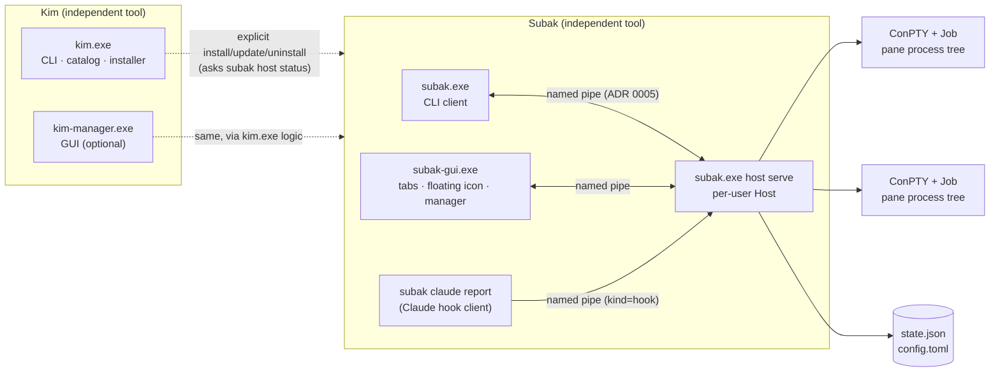
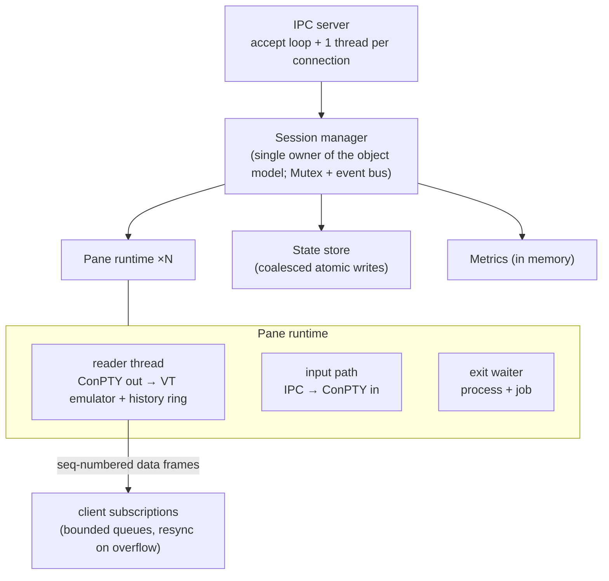
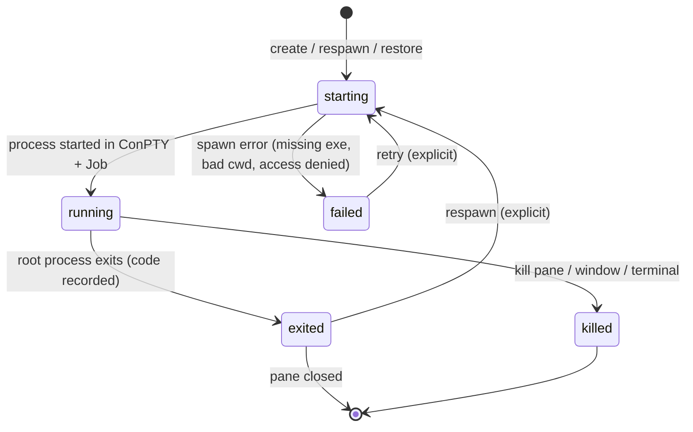

# Architecture

Status: **current** (design; components are implemented step by step — see §10) · Step 03

This document is the map; the reasons behind each choice are in the [ADRs](adr/README.md),
wire and storage formats in [contracts/](contracts/IPC_PROTOCOL.md), and known risks in the
[risk register](RISK_REGISTER.md).

## 1. System overview



- **Kim** and **Subak** are separate packages and binaries ([ADR 0002](adr/0002-independent-tool-binaries.md)).
  Kim touches Subak only through Subak's public CLI (`subak host status --json`,
  `subak capabilities --json`) and the file system layout of its own installs. Tools discover
  each other through capabilities documents, without a resident orchestrator
  ([ADR 0015](adr/0015-cli-contract-and-tool-discovery.md)).
- **Only the Host owns processes.** Every other box is a client that can disappear at any time
  without consequences for sessions.

## 2. Components

| Component | Binary / crate | Responsibility | Requirements |
| --- | --- | --- | --- |
| Kim CLI | `kim.exe` / `crates/kim` | Catalog queries, explicit install/update/uninstall, update check, status, tool and capability discovery ([CLI_CONTRACT](CLI_CONTRACT.md), [KIM_CLI](KIM_CLI.md)) | KIM-FR-003…011, KIM-FR-020, KIM-SEC-001…005 |
| Kim Manager GUI | `kim-manager.exe` (Step 06) | Same operations with a GUI; never runs headless paths through the GUI | KIM-FR-009, KIM-FR-013 |
| Hotkey library | `crates/kim-hotkeys` (Step 46; a library compiled into each tool, never a process) | Key syntax, `hotkeys.json`, conflict checks, `RegisterHotKey` backend ([HOTKEY_CONTRACT](HOTKEY_CONTRACT.md)) | KIM-FR-040…046, KIM-NFR-020…022, KIM-SEC-020…023 |
| Subak CLI | `subak.exe` / `crates/subak` | Terminal CRUD, attach/detach, capture, host control, Claude hook reporter | SUBAK-FR-011…015, SUBAK-FR-053 |
| Subak Host | `subak.exe host serve` | Owns Terminals/Windows/Panes, ConPTYs, jobs, VT state, history, state store, IPC server, metrics | SUBAK-FR-001…004, SUBAK-FR-016, SUBAK-FR-040 |
| Subak terminal core | `crates/subak-term` (Step 15; a library linked by the Host — model only — and by the GUI) | One VT model for the Host and every client view, the client view state (viewport, selection and copy, hyperlinks, device reports), input encoding, and the CPU cell-grid renderer with GDI glyphs ([TERMINAL_EMULATOR](TERMINAL_EMULATOR.md), ADR 0036) | SUBAK-FR-031, SUBAK-FR-036, SUBAK-NFR-001, SUBAK-SEC-013 |
| Subak GUI | `subak-gui.exe` (Step 16, built by the `subak` package; Step 17: the Host's Terminals as tabs; Step 18: `subak-gui --float`, the floating icon, tray icon and Terminal manager) | Native Win32 window over the `subak-term` renderer; a pure IPC client (`gui`) that starts a Host on demand without a shell, attaches only the shown tab's pane, never ends a Terminal by closing or hiding, and ends one only on `Ctrl+W` by id, asking when the Host says busy ([SUBAK_GUI](SUBAK_GUI.md), ADR 0039, ADR 0042). `--float`: a tiny optional process of the same binary (a layered 40 px tool window that never activates, a tray icon, a manager of the system's own controls; one `subak-float` connection that lists and manages Terminals, never attaches, never starts a Host except for New Terminal; hands the foreground to the window that shows a Terminal; ADR 0045). Step 19 (ADR 0048): search over the view's own copy of the pane's retained output (headless engine in `subak-term`, bounded regex, no Host method), keyboard and mouse selection, plain-text paste with a question before lines that would run or hidden control sequences, copy with colours, validated links opened through the OS "open" verb, "Save output…" after a question naming the secrets found; the clipboard, opener and save dialog behind traits | SUBAK-FR-030…035, SUBAK-FR-037, SUBAK-FR-038, SUBAK-FR-047, SUBAK-SEC-014, SUBAK-NFR-002 |
| Subak MCP | later (Step 37) | Opt-in local MCP adapter over the same IPC | SUBAK-FR-062 |
| Noeul | `noeul.exe` / `crates/noeul` (Step 49 foundation, [ADR 0023](adr/0023-noeul-app-foundation.md); Step 50 `F1` overlay, [ADR 0026](adr/0026-noeul-capture-overlay.md); Step 53 pin engine, [ADR 0029](adr/0029-noeul-pin-engine.md); Step 51 double-click to pin and outputs, [ADR 0032](adr/0032-noeul-double-click-pin-and-outputs.md); Step 52 smart selection and precision, [ADR 0035](adr/0035-noeul-smart-selection-and-precision.md); Step 56 annotation, [ADR 0038](adr/0038-noeul-annotation.md); Step 57 privacy tools, [ADR 0041](adr/0041-noeul-privacy-tools.md); Step 54 pin transforms and control, [ADR 0044](adr/0044-noeul-pin-transforms-and-control.md); Step 55 clipboard paste and rich sources, [ADR 0047](adr/0047-noeul-clipboard-paste-and-rich-sources.md); Step 58 displays and capture backends, [ADR 0050](adr/0050-noeul-displays-and-capture-backends.md); Step 59 colour picker, [ADR 0053](adr/0053-noeul-color-picker.md)) | Screenshot and floating-pin tool: one per-user instance (`noeul start`) owning pins, the optional tray icon, its global hotkeys and the region selection overlay (one frozen GDI picture, a back-buffered Win32 window; a double-click inside the selection, `Enter`, the toolbar or the menu pins, `Ctrl+C` copies, `Ctrl+S` saves, with gesture settings; window detection from a rectangle list taken with the picture and UI element rectangles from a UI Automation worker, geometry only; magnifier, physical `W A S D` pointer keys, corner marking, snapping and an in-memory rectangle history; since Step 59 a colour picker that copies the frozen picture's pixel under the magnifier as HEX, RGB or HSL text on `C`; annotation as vector objects until an output, in the overlay and on pins, with mosaic, blur, an eraser and a solid redaction that every output flattens and nothing else keeps); the pin engine (retained layered topmost windows that move, zoom, hide, show and close independently, each with its menu; placement in work areas; focus handed back; pins in memory only; since Step 54 reversible rotation, flips, opacity, thumbnails and border resizing over an unchanged picture, an outline and shadow, click-through only while a way back exists, and groups); since Step 58 whole-monitor and active-window capture without the overlay (the focused window's frame cut from the screen, never `PrintWindow`), the pointer drawn into a capture, a logical mapping and honest warnings per capture, rotation and HDR from the display configuration, gaps made black, and display changes coalesced by a one-shot timer that pins and the overlay follow; headless CLI that controls it over its own identity-checked pipe (Noeul IPC v1); plain Win32, GDI capture on request (the only backend, ADR 0050) | NOEUL-FR-001…003, NOEUL-FR-010…014, NOEUL-FR-016, NOEUL-FR-017, NOEUL-FR-020…026, NOEUL-FR-030…032, NOEUL-FR-040…044, NOEUL-FR-050, NOEUL-FR-060…068, NOEUL-FR-080…083, NOEUL-FR-090…093, NOEUL-FR-110…114, NOEUL-SEC-001…013 |

### 2.1 Host internals



- **Concurrency model:** plain OS threads and channels. Blocked threads cost no CPU when idle;
  there are no polling loops or timers while idle (`KIM-NFR-001`). An async runtime may be
  introduced later only with measurements and an ADR.
- **Panic containment:** each connection and pane thread runs request handling inside
  `catch_unwind`; a panic fails that request/pane with `internal_error` and is logged without
  content, while other sessions continue.

## 3. Object model

Terminal → internal Window → Pane → process tree ([SUBAK_PHILOSOPHY §2](SUBAK_PHILOSOPHY.md),
[ADR 0007](adr/0007-object-identity-and-naming.md)).

| Object | Identity | Owns | Invariants |
| --- | --- | --- | --- |
| Terminal | `t-…` + unique case-insensitive name | ≥ 1 Window; profile; restore policy | Exactly one Host owns it; appears as one GUI tab |
| Window | `w-…` + index within Terminal + name | ≥ 1 Pane; layout tree (one pane, the active one, until Step 22); active pane | Belongs to exactly one Terminal; the Terminal's active window and each window's active pane are Host state shared by every client (Step 21, ADR 0054) |
| Pane | `p-…` + index within Window | one ConPTY, one Job, VT state, history ring | Belongs to exactly one Window; its process tree is in exactly its Job |

An object is never shared between Terminals; moving a pane (`join-pane`, Step 24/25) re-parents
it inside the same Host without restarting its process.

## 4. Lifecycles

### 4.1 Pane process



### 4.2 Terminal

The implemented state machine (Step 10: `starting`, `running`, `stopping`, `stopped`, `failed`)
and its transitions are in [SESSION_MODEL §2](SESSION_MODEL.md); `restorable` and `unknown` below
arrive with persistence and recovery (Steps 29–30), and "start (respawn)" of a stopped Terminal
with Step 30.

| State | Meaning | How it is entered | Allowed operations |
| --- | --- | --- | --- |
| `starting` | Ids and name reserved, pane process being started | create | info, rename |
| `running` | ≥ 1 pane process alive | create, start, restore | attach, input, rename, split, stop, kill |
| `stopping` | Its processes are being ended | stop, kill, host stop, or its program exited | info, rename (a kill escalates a stop) |
| `stopped` | Terminal kept, no live process (all exited with remain-on-exit, or `subak stop`) | last process ends while kept; explicit stop | start (respawn panes; Step 30), rename, delete |
| `restorable` | Loaded from state after a Host restart/reboot; old processes are gone | Host start with persisted Terminals | restore (dry-run or confirmed), rename, delete |
| `failed` | Last start/restore failed; reason kept | spawn failure | retry, edit profile, delete |
| `unknown` | State cannot be trusted (e.g. written by a newer Subak version) | Host start with unreadable/newer state | inspect, delete only with `--force` |

A Terminal whose last pane exits **without** remain-on-exit is removed (tmux semantics);
with remain-on-exit it becomes `stopped`. Nothing ever goes from `restorable` to `running`
without an explicit user action or an explicit per-Terminal auto-restore opt-in
(`SUBAK-SEC-002`).

### 4.3 Host

```mermaid
stateDiagram-v2
  [*] --> starting: client finds no Host → start lock → spawn detached
  starting --> serving: pipe created (first instance), state loaded
  starting --> [*]: another Host won the race (exit quietly)
  serving --> idle_grace: 0 live Terminals AND 0 clients
  idle_grace --> serving: client connects / Terminal created
  idle_grace --> [*]: grace period elapsed (persist + exit)
  serving --> stopping: subak host stop (refused if live Terminals unless --kill-terminals)
  stopping --> [*]: state persisted, panes ended
  serving --> [*]: logoff / shutdown / crash (all panes end; restore later)
```



### 4.4 Client connection

`connecting → handshake (≤ 5 s) → ready → [subscribed to events / attached to panes] →
closed`. A client's disappearance at any point only removes its subscriptions; if it was the
pane's size owner, the next most recently active client becomes owner
([ADR 0008](adr/0008-attach-replay-and-backpressure.md)).

## 5. Operation semantics: detach vs close vs stop vs kill vs delete

| Intent | CLI | GUI | Processes | Stored Terminal |
| --- | --- | --- | --- | --- |
Implemented in Step 10 for Terminals; the full rules (consent, the busy guard, races) are in
[SESSION_MODEL §4](SESSION_MODEL.md) and [ADR 0020](adr/0020-terminal-session-lifecycle.md).
There is no `close` verb: every "close" in a UI is one of these rows.

| Intent | CLI | GUI (Steps 16–18; tab rows implemented in Step 17) | Processes | Stored Terminal |
| --- | --- | --- | --- | --- |
| Stop looking | `Ctrl+B d`, Ctrl+Break, end of piped input, close the console window; from elsewhere `subak detach <t>` / `--client <id>` | close window / quit / `Ctrl+B d` / crash | unaffected | unaffected |
| Look again | `subak attach <target>` | show its tab (`Ctrl+Tab`, a click) / session manager | unaffected | unaffected |
| Hide one tab | — | the tab's × button, a middle click, tab menu "Hide tab" | unaffected | unaffected |
| End processes, keep Terminal | `subak stop <t>` (graceful, then forced after 5 s; asks or `--yes`) | session manager "Stop" | ended | kept as `stopped` |
| End Terminal (tmux kill-session) | `subak kill <t>` (at once; asks or `--yes`) | `Ctrl+W` / "Close Terminal" (by id; asks when the Host says busy, Cancel is the default) | ended | removed |
| Remove a dead Terminal record | `subak rm <t>` (only `stopped`/`failed`, later `restorable`; `--force` also ends a running one) | `Ctrl+W` or "Remove Terminal" on a stopped/failed tab; Terminal manager "Delete…" (Step 18; asks first) | none running | removed |
| Kill pane / window | `subak pane kill <t:w.p>` / `subak window kill <t:w>` (Step 21; asks or `--yes`, by id; never the last running one) | `Ctrl+B x` / `Ctrl+B &` (confirm; Step 23) | that pane/window only | topology updated; the Terminal stays |
| Split / resize / zoom a pane | `subak pane split|resize|swap|zoom`, `subak window rotate|layout` (Step 22) | `Alt+Shift+Plus`/`Minus`, `Alt+Shift+Arrow`, `Ctrl+Shift+Z`, a divider drag (Step 22) | none | the layout changes; every pane's pseudo console gets its share |

"Graceful" = `ClosePseudoConsole` (processes receive `CTRL_CLOSE_EVENT`), wait up to 5 s,
then `TerminateJobObject`. A kill terminates the job first. The IPC `force` flag is the client's
statement that the user consented to ending a *busy* Terminal; without it the Host refuses one
(`busy`). Every destructive CLI command supports `--dry-run` (prints exactly which objects and
how many processes would end).

## 6. Disconnect, restart and version behavior

| Event | Host | Clients | Sessions |
| --- | --- | --- | --- |
| Client exits/crashes/closes window | drops its subscriptions; reassigns size owner | — | unaffected |
| Host crashes | — | GUI keeps the last screen with a "Disconnected" banner and reconnects with backoff (0.5 s → 10 s) without starting a Host (Step 16, SUBAK_GUI §2); CLI attach exits with `host_disconnected` | all processes end (Job kill-on-close); next Host start marks Terminals `restorable` |
| Logoff / shutdown / reboot | ends | end | as above; restore offered later |
| Sleep / hibernate / lock / RDP disconnect | keeps running | reconnect if their pipe broke | unaffected; **no restore, no duplicates** (`SUBAK-FR-044`) |
| Client newer than Host (protocol minor) | serves common features | hides unsupported features | unaffected |
| Protocol major mismatch | rejects handshake (`protocol_unsupported`) | explains; never restarts the Host automatically | unaffected |
| Subak updated while Host runs | keeps running old version | `subak host status` shows host vs client version | unaffected until the user chooses to restart the Host |

## 7. Key data flows

```mermaid
sequenceDiagram
  participant C as subak attach (client)
  participant H as Host
  participant P as Pane runtime
  C->>H: hello {protocol 1..1, kind cli}
  H-->>C: welcome {protocol 1, features}
  C->>H: pane.attach {target, interactive, size}
  H->>P: lock; snapshot VT state @ seq N; subscribe from N+1
  H-->>C: result {snapshot (VT bytes), seq N}
  P-->>C: data frames seq N+1, N+2, ...
  C->>H: data frame (input bytes)
  H->>P: write to ConPTY input
  Note over C,H: client closes window → pipe breaks → Host drops subscription only
```

Create Terminal: `terminal.create {name?, command?, cwd?, size?, …}` → under the session lock the
session manager validates the name, checks it is free, allocates IDs and records the Terminal as
`starting` (emitting `terminal.created`) → spawns the pane outside the lock → `running`
(`terminal.state_changed`) → responds with IDs and the Terminal. Failure to spawn yields a
structured `spawn_failed` error and `terminal.removed`; no half-created Terminal, pseudo console
or job remains unless `--keep-on-failure` keeps a `failed` record. Persisting (Step 29) will
follow the create.

## 8. Performance telemetry (local only)

Metrics are defined in [ADR 0012](adr/0012-local-metrics-no-telemetry.md) and read with
`subak host stats --json`. Measurement method for budgets in
[PRODUCT_REQUIREMENTS §3.2](PRODUCT_REQUIREMENTS.md):

| Budget | Measured as | Method |
| --- | --- | --- |
| Idle CPU (`KIM-NFR-001`) | Host process CPU time delta over 60 s with N idle Terminals, no clients | `GetProcessTimes` sampled by the harness; machine/OS recorded |
| Memory (`KIM-NFR-002`) | Host private working set with N idle panes, excluding child processes | `GetProcessMemoryInfo` |
| Attach latency | `pane.attach` request → snapshot received | client-side monotonic clock; p50/p95 over 100 attaches |
| Keystroke echo latency | input frame sent → corresponding output frame received (echo in `cmd /k`) | client-side, p95 |
| Throughput | bytes/s sustained from `type`-ing a large file with 0, 1, 3 clients | Host counters |
| State write cost | `state.write_latency_us` p95 | Host histogram |

No metric includes content, names, paths or command lines (`KIM-SEC-012`).

## 9. Portability

Platform-specific code is confined to five interfaces — `Pty`, `ProcessTree`, `IpcTransport`,
`Paths`, `SecretStore` ([ADR 0011](adr/0011-portability-boundary.md)). On non-Windows targets
they return `unsupported_platform` until milestone M4. Since Step 11 `Pty` and `ProcessTree` of
one pane are the single trait `pty::Pty` ([PTY_PROCESSES §8](PTY_PROCESSES.md), ADR 0025).

## 10. Implementation status

| Area | Status | Step |
| --- | --- | --- |
| Workspace, CI, placeholder binaries | implemented | 02 |
| This architecture, ADRs, contracts | current (design) | 03 |
| Design system, GUI toolkit ADR | planned | 04 |
| Kim catalog (signed, offline, read-only CLI + explicit refresh) | implemented | 05 |
| Kim installer (transactional, explicit) + Kim Manager GUI | implemented | 06 |
| Kim CLI contract v1, JSON schemas, headless management (`status`, `version`, `tools list\|describe`), capability discovery | implemented | 07 |
| Hotkey contract v1 for every GUI tool (specification, schemas, conflict scenarios; [HOTKEY_CONTRACT](HOTKEY_CONTRACT.md)) | current (design) | 45 |
| Shared hotkey library (`crates/kim-hotkeys`), `kim hotkeys` CLI, cross-tool conflict detection, Kim Manager shortcuts (`focus` backend), Windows `RegisterHotKey` backend ([HOTKEY_CONTRACT §17](HOTKEY_CONTRACT.md)) | implemented (binding editor of §11.2: planned) | 46 |
| Catalog tool metadata (features, entry points, links, shortcut summaries, permissions), derived availability, permission disclosure in install plans; Noeul and Ddalgak listed as planned ([CATALOG_FORMAT §2.1](CATALOG_FORMAT.md)) | implemented (Noeul and Ddalgak themselves: planned, Steps 48–64 and 65–83) | 47 |
| Noeul product definition: philosophy, `NOEUL-*` requirements and milestones N1–N7, Snipaste parity matrix, UX spec with the double-click-to-pin rules and tests, final hotkey manifest ([NOEUL_PHILOSOPHY](NOEUL_PHILOSOPHY.md), ADR 0021) | current (design); the `noeul` binary: foundation implemented in Step 49 (ADR 0023), `F1` selection overlay in Step 50 (ADR 0026), pin engine in Step 53 (ADR 0029), double-click to pin, toolbar, copy and save in Step 51 (ADR 0032), smart selection and precision in Step 52 (ADR 0035), annotation in Step 56 (ADR 0038), the privacy tools in Step 57 (ADR 0041), pin transforms, click-through, thumbnails and groups in Step 54 (ADR 0044), clipboard paste of images, image files, colours, HTML and text cards with local decoding in Step 55 (ADR 0047); the rest planned, Steps 58–64 | 48 |
| Ddalgak specification: philosophy, requirements, rule model and schemas (`ddalgak-rules-v1`, `ddalgak-simulation-v1`), GUI journeys, safety scope, AutoHotkey matrix, final hotkey manifest ([DDALGAK_RULE_MODEL](DDALGAK_RULE_MODEL.md), ADR 0022) | current (design; Ddalgak itself planned, Steps 66–83) | 65 |
| Ddalgak engine: `ddalgak-gui.exe` tray app owning a `WH_KEYBOARD_LL` engine (event model, decision core, worker, lifecycle, emergency chord, held-key ledger, stepping aside), `RegisterHotKey` shortcuts, the headless `ddalgak` CLI over an identity-checked pipe, opt-in sign-in start; engine-control rules only ([DDALGAK_ENGINE](DDALGAK_ENGINE.md), ADR 0024) | implemented (Windows) | 66 |
| Ddalgak rule store: typed `ddalgak.rules` v1 model keeping unknown fields, the published schema applied at run time per rule, the reference cross-references plus run-time checks with non-destructive offers, locked atomic writes with backup, history, drafts, restore and a migration chain, `ddalgak rule …`/`rules …` CRUD without the app, live reload in the running app that keeps its hook ([DDALGAK_RULE_MODEL §13](DDALGAK_RULE_MODEL.md), [DDALGAK_ENGINE §10](DDALGAK_ENGINE.md), ADR 0028) | implemented (Windows) | 67 |
| Ddalgak remaps and blocks: output events decided by the decision core (reference counts, released and restored trigger modifiers, dual roles with a hook-thread timer and replay, exact chords beating widened matches) and sent by the worker that owns the injector ledger; mouse-button triggers and outputs with a `WH_MOUSE_LL` hook installed only while a mouse-button rule is active; release on pause, stop, lock, desktop switch and an elevated window taking focus; a debug test host that never injects ([DDALGAK_ENGINE §11](DDALGAK_ENGINE.md), ADR 0031) | implemented (Windows; physical-keyboard, IME and mouse checks manual) | 68 |
| Ddalgak typing: `type_text` (Unicode key events, optional paste that restores the clipboard), `send_keys`, a date/time variable whitelist with an insertion point, and hotstrings (a bounded buffer of characters translated without changing keyboard state); runs carried out by the worker between its messages with the focused target checked before every call (focus change, password, elevated, IME, disabled field) and cancelled by pause, stop, emergency and reload; snippet text never in any output ([DDALGAK_ENGINE §12](DDALGAK_ENGINE.md), ADR 0034) | implemented (Windows; real-application, IME and clipboard checks manual) | 69 |
| Ddalgak launches: `open_program` with `CreateProcessW` (known-folder paths checked again before the start, a command line quoted per argument, explicit `env` overrides, never a shell string, never elevated) and `open_url`/packaged apps through the shell's `open` (`http`/`https` only, normalized input); a short-lived launch thread per run with `busy` and a one-second gate; targets redacted in every output; a debug test host that starts only its own hidden test program and records URLs ([DDALGAK_ENGINE §13](DDALGAK_ENGINE.md), ADR 0037) | implemented (Windows; installed programs, the default browser, elevation and focus checks manual) | 70 |
| Ddalgak mouse actions: `mouse_move` (relative in logical pixels or grid cells, absolute on the desktop, the primary monitor or the active window, continuous or stepped while held), `mouse_scroll` and `mouse_click` (click, double click, hold on the remap ledger) as normalized absolute `SendInput` moves to pixels clamped onto the union of monitors, read in per-monitor DPI mode; motions ticked only while held and stopped on every way out; the input window at the point checked first; a simulated pointer for the playground, the test host and every test ([DDALGAK_ENGINE §14](DDALGAK_ENGINE.md), ADR 0040) | implemented (Windows; real pointer, monitors, scaling and games checks manual) | 71 |
| Ddalgak modes and layers: exclusive modes and layers over a parent with per-mode precedence along the chain, `set`/`toggle`/`cycle`/`hold`/`previous`/`default` decided inside the hook callback, one-shot and timed exits, every held output released on a switch, the active mode never stored or restored (the safe reset on pause, start and emergency); mode CRUD and `ddalgak mode set`/`toggle`/`reset`/`status` through the hook thread; the tray indicator and mode menu ([DDALGAK_ENGINE §15](DDALGAK_ENGINE.md), ADR 0043) | implemented (Windows; real typing in applications and the real tray indicator checks manual) | 72 |
| Ddalgak rule editor: `ddalgak-editor.exe`, its own on-demand egui + glow process (package `ddalgak-editor`) that the tray app starts from *Open rule editor* and the `editor.open` shortcut; rule CRUD with key capture, eight effect tiles plus block and their forms on the engine's data models, a list with search, filters, grouping, drag ordering, multi-select, badges and undo, export and import hooks (imports turned off, without consent), Korean and English; every change a rule-store transaction with origin `gui`, "saved and active" only after the running app's reload answer; the CLI and the tray app still link no GUI toolkit ([DDALGAK_GUI_JOURNEYS §7](DDALGAK_GUI_JOURNEYS.md), ADR 0049) | implemented (Windows; the visible window, its manual usability script and the memory budget with rules pending) | 74 |
| ConPTY + detached Host proof: `subak host start\|status\|attach\|stop` prototype (one shell per Host, prototype pipe; [CONPTY_PROOF](CONPTY_PROOF.md), ADR 0016) | implemented (prototype) | 08 |
| Host supervisor and IPC v1: identity-checked per-user pipe, version negotiation, authorization by client kind, start on demand under a start lock, idle exit, health, user logon environment ([IPC_PROTOCOL](contracts/IPC_PROTOCOL.md), ADR 0019) | implemented | 09 |
| Terminal session lifecycle: named Terminals (Terminal → Window → Pane, one window and pane each), the state machine, names and targets, create/list/info/rename/stop/kill/remove over IPC and `subak terminal …`, `host stop --kill-terminals` ([SESSION_MODEL](SESSION_MODEL.md), ADR 0020) | implemented (no persistence before Step 29) | 10 |
| PTY and shell process management: the platform-neutral `pty::Pty` interface (Windows ConPTY + job; `unsupported_platform` stub elsewhere), program resolution on the pane's `PATH` with scripts refused, MSVC-rule quoting, fresh logon environment per pane plus `--env`/`--unset-env` overrides and `SUBAK_PANE_ID`/`SUBAK_TERMINAL_ID` (values never shown), precise `spawn_failed` reasons, exit status, byte-bounded send queues ([PTY_PROCESSES](PTY_PROCESSES.md), ADR 0025) | implemented (Ctrl+Break to panes and profiles: not yet; verbatim command lines: Step 12) | 11 |
| Subak CLI and headless control: tmux-familiar verbs `new`/`ls`/`info`/`status`/`attach`/`detach`/`rename`/`stop`/`kill`/`rm` (`terminal <verb>` deprecated alias), `subak-cli-v1` schema with golden files, `client.detach` and `pane.detached` over IPC, verbatim `--command-line`, `--no-start`, read-only attach, console restore on every exit path a client survives, Ctrl+Break detaches ([SUBAK_CLI](SUBAK_CLI.md), ADR 0027) | implemented (send-keys, capture and detach-key rebinding: later Steps) | 12 |
| Scrollback and replay: an in-house terminal model per pane (screens, modes, bounded history with deterministic eviction), attach as a snapshot at a `seq` then live output (no loss, duplication or reordering), lagging clients resynced instead of dropped, `pane.capture`/`pane.clear_history` with redaction by default, `subak capture|history|clear-history`, `new --history-limit`, scrollback counters in `host status`/`host.stats` ([SCROLLBACK](SCROLLBACK.md), ADR 0030) | implemented (history persistence: Steps 29+, opt-in) | 13 |
| Milestone A validation: persistent sessions and reconnection under client and Host failures, concurrency, 60 attach/detach cycles, scrollback after reattach, bursts and resize storms (`crates/subak/tests/milestone_a.rs`), the smoke script with the maintainer's Windows Terminal + Claude Code phases (`scripts/milestone-a-smoke.ps1`), baseline measurements ([MILESTONE_A_VALIDATION](MILESTONE_A_VALIDATION.md)) | automated part implemented and passing; **Milestone A not complete** until the manual live-Windows acceptance run passes | 14 |
| Native terminal emulator: the Step 13 model moved into `crates/subak-term` and shared by the Host and client views (OSC 8, mouse modes, soft wraps in snapshots, device reports answered by one view only), the client view (viewport, selection and copy, hyperlinks), input encoding (xterm keys, win32-input-mode, sanitized bracketed paste, every mouse protocol, focus), the CPU cell-grid renderer (themes, GDI glyph fallback, procedural box drawing, damage, DPI), conformance fixtures, real-ConPTY render tests, the benchmark harness ([TERMINAL_EMULATOR](TERMINAL_EMULATOR.md), ADR 0036) | implemented (headless; the window is Step 16; visible-window check pending the maintainer) | 15 |
| Subak window: `subak-gui.exe`, a plain Win32 IPC client showing one Terminal (start on demand without a shell, which Terminal opens, keyboard dispatch with shortcuts in the hotkey syntax, inline IME composition, mouse selection and clipboard, per-monitor DPI, minimize/maximize, loading/empty/chooser/error/disconnected states, reconnect without starting a Host, `gui.json` preferences) ([SUBAK_GUI](SUBAK_GUI.md), ADR 0039) | implemented (off-screen tests; visible-window checks pending the maintainer) | 16 |
| Subak window tabs: the Host's Terminals as tabs following every client, `Ctrl+Tab`/`Ctrl+Shift+Tab`/`Ctrl+T`/`Ctrl+W`, hide vs close vs remove with the busy confirmation, rename in place, shortcuts from Subak's hotkey manifest and `hotkeys.json`, `subak hotkeys …` ([SUBAK_GUI §2](SUBAK_GUI.md), ADR 0042) | implemented (off-screen tests; visible-window checks pending the maintainer) | 17 |
| Subak floating icon, tray and Terminal manager: `subak-gui --float` (optional, off unless started; layered tool icon with drag, snapping, a saved place per monitor and off-screen recovery; tray behind a trait; a manager of system controls with search, open in an existing or new window, new, rename, delete that always asks; a `manager` hotkey context; `float.json`; hidden tabs kept across window runs) ([SUBAK_GUI §11](SUBAK_GUI.md), ADR 0045) | implemented (off-screen tests; visible icon, real tray and drags pending the maintainer) | 18 |
| Subak search, selection, clipboard, links and saving output in the window (search bar over the retained history with bounded regex and incremental refresh, mark mode, select all, copy with colours, paste questions, plain-text and one-line paste, validated links through the open verb, "Save output…" with the secret detector; the Host and CLI never call it) ([SUBAK_GUI §12](SUBAK_GUI.md), ADR 0048) | implemented (off-screen tests with recording fakes; the real clipboard, a browser and the save dialog pending the maintainer) | 19 |
| GUI search, polish | planned | 19–20 |
| Internal windows and panes: Terminal → Window → Pane with many of each, every pane its own ConPTY and job; tmux numbering and `<terminal>:<window>.<pane>` targets taking exactly one level; `window.*`, `pane.create\|list\|select\|kill` over IPC and `subak window\|pane …`; Host-owned selection followed by the GUI; two-level end claims so no window or pane command ends a Terminal ([SESSION_MODEL](SESSION_MODEL.md), ADR 0054) | implemented (the prefix keys: Step 23; persisted topology: Step 29) | 21 |
| Splits and layout: a Host-owned split tree per window in cells, the latest client's size shared out, `pane.split|adjust|swap|zoom`, directional `pane.select`, `window.rotate|select_layout`, `window.layout` events; the window draws every visible pane (read-only views for the others), pane keys, click and divider drag ([SESSION_MODEL §3](SESSION_MODEL.md), ADR 0056) | implemented (layout presets and moving panes across windows: Step 25) | 22 |
| Layout, tmux engine | planned | 22–26 |
| Claude integration, persistence, recovery | planned | 27–31 |
| Profiles, SSH, extended features | planned | 32–36 |
| MCP, interoperability, hardening, release | planned | 37–40 |
| Linux | planned | 41–42 |
