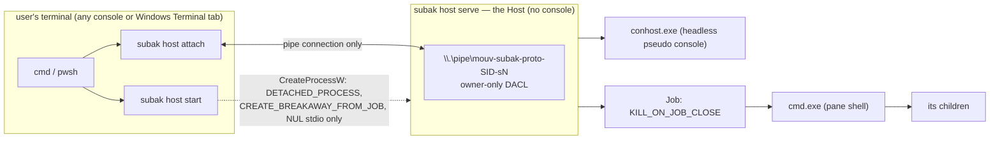

# ConPTY and detached Host proof

Status: **current** · Step 08 (issue #8) · Decision: [ADR 0016](adr/0016-conpty-host-validation.md)
· Validates [ADR 0003](adr/0003-subak-host-process-model.md), [ADR 0004](adr/0004-pty-and-process-ownership.md)
and the transport part of [ADR 0005](adr/0005-local-ipc.md) · Requirements: `SUBAK-FR-001`,
`SUBAK-FR-003`, `SUBAK-FR-013`, `SUBAK-FR-015`, `SUBAK-FR-016`, `SUBAK-FR-044`, `SUBAK-SEC-010`,
`KIM-NFR-001`, `KIM-NFR-010`

This document records what Step 08 proved on a real Windows machine, how, and what it could not
prove. Every "verified" line below comes from a run on this machine. Everything else is marked
**not verified** and says why.

Machine: Windows 10 Pro 22H2, build **10.0.19045.6466**, x64, Windows session 1, inbox ConPTY
(no bundled `conpty.dll`), `subak` 0.0.1 debug build, toolchain 1.99.1 (GNU). The same tests also
run on every push on the GitHub `windows-2025` runner (Windows Server 2025, build 26100, a newer
inbox ConPTY). All 11 Host tests of §4 pass there too (CI run 41731725304), after the two fixes
for differences listed in §6.

> **Step 09 update (2026-11-04).** This document records the Step 08 prototype as it was proven.
> The ConPTY, job, detached-spawn and survival results below still hold, and the 11 tests of §4
> pass unchanged against the Step 09 Host. Step 09 replaced three things
> ([ADR 0019](adr/0019-secure-host-supervisor-and-ipc-v1.md),
> [IPC_PROTOCOL](contracts/IPC_PROTOCOL.md)):
> - the default endpoint is now `\\.\pipe\mouv-subak-<user SID>-s<session>` (no `proto` part);
> - the protocol is now v1 with mutual identity checks (major 0 is refused);
> - the Host no longer lives exactly as long as its shell. It runs while it owns a live pane or
>   has a client, then exits after its idle grace period (default 10 s).
>
> Where §2, §3 and §6 say otherwise about these points, they describe Step 08.
>
> **Step 11 update (2026-11-04).** What runs in a pane, its environment, I/O, exit status and
> backpressure are now specified and measured in [PTY_PROCESSES.md](PTY_PROCESSES.md)
> ([ADR 0025](adr/0025-pane-programs-environment-and-backpressure.md)). Two statements below are
> superseded there: a lagging client is dropped by bytes queued (16 MiB), no longer after 4096
> frames (§3, §6), and the Host now resolves the program itself instead of letting
> `CreateProcessW` search. New measured limits of the inbox ConPTY on 19045: one handle kept per
> pseudo console after `ClosePseudoConsole`, and no Ctrl+Break through its input.
>
> **Step 14 update (2026-11-04).** The Milestone A validation
> ([MILESTONE_A_VALIDATION.md](MILESTONE_A_VALIDATION.md)) repeats the survival evidence with
> named Terminals, several shells, a development server and an interactive stand-in, and adds the
> failure and concurrency matrix and baseline measurements. The Windows Terminal check of §7.1 and
> the Claude Code check of §7.4 are now one procedure with `subak new claude`
> (`scripts/milestone-a-smoke.ps1`, MILESTONE_A_VALIDATION §6); both are still **pending** the
> maintainer's run. `scripts/conpty-smoke.ps1` still passes unchanged (Auto phase re-run on this
> machine on 2026-11-04), and §7.2 and §7.3 (sleep, logoff) still use it.

## 1. Result

| Acceptance criterion (issue #8) | Result |
| --- | --- |
| Host/PTY survives **client process exit** | **verified**: clean detach, end of input, `TerminateProcess` of the client, killed client console host (§4) |
| Host/PTY survives **its console window closing** | **verified headlessly**: a hidden console window that launched the Host *and* ran the attached client got `WM_CLOSE` (what its close button sends); the Host and shell kept their pids (§4) |
| Host/PTY survives **Windows Terminal closure** | **not verified (manual run pending)**: it would open a visible window on the maintainer's desktop. Procedure in §7.1 |
| Reattachment recovers interactive I/O | **verified**: state set before the window closed is read back by a new client from the same shell pid; typed keys, Ctrl+C, resize (§4) |
| Terminates only on explicit stop or legitimate OS termination | **verified** for explicit stop, shell exit, Host crash and a closed launcher job without breakaway (§4). Logoff, shutdown and sleep are **not verified (manual run pending)** (§6, §7) |
| Tests, demo instructions, ownership ADR committed | **done**: `crates/subak/tests/conpty_host.rs`, `crates/subak/src/win/*` unit tests, `scripts/conpty-smoke.ps1`, this document, ADR 0016 |

## 2. What "detached" means

The Host (`subak host serve`) is a separate, per-user process that owns the pseudo console and the
shell. "Detached" is a set of concrete properties:

- **No console.** It is created with `DETACHED_PROCESS`, so it is attached to no console. Closing
  any console window cannot send it `CTRL_CLOSE_EVENT`, and Ctrl+C or Ctrl+Break typed in a
  client's console never reach it.
- **No inherited handles.** Its stdin/stdout/stderr are a fresh `NUL` handle, and
  `PROC_THREAD_ATTRIBUTE_HANDLE_LIST` allows exactly that one handle to be inherited. Nothing of
  the launcher's console, pipes or files is kept open. The test harness proves this: `host start`
  with captured output returns at once, while the Host keeps running.
- **Outside the launcher's job when allowed.** It is created with `CREATE_BREAKAWAY_FROM_JOB`.
  When a job of the launcher forbids that, it falls back, and the Host reports
  `job_breakaway: false` (risk R-03, §6).
- **Its own working directory**, the user profile, so it holds no directory of the launcher.
- **Clients only hold a pipe connection.** `host attach`, `host status` and `host stop` are
  short-lived processes. Whatever happens to them only drops their connection: the Host removes
  that client and keeps the pane.

"Detached" does **not** mean immortal. The Host ends on an explicit `host stop`, when its shell
exits (in the prototype the Host lives exactly as long as its one shell), when it crashes or is
killed, at logoff, shutdown or reboot, and when a launcher job without breakaway permission is
closed (§6). It is not a Windows Service, runs as the user in the user's session, and starts only
on an explicit `subak host start`. Nothing starts it at login.



## 3. The Step 08 prototype

A narrow vertical slice, labeled as a prototype in `--help`, in `capabilities` and in the code.

| Command | Effect | What it does |
| --- | --- | --- |
| `subak host start [--endpoint <name>] [--shell <cmd>] [--dry-run] [--json]` | write | Spawns `subak host serve` detached (§2), waits until it serves its pipe, prints Host and shell pids |
| `subak host status [--endpoint <name>] [--json]` | read | Host pid, start time, session, `job_breakaway`, `in_job`; shell pid, command, running, size, processes in its job; clients |
| `subak host attach [--endpoint <name>] [--size <c>x<r>] [--dry-run [--json]]` | write | Streams the shell. In a console it uses raw VT input and follows window resizes. With redirected input it sends bytes; the end of input detaches. `Ctrl+B d` detaches in both modes |
| `subak host stop [--endpoint <name>] [--kill-terminals] [--yes] [--dry-run] [--json]` | destructive | `ClosePseudoConsole` (shell gets `CTRL_CLOSE_EVENT`), wait up to 5 s, `TerminateJobObject` for the rest, then the Host exits. Needs `--yes` when it cannot ask; since Step 10 a Host with a live Terminal (the shell is one) also needs `--kill-terminals` ([SESSION_MODEL §4](SESSION_MODEL.md)) |
| `subak host serve [--endpoint <name>] [--shell <cmd>] [--dry-run] [--json]` | write | The Host itself, in the foreground (what `start` launches) |

- **Endpoint.** The default is `\\.\pipe\mouv-subak-proto-<user SID>-s<session id>`. The `proto` part
  keeps it apart from Step 09's real pipe. Tests and the smoke script always pass their own
  `--endpoint`, so they never touch a user's Host. A second Host on the same endpoint is refused
  (`FILE_FLAG_FIRST_PIPE_INSTANCE`, `host_already_running`, exit 7).
- **IPC prototype.** It uses the framing of [IPC v1](contracts/IPC_PROTOCOL.md) (`u32` length, kind, JSON control
  frames, binary data frames with stream, seq and flags) with protocol major **0**, so a v1 Host
  and a prototype client reject each other cleanly. Methods: `host.status`, `host.stop`,
  `pane.attach`, `pane.resize`, `pane.detach`. Events: `pane.exited`, `host.stopping`.
  All pipe I/O is overlapped. The pipe is local-only (`PIPE_REJECT_REMOTE_CLIENTS`) with an
  owner-only DACL (deny NETWORK, allow the user; checked by a unit test). Peer identity checks
  are **not implemented** and follow in Step 09.
- **Output and replay.** A reader thread drains the ConPTY output continuously into a 64 KiB
  history ring, and to every attached client through a bounded queue. A client that falls 4096
  frames behind is disconnected rather than allowed to block the pane (resync is Step 13). On
  attach the client first receives the recent raw output (a prototype replay, not a VT snapshot;
  ADR 0008, Step 13).
- **Errors** follow [CLI_CONTRACT §6](CLI_CONTRACT.md): `host_not_running` (3),
  `host_already_running` (7), `spawn_failed` (1), `host_disconnected` (6), `protocol_error` (4),
  `unsupported_platform` (5, non-Windows), `confirmation_required` (7).
- **`--json` data** (prototype; not yet a published schema). `host.status` returns
  `{prototype, protocol, endpoint, host: {pid, version, started_at, session_id, job_breakaway,
  in_job, stopping}, pane: {pid, command, running, size: {cols, rows}, job_processes,
  output_bytes}, clients: {connected, attached, list}}`. `host.start` returns
  `{started, endpoint, host, pane}`. `host.stop` returns `{stopped, host: {pid, exited},
  shell: {pid, exit_code, processes_in_job, forced, job_processes_left}}`. Dry runs return
  `{dry_run: true, would_…}`.

## 4. Evidence

All rows are from `cargo test -p subak --test conpty_host -- --nocapture --test-threads=1` on the
machine above (11 passed in 9.4 s). The pids are from that run, and every test checked them by
handle, not by name. No test leaves a process behind: each one stops or kills its Host, and a
final `tasklist /FI "IMAGENAME eq subak.exe"` showed none.

| Scenario | Test | Observed (pids) |
| --- | --- | --- |
| A shell in a **hidden console window** runs `subak host start` and `subak host attach`; it types `set KIMSTATE=…`; the window gets **`WM_CLOSE`** | `host_survives_its_launching_console_closing_and_client_crashes_then_reattaches` | Before: Host 3904, shell 93280, terminal shell 68840, attach client 25544, console host 70616. After: attach client and terminal shell exited `0xC000013A` (closed by the console), console host exited 0; **Host 3904 and shell 93280 alive**, status lists 0 attached clients |
| Attached client killed (`TerminateProcess`) | same | client 96832 killed; Host 3904, shell 93280 alive |
| A client's **console host killed** | same | console host 89572 killed; the client 76364 did *not* end by itself within 5 s (it was then killed); Host and shell alive |
| **Reattach** from a new client | same | client 48980 printed `alive-42-marker-333` from `echo %KIMSTATE%-…`: same shell 93280, state from before the window closed; `Ctrl+B d` → exit 0 |
| Launcher in a kill-on-close **job that allows breakaway**, job closed | `host_outlives_a_closed_launcher_job_that_allows_breakaway` | Host 79620 `job_breakaway: true`, not in the launcher's job; attach client 59168 (inside the job) killed by the job close; **Host 79620 and shell 32684 alive** |
| Launcher in a kill-on-close **job that forbids breakaway**, job closed | `host_dies_with_a_closed_launcher_job_that_forbids_breakaway` | `host start` reported `job_breakaway: false`, `in_job: true`; closing the job **ended Host 17112, shell 54456 and console host 95340** (risk R-03 confirmed) |
| **Host crash** (`TerminateProcess` on the Host) | `host_crash_ends_the_whole_pane_tree` | Host 12188 killed; shell 27392, its child `ping` 9108 and the pseudo console host 37528 all ended (kill-on-close job, ADR 0004); the attached client reported `host_disconnected` |
| **Explicit stop** | `stop_needs_consent_and_ends_host_shell_and_console_host` | without `--yes`: `confirmation_required` (7), nothing ended; `--dry-run` listed the pids; `--yes`: Host 83312 exit 0, shell 91916 exit `0xC000013A` (graceful `CTRL_CLOSE_EVENT`, not forced), console host 85764 ended, 0 processes left in the job; an attached client printed "the Host stopped (stop_requested)" and exited 0; then `host_not_running` (3) |
| **Shell exits** (`exit 7`) | `shell_exit_ends_the_host_and_its_clients` | shell exit code 7 reported to the client; Host exited; `host_not_running` |
| **Ctrl+C** typed into the pane | `ctrl_c_typed_into_the_pane_interrupts_a_running_command` | `ping -n 60` in shell 20516 interrupted after 57 ms; Host and shell alive. **Fails without the ADR 0016 fix** (marker not seen within 20 s) |
| **Console attach** (the client's stdin/stdout are a real console: an outer pseudo console owned by the test, which has no visible window) | `console_attach_sends_raw_keys_and_follows_window_resizes` | No window owned by the client or its pseudo console host is visible. Raw keys reach the shell. The pane starts at the window size (100 columns per `mode con`), and a **window resize to 90×24 reaches the shell** (`mode con` → 90). Ctrl+C typed in the console interrupts a running `ping` and does not end the client. `Ctrl+B d` → exit 0. With `-v` the client logged the key records it read: on 19045 Ctrl+C and Ctrl+B arrive as `vk=0x00 char=0x0003`/`0x0002` with no Ctrl state |
| **Resize and replay** | `resize_reaches_the_shell_and_reattach_replays_recent_output` | `--size 100x30` → `mode con` 100; reattach with `132x40` → 132, status 132×40; output from before the attach replayed |
| **Handle hygiene** | `attach_detach_cycles_and_status_calls_do_not_leak_host_handles` | Host 31592 handle count 88 → 88 over 20 attach/detach cycles plus status calls |
| One Host per endpoint, dry runs | `only_one_host_per_endpoint_and_start_dry_run_changes_nothing` | duplicate `start`/`serve` → `host_already_running` (7); a dry run starts nothing; a bad `--shell` → `spawn_failed` (1) and no Host left |

In-process unit tests (`cargo test -p subak --bin subak`) exercise the same primitives without the
CLI: ConPTY interactive I/O, resize, teardown and 8 create/close cycles with a stable handle
count; overlapped duplex pipe I/O (a blocked read never blocks a write on the same handle); the
pipe's DACL; frame limits and malformed frames.

**Headless smoke script** (`scripts/conpty-smoke.ps1`, Auto phase, same machine):

```text
== Start a detached Host on \\.\pipe\subak-smoke-da4c0384
Host pid 24952 (job breakaway: True, in a job: False); shell pid 11212 (C:\Windows\system32\cmd.exe)
== Start a long-running counter in the shell            counter at tick 3
== Kill the attached client (as if its window or terminal died)
PASS  client 34436 is gone
PASS  Host 24952 still runs
PASS  shell 11212 still runs
PASS  status reports the same Host and shell (2 process(es) in the pane job)
== Reattach from a new client and read the counter
PASS  the counter kept running while no client was attached (tick 3 -> 8)
PASS  client exited 0 after Ctrl+B d
PASS  claude --version ran inside the ConPTY: 2.1.317 (Claude Code)
PASS  host stop --yes (shell exit code 3221225786, forced: False)
PASS  Host process 24952 is gone
PASS  shell process 11212 is gone
PASS  host status now reports host_not_running (exit 3)
all checks passed
```

Started from a normal user shell on this machine, the Host reports `in_job: false`. Under
`cargo test` it reports `in_job: true` even after a successful breakaway, because cargo itself
runs in a kill-on-close job that forbids breakaway (§6).

## 5. Ownership model as validated

As in ADR 0004, with the corrections recorded in ADR 0016:

1. The Host creates two anonymous pipes and calls `CreatePseudoConsole`. It then closes its copies
   of the pseudo console's ends; otherwise the output pipe never reports end of stream.
2. The shell is created **suspended** with `PROC_THREAD_ATTRIBUTE_PSEUDOCONSOLE` and null std
   handles (the Host's own stdio is `NUL`). It goes into a new `KILL_ON_JOB_CLOSE` job and only
   then resumes, so no descendant can escape before the job exists. Descendants stay in the job
   (verified with `ping` in the crash test).
3. The **pseudo console host** (`conhost.exe`) is a child of the Host but **not** in the pane job.
   It belongs to the `HPCON` and ends with `ClosePseudoConsole` or with the Host (verified in the
   stop, crash and job tests).
4. A dedicated thread drains the output continuously. On Windows 10, `ClosePseudoConsole` blocks
   until conhost exits, so the Host calls it on a helper thread while the reader keeps draining,
   waits up to 5 s for the shell, and only then terminates the job.
5. Ctrl+C typed by a user is `0x03` input; ConPTY turns it into `CTRL_C_EVENT` for the pane's
   processes. This works only after the Host clears its inherited "ignore Ctrl+C" flag (ADR 0016).

## 6. OS limitations and failure modes

| Situation | What happens | Evidence |
| --- | --- | --- |
| Client exits, detaches, crashes or its console window closes | Nothing happens to the Host or the shell | verified (§4) |
| A client's console host is killed | The client may linger without a console; the Host is unaffected | verified (client did not end within 5 s) |
| Launcher job allows breakaway | The Host leaves that job and survives its closing | verified |
| Launcher job (or any job in its chain) forbids breakaway | The Host falls back to starting inside the job (`job_breakaway: false`, `in_job: true`); closing that kill-on-close job ends the Host, its shell and conhost | verified: risk R-03 is real |
| Nested jobs | Breakaway is decided per level. The Host left the immediate job (which allowed it) but stayed in cargo's outer job, which forbids breakaway. `in_job` reveals this | verified under `cargo test` |
| Windows Terminal window or tab closed | Expected to behave like the console-window case if Windows Terminal does not put its shells in a kill-on-close job without breakaway | **not verified (manual run pending)**, §7.1 |
| VS Code integrated terminal, SSH session (OpenSSH server) | These may run shells inside jobs. If such a job forbids breakaway, the R-03 row applies | **not verified**: needs the respective environment |
| Host crash or `TerminateProcess` | Every pane process ends (by design, ADR 0004: no orphans) | verified |
| Lagging client (≥ 4096 queued frames) | That client is disconnected; the pane is never blocked | implemented; not stress-tested |
| Newer inbox ConPTY (Windows Server 2025, build 26100, the CI runner): pseudo console close | `ClosePseudoConsole` alone did not end the shell within 10 s, while on 19045 it does. The Host's teardown (grace period, then `TerminateJobObject`) ends it either way | observed in CI (unit test, before the test followed the Host's teardown order) |
| Newer inbox ConPTY: **win32-input-mode request** | The pane's ConPTY writes `ESC[?9001h` (a request for win32-input-mode) to its output. Passed through, that request switched the console client's own console into win32-input-mode: every key arrived as an escape sequence (the `-v` key log showed only `char=0x001B` records), keys still reached the shell, but `Ctrl+B d` reached it as `^Bd` instead of detaching. Fix: the client, which is the pane's terminal and does not implement win32-input-mode, drops `ESC[?9001h`/`ESC[?9001l` from pane output; ConPTY then gets plain VT input. Any modern console that honors the request is affected the same way, not only CI | observed in CI with `-v`; fixed, the console test passes on Server 2025 and 19045 |
| Lock screen, fast user switching, RDP *disconnect* | The logon session stays, so the Host and shells keep running | **not verified (manual run pending)**, §7.3 |
| Sleep (S3 / modern standby) and hibernate (S4) | All processes are frozen and resumed; the Host and shell survive, wall-clock gaps appear, and network connections inside the shell may break | **not verified (manual run pending)**, §7.2 |
| **Logoff / sign out**, RDP *logoff* | Every process of the logon session ends, including the Host: no live process can survive | **not verified (manual run pending)**, §7.3; restore is Steps 29–31 |
| **Shutdown, restart, Windows Update restart** | Same as logoff. *Fast startup* is a logoff followed by a kernel-only hibernate, so user processes end too | **not verified (manual run pending)**, §7.3 |
| Power loss, OS crash (bug check) | Everything ends without notice; state on disk is all that is left | inherent; not tested |

**Power states that cannot preserve the live Host:** shutdown (including fast startup), restart,
logoff, power loss and OS crashes. Sleep (S0 low-power idle, S3), hibernate (S4) and
locking/switching users preserve it (expected; not verified, §7).

Other measured pitfalls, fixed or handled in code:

- **`CREATE_NEW_PROCESS_GROUP` disables Ctrl+C** for the Host and, through inheritance, for every
  pane process: `0x03` typed into the pane did not interrupt `ping`. Fixed: the Host calls
  `SetConsoleCtrlHandler(NULL, FALSE)` before spawning panes (regression test above).
- **Synchronous pipe handles deadlock duplex use**: a blocked `ReadFile` holds the file object, so
  another thread's `WriteFile` on the same handle waits. Every pipe handle is overlapped.
- **A launcher with redirected output** (an agent, a test or CI) would hang waiting for EOF if the
  Host inherited its pipe. Solved by the `NUL`-only handle list.
- **Windows PowerShell 5.1 / .NET Framework** writes a UTF-8 BOM to a child's redirected stdin
  before any data. `host attach` drops a BOM at the very start of redirected input.

## 7. Manual verification (pending)

These checks need a visible window, a power transition or a logoff on the maintainer's desktop,
so Step 08 did not run them. Use a release or debug `subak.exe` (`cargo build -p subak`), and
start in the repository root. `-Phase Prepare` starts a Host and a counter on its own endpoint
and remembers their pids. `-Phase Verify` reports whether they are the same live processes,
reattaches headlessly, shows the counter advancing, and then stops the Host.

Below, `smoke` stands for
`powershell -NoProfile -ExecutionPolicy Bypass -File scripts\conpty-smoke.ps1`.

### 7.1 Windows Terminal window close (acceptance item 1)

1. Open Windows Terminal with any profile (cmd, PowerShell). In that tab run
   `smoke -Phase Prepare -Endpoint subak-smoke-wt -Attach`. The Host is then
   launched *from inside* Windows Terminal, and the tab shows the counter.
2. Write down the Host and shell pids it prints.
3. Close the **whole Windows Terminal window** with its X button. Confirm closing all tabs.
4. From a different console (Win+R → `cmd`), run `smoke -Phase Verify -Endpoint subak-smoke-wt`.
5. **Expected:** `same Host process …`, `same shell process …`, `the counter is live`, then a clean
   stop. **If the Host is gone**, Windows Terminal put the launcher in a kill-on-close job without
   breakaway: record `job_breakaway` from step 1 and reopen risk R-03.
6. Repeat with closing only the **tab**, and with a Host started from the Start menu's
   "Command Prompt" (conhost window) closed with its X button.

**Result (2026-11-13, Windows 10 Pro 22H2 19045, ADR 0088):** steps 1–6 pass. A Host prepared
from inside a new Windows Terminal window (`job_breakaway: true`, not in a job) survived closing
the whole window (Host 56988, shell 67496: same processes, counter live, then a clean explicit
stop); a Host prepared in a second tab survived closing only that tab with `Ctrl+Shift+W` (Host
99460, shell 127688); a Host prepared in a classic console window survived closing that window
with its close button, which ended the console client (Host 125688, shell 40508). Only the
test's own windows were closed (addressed by handle; Windows Terminal hosts every window in one
process).

### 7.2 Sleep and hibernate

1. `smoke -Phase Prepare -Endpoint subak-smoke-sleep` from any console.
2. Sleep (Start → Power → Sleep), wake up, sign in.
3. `smoke -Phase Verify -Endpoint subak-smoke-sleep`. **Expected:** the same pids and a live counter. Its
   numbers only advance while the machine is awake.
4. Repeat with Hibernate (`shutdown /h`), if hibernation is enabled.

### 7.3 Logoff, restart, shutdown, lock, RDP

1. `smoke -Phase Prepare -Endpoint subak-smoke-logoff`.
2. Sign out (or restart or shut down; with fast startup on, shutdown counts as a logoff). Sign
   in again.
3. `smoke -Phase Verify -Endpoint subak-smoke-logoff`. **Expected:** "The Host is gone
   (host_not_running)" and the remembered pids are no longer running. This is the expected
   "legitimate OS termination"; the script still counts it as a failed check by design.
4. Lock (Win+L) or fast user switching, then come back: **expected** that the Host survives
   (`-Phase Verify` passes).

**Not run (2026-11-13):** sleep, hibernate, sign-out, restart and shutdown end the maintainer's
work and this agent session on the same PC (and the session keeps the PC awake on purpose), so
they wait for the maintainer. A lock check is prepared as `subak-smoke-lock` and verified after
the next natural lock.

### 7.4 Claude Code in an interactive session (needs the user's consent)

The automated run only executed `claude --version` inside the pseudo console (2.1.317). An
interactive Claude Code session spends tokens and uses the user's account, so it was **not
started**. With consent: `subak host start --endpoint subak-smoke-claude`, then
`subak host attach --endpoint subak-smoke-claude` in a terminal, run `claude`, ask something
trivial, close the terminal window, reattach from another terminal, and check that the
conversation is still there and responsive. Stop the Host with
`subak host stop --endpoint subak-smoke-claude --kill-terminals --yes` (Step 10 added
`--kill-terminals`).

## 8. Reproducing the automated evidence

```sh
cargo test -p subak                                   # unit + CLI contract + ConPTY/Host tests
cargo test -p subak --test conpty_host -- --nocapture --test-threads=1   # prints EVIDENCE lines
powershell -NoProfile -ExecutionPolicy Bypass -File scripts/conpty-smoke.ps1   # headless smoke
```

The tests run only on Windows (`#![cfg(windows)]`). On other targets the `host` commands return
`unsupported_platform`, and CI only compiles them there (ADR 0011).
