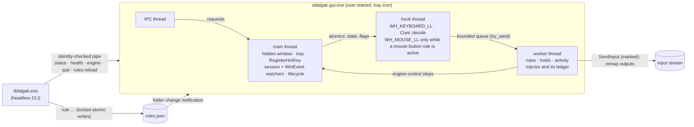

# Ddalgak engine (Steps 66–75)

Status: **current** (engine implemented in Step 66 for Windows, the rule store and live reload in
Step 67, §10; remaps, blocks and mouse-button triggers in Step 68, §11; sent keys, typed text,
paste and hotstrings in Step 69, §12; program and website launches in Step 70, §13; mouse moves,
wheel, clicks and holds in Step 71, §14; modes and layers in Step 72, §15; enable, disable, pause
and recovery in Step 73, §16; profile switches in Step 75, §17) · Decisions:
[ADR 0022](adr/0022-ddalgak-rule-model-and-safety.md),
[ADR 0024](adr/0024-ddalgak-windows-input-apis-and-permissions.md),
[ADR 0028](adr/0028-ddalgak-rule-store-validation-and-reload.md),
[ADR 0031](adr/0031-ddalgak-remap-execution-and-mouse-hook.md),
[ADR 0034](adr/0034-ddalgak-typing-runs-hotstrings-and-clipboard.md),
[ADR 0037](adr/0037-ddalgak-program-and-website-launches.md),
[ADR 0040](adr/0040-ddalgak-mouse-actions.md),
[ADR 0043](adr/0043-ddalgak-modes-layers-and-runtime-mode-state.md),
[ADR 0046](adr/0046-ddalgak-enable-disable-and-recovery.md) · Code: `crates/ddalgak` ·
Requirements: `DDALGAK-FR-001…010`, `DDALGAK-FR-017`, `DDALGAK-FR-020`, `DDALGAK-FR-060`, `DDALGAK-FR-071`,
`DDALGAK-FR-011`, `DDALGAK-FR-012`, `DDALGAK-FR-013`, `DDALGAK-FR-014`, `DDALGAK-FR-015`, `DDALGAK-FR-070`,
`DDALGAK-NFR-001`, `DDALGAK-NFR-002`, `DDALGAK-NFR-004`, `DDALGAK-SEC-001…005`,
`DDALGAK-SEC-007`, `DDALGAK-SEC-008`, `DDALGAK-SEC-010`, `DDALGAK-SEC-011`, `DDALGAK-SEC-013`,
`DDALGAK-SEC-014`

This document describes what the Ddalgak engine does today, how it is built, how to drive it
from the CLI, what was measured and what was verified on real Windows. The *why* is in the ADRs;
the rule format is [DDALGAK_RULE_MODEL](DDALGAK_RULE_MODEL.md); the safety scope is
[DDALGAK_SAFETY](DDALGAK_SAFETY.md).

## 1. What Step 66 delivers, and what it does not

| Delivered | Not yet (owner Step) |
| --- | --- |
| `ddalgak-gui.exe`: the tray app that owns the engine (tray icon with state by shape and text, single instance per user session, hidden window, no editor) | the rule editor and playground windows (74, 76) |
| The low-level keyboard hook engine: event model, trigger tables, decision core, worker, lifecycle, emergency chord, held-key ledger, rate limit, stepping aside; since Step 68 remaps and blocks, mouse-button triggers with the on-demand mouse hook (§11); since Step 69 sent keys, typed text, paste with clipboard restore and hotstrings (§12); since Step 70 program and website launches on a launch thread (§13); since Step 71 mouse moves, wheel, clicks and holds across monitors and DPI (§14); since Step 72 modes and layers with per-mode precedence (§15); since Step 73 a remembered turn-off, per-mode and per-profile `enabled`, the lost-hook check, stale-key release and the status indicator model (§16) | ordered multi-step runs (78), wheel triggers (unassigned, ADR 0040), drawing the floating status badge (74; its model and setting exist since Step 73) |
| Ddalgak's own global shortcuts `engine.toggle` and `engine.pause` from `hotkeys.json`, registered with `RegisterHotKey` | the `ddalgak hotkeys …` commands (81; bind by editing `hotkeys.json` until then) |
| Rules: the engine runs **engine-control rules** (`engine` steps), since Step 68 **remap** and **block** rules (§11), since Step 69 **`send_keys`**, **`type_text`** and **hotstring** rules (§12), since Step 70 **`open_program`** and **`open_url`** rules (§13), since Step 71 **`mouse_move`**, **`mouse_scroll`** and **`mouse_click`** rules (§14), since Step 72 **`mode`** rules (§15), and keeps every other rule inactive with a stated code; since Step 67 the rule store with full validation, CRUD, drafts, history and live reload (§10) | `delay` and mixed steps (78) |
| `ddalgak status`, `health`, `engine start|pause|resume|stop`, `pause`, `resume`, `quit`, `startup status|enable|disable`, `capabilities` with `--json` and `--dry-run`; since Step 67 `rule …` and `rules …`; since Step 72 `mode …`; since Step 73 `enable`, `disable` (also with `--rule`, `--mode`, `--profile` scopes), `mode enable|disable` and `release` | `profile`, `test`, `explain` (75, 76, 77, 81) |
| Opt-in start at sign-in through the user's Run key | — |

**Never broader.** A rule this version does not run is listed in `status` as inactive with its
code: `step_unsupported` (an action type of a later Step — `delay`, a typing or mode
step among other steps and launches or mouse steps mixed with other steps in 78 — or an unknown one),
`condition_unsupported` (a `when` this version cannot evaluate; known conditions run since Step 77), `rule_unsupported` (an unknown field inside the rule),
`trigger_invalid`/`trigger_reserved`, `duplicate_rule_id`, `duplicate_trigger` and every other
error of DDALGAK_RULE_MODEL §8. A file that is not a usable `ddalgak.rules` v1 document is not
loaded at all and the engine cannot be turned on with it (`rules_invalid`,
`rules_from_newer_version`). `rules.json` is read again at every `engine start` and reloaded
while the app runs (§10); the app itself never writes it.

## 2. The event model

Each `KBDLLHOOKSTRUCT` becomes a `RawKey` and then a normalized `KeyEvent`
(`crates/ddalgak/src/event.rs`):

| Field | Meaning |
| --- | --- |
| `vk` | Virtual key; side-specific for modifiers (`VK_LSHIFT`, `VK_RCONTROL`, …; generic codes from injected input are resolved by scan code or the extended flag). Logical triggers (`J`, `F13`) match it; Windows assigns it per layout, so `Ctrl+Z` on QWERTZ is the key labeled Z. |
| `scan`, `extended` | The position. Physical triggers (`code:KeyZ`) match the scan code, whatever the layout. |
| `transition` | `Down`, `Repeat` (a down for a key that is already down) or `Up`. Holds are timed by the worker from the down. |
| `source` | `physical`, `injected_by_ddalgak` (`LLKHF_INJECTED` + the `dwExtraInfo` marker) or `injected_by_other_program`. |
| `device` | `unknown` for physical keys (the low-level hook does not identify keyboards), `synthetic` for injected ones. |
| `modifier`, `altgr_fake_ctrl` | Which of the eight modifier keys this is; the fake left Ctrl (scan `0x21D`) that precedes Right Alt on AltGr layouts. |

Modifier matching is exact (HOTKEY_CONTRACT §5.5): generic modifiers accept either side,
side-specific ones need that side, nothing else may be held, `Win` is never part of a trigger,
and AltGr is its own modifier (`AltGr+Q` ≠ `Ctrl+Alt+Q`). The normalizer keeps only the
current key state; nothing is recorded (`DDALGAK-SEC-001`).

**Mouse buttons** (Step 68). While the low-level mouse hook is installed (§11), middle and X
button events become `RawKey`s with the documented `VK_MBUTTON`, `VK_XBUTTON1` and `VK_XBUTTON2`
codes (a keyboard never sends them) and go through the same normalizer and core; moves, the wheel
and the primary and secondary buttons pass on without reaching the core.

**IME and layouts.** No character translation happens in the hook (dead keys stay intact).
While an IME window reports a composition (`EVENT_OBJECT_IME_SHOW`), no rule fires and keys pass
(`skipped_ime_composition`); IMEs that compose inline without an IME window may not report it,
which is left to the manual checks with the Korean IME (§11, §12). Layout switches change nothing
in the rules. Since Step 69, and only while a hotstring rule is active, keys that reach the
application unchanged are translated to characters with the foreground layout's `ToUnicodeEx`
and its "keyboard state is not changed" flag (§12).

## 3. The decision pipeline

`Core::decide` (`crates/ddalgak/src/core.rs`) runs inside the hook callback, allocation-free,
over a table compiled when the engine starts (`crates/ddalgak/src/table.rs`):

1. **Emergency chord** `Ctrl+Alt+Shift+Escape`, any order, on *physical* modifier state (AltGr's
   fake Ctrl counts as Ctrl). The event passes on, the engine state flips to off in the callback,
   the hook is removed right after it, held keys are released, the emergency marker is written
   and a tray notice explains it. Injected modifiers or an injected Escape never count.
2. **Own input** passes untouched and is never matched (two rules that point at each other are a
   swap, not a loop).
3. **Consumed down, consumed up**: a key-up and its auto-repeats are consumed exactly when the
   key-down was; a reload keeps the pairs.
4. **Candidates** in precedence order (mode-scoped first, then `priority`, then file order).
   Other programs' input only reaches `injected: accept` rules (`skipped_injected_input`
   otherwise). While paused only engine-control rules remain (`skipped_paused`).
5. **Stepping aside**: session locked or secure desktop (`skipped_secure_desktop`), a Win32
   password edit has focus (`skipped_password_field`), an IME composition
   (`skipped_ime_composition`), an elevated foreground window for injecting rules
   (`skipped_elevated_target`). The key passes unchanged.
6. **Triggers**: `press` (consumed unless `pass_through`), `release` (a tap with no other key in
   between; a bare modifier's down and up always pass so it keeps working in chords), `hold`
   (armed on down, fired by the worker after `hold_ms` unless released), `repeat: true`, and
   sequences of up to four chords (`Escape`, a non-matching step or a focus change cancel;
   pending steps are swallowed as the contract says).
7. **Rate limit** per rule (`max_runs_per_second`, default 20): runs beyond it are dropped with
   `rate_limited`, which stops storms of auto-repeat and loops through other programs.

Widened matching for `remap`/`block` (a trigger without modifiers matches with modifiers held,
except where that forms a reserved chord: with `Tab` remapped, `Alt+Tab` still switches
windows) runs since Step 68; an exact chord of another rule wins over a widened match. Remaps
themselves are §11.

## 4. Process, threads and lifecycle



| State | Hook | How to get there |
| --- | --- | --- |
| `off` | none | app start (default), `ddalgak engine stop` or `disable`, tray, `engine.toggle`, an engine-control rule (`disable`), the emergency chord, a lost hook (Step 73, §16), app exit |
| `running` | installed | `ddalgak engine start`, tray, `engine.toggle`, `engine_on_start: on` at a clean start; `resume` from paused |
| `paused` | installed (only engine-control rules run) | `ddalgak pause`, tray, `engine.pause`, a rule (`pause`, `toggle_pause`) |

- **Start policy** (`DDALGAK-FR-003`): off unless `engine_on_start: on`; always off, with a
  notice, after an unclean exit (the run marker `%LOCALAPPDATA%\mouv\ddalgak\engine.running` was
  left behind), after an emergency off (`engine.emergency`), since Step 73 after the user turned
  it off and did not turn it on again (`engine.disabled`, §16), with
  `--no-hotkeys`/`KIM_NO_HOTKEYS`, or when the app runs elevated. `status` reports the reason as
  `start.off_reason`.
- **No rule turns the engine on** (`DDALGAK-FR-004`); the lifecycle refuses it.
- **Held keys** are released on pause, stop, emergency, session lock or disconnect, shutdown,
  `Drop` and in the panic hook (`DDALGAK-SEC-005`); since Step 68 the worker owns the injector
  and its ledger (keys and mouse buttons), the hook thread tells it to release everything when it
  drops its remaps, and an elevated window taking focus releases too (§11). After a desktop switch (lock screen, UAC,
  Ctrl+Alt+Del) or an unlock the hook forgets its key state, so a key-up it never saw (the
  `Win` of `Win+L`) cannot block every trigger afterwards (unit-tested; the switch events
  themselves are **not tested** on this machine).
- **Single instance** per user session (named mutex with the user SID in `Local\`, plus the
  pipe's first instance): a second `ddalgak-gui.exe` exits with `app_already_running` (7).
- **Sign-in start** (opt-in): `ddalgak startup enable` writes
  `HKCU\Software\Microsoft\Windows\CurrentVersion\Run\mouv.ddalgak` =
  `"<folder>\ddalgak-gui.exe" --startup`; `disable` removes it. No service, task or daemon.
- **Visibility**: the shipped app always shows its tray icon. The debug-only **test host**
  (`ddalgak-gui --test-host`, compiled out of release builds) has no tray icon, never consumes a
  key, and ends by itself; the automated tests use it.

## 5. Ddalgak's own shortcuts

`hotkeys.json` (`%APPDATA%\mouv\ddalgak\hotkeys.json`, hotkey contract v1) binds Ddalgak's GUI
actions; all ship unbound. Example:

```json
{ "schema": "kim.hotkeys", "schema_version": 1, "tool": "ddalgak",
  "overrides": [ { "action": "engine.toggle", "bindings": ["Ctrl+Alt+Shift+F9"] },
                 { "action": "engine.pause",  "bindings": ["Ctrl+Alt+Shift+F10"] } ] }
```

The app registers `engine.toggle`, `engine.pause` and (since Step 74) `editor.open` with
`RegisterHotKey` at start, so they work while the hook is off; `editor.open` and the tray menu's
**Open rule editor** start `ddalgak-editor.exe` from the app's folder (its own process, ADR 0049;
the debug test host registers the chord but never opens a window). `status` shows each as
`registered`, `taken` (another program owns it; nothing is retried or stolen), `unsupported`
(left/right modifiers or `code:` keys, which `RegisterHotKey` cannot express) or, from an app
older than Step 74, `unavailable` for `editor.open`. An invalid file
is safe mode: nothing is registered. Since Step 73 a `taken` shortcut is also named once in a tray
notice at start, in `health.problems` (`shortcut_taken`) and in the indicator's attention; it is
never registered later, not even when the other program lets go (tested,
`tests/cli.rs::a_taken_shortcut_is_reported_and_never_stolen`).

## 6. CLI

`ddalgak --help` is the reference; every `--json` document is specified by
[ddalgak-cli-v1](contracts/schemas/ddalgak-cli-v1.schema.json) (examples from real runs in
`contracts/examples/ddalgak-cli-v1/`).

| Command | Effect | Notes |
| --- | --- | --- |
| `status` | read | Works without the app (then from the files, `engine.off_reason: app_not_running`). Activity names rule IDs and outcome codes only. |
| `health` | read | Needs the app. Hook installed/thread alive, callback timing, late events, dropped signals, panics, wake-ups, CPU time; `healthy` and `problems`. |
| `engine start` (`engine on`) | write, `--dry-run` | Re-reads `rules.json`. Refused: `rules_invalid` (4), `rules_from_newer_version` (5), `engine_elevated` (5), `hook_failed` (1). |
| `engine pause` / `pause` | write, `--dry-run` | `engine_off` (7) when off. |
| `engine resume` / `resume` | write, `--dry-run` | Never turns an engine on that is off. |
| `engine stop` (`engine off`) | write, `--dry-run` | Removes the hook. |
| `enable` / `disable` | write, `--dry-run` | Step 73, §16: the engine on or off, like `engine start`/`stop`; a `disable` is remembered across restarts until the next `enable`. With `--rule <id>…`, `--mode <id> [--profile p]` or `--profile <id>` they switch that scope in `rules.json` instead (no app needed; `--draft`, `--if-revision`, and `--allow` with `--rule`). |
| `mode enable|disable <id>` | write, `--dry-run` | Step 73: a mode's `enabled`; never the default mode (`mode_invalid`). |
| `release` | write, `--dry-run` | Step 73: releases Ddalgak's ledger, makes the hook forget its key state, releases stale keys Windows still considers pressed (counts only). |
| `quit` | write, `--dry-run` | Ends the tray app (engine off first). |
| `startup status|enable|disable` | read / write, `--dry-run` | The user's Run value only. |
| `capabilities` | read | [tool-capabilities-v1](contracts/schemas/tool-capabilities-v1.schema.json) |
| `rule list|show|check`, `rule add|edit|delete|duplicate|enable|disable|move|revoke`, `rules history|backup|restore|reload|draft` | read / write / destructive | Step 67, §10. They work without the app (only `rules reload` needs it); after a saved change they ask a running app to reload. |
| `mode list|show|add|edit|rename|copy|delete` | read / write / destructive | Step 72, §15. The mode definitions in `rules.json`, through the rule store like `rule …`; they work without the app. |
| `mode set|toggle|reset|status` | write / read, `--dry-run` | Step 72, §15. The running engine's active mode (`engine_off` while off, `engine_not_running` without the app); `status` shows it too (`profile.mode_state`). |

Every command that talks to the app first checks that the pipe is served by `ddalgak-gui.exe` of
the same user (`app_identity_mismatch`, 4) and sends nothing otherwise. Without the app it fails
with `engine_not_running` (3); the CLI never starts the app, installs a hook, opens a window or
shows a tray icon (`DDALGAK-FR-060`). Error codes: [CLI_CONTRACT §6](CLI_CONTRACT.md).

## 7. Measurements

Machine: Windows 10 Pro 19045, the maintainer's PC (shared, often locked during the run).
Numbers are local measurements (ADR 0012), never sent anywhere.

| What | Method | Result |
| --- | --- | --- |
| Decision cost, 1000 rules, key no rule uses (full scan) | `core::tests::decision_cost_with_1000_rules_…`, 20 000 calls | **0.28 µs** per event (release), 2.3 µs (debug) |
| Compiling 1000 rules into a table | same test | 31 µs (release), 155 µs (debug) |
| Installing the hook | `tests/hook_windows.rs` | 0.16–0.32 ms (debug) |
| `engine start` through the CLI (IPC round trip, rules load with 100 rules, hook install) | benchmark script below | 20 ms (debug) |
| **Idle, engine on, 100 rules, 60 s, no input** | debug test host; `ddalgak health` before and after; `GetProcessTimes` and Ddalgak's own wake-up counters | **CPU 0 ms** (below the 15.6 ms timer resolution, i.e. < 0.026 % of one core); hook-thread wake-ups **0**; worker wake-ups **0**; app main-thread wake-ups 1 (the second `health` request itself) |
| Idle, hook installed, 2 s, in-process | `tests/hook_windows.rs` | hook-thread wake-ups 0, worker wake-ups 0, CPU 0 µs |
| Hook callback time with real input | `tests/hook_windows.rs` (p99 bucket and maximum from the callback's own timing) | asserted p99 ≤ 1 ms when the desktop stays unlocked for the run (not observed yet, §8); the decision itself is the 0.28 µs above |

Method of the idle benchmark (reproducible): build the debug binaries, write a `rules.json` with
100 engine-control rules on `F13`–`F24` with modifier combinations into a sandbox `%APPDATA%`,
start `ddalgak-gui --test-host --endpoint <name>` with that environment, `ddalgak engine start`,
read `ddalgak health --json`, wait 60 s without input, read it again and subtract
`process.cpu_ms` and `counters.wakeups.*`. The engine has no timer: threads wake only for input,
posted messages and IPC requests. `DDALGAK-NFR-001` (< 0.1 % over 60 s with 100 rules) is met by
this run; the release tray app is measured in Step 82 (its tray icon cannot be shown on the
maintainer's desktop during automated runs).

## 8. Verification status on real Windows

| Check | Status | Evidence |
| --- | --- | --- |
| Hook installs, observes, unhooks on stop, on the watchdog timeout and while unwinding a panic | **tested** (Windows 10 19045) | `tests/hook_windows.rs` |
| No idle wake-ups or CPU with the hook installed | **tested** | §7 |
| Own injected input is never matched | **tested** with real `SendInput` (40 marked events, all seen as Ddalgak's own, none fired a rule that accepts injected input) | `tests/hook_windows.rs` |
| Other programs' injected input reaches only `injected: accept` rules | **tested** through the real app (below) | `tests/cli.rs` |
| Held keys released by `release_all` and on drop (checked with `GetAsyncKeyState`), a 40-event storm through "another program" cut by the rate limit, p99 callback time with real input | **attempted, not observed**: in every run `SendInput` was refused before these steps (the shared workstation was locked, or an elevated window had focus), so the test reported `skipped (SendInput refused)`; the logic is unit-tested (`inject`, `core`). Re-run `cargo test -p ddalgak --test hook_windows -- --nocapture` on an unlocked desktop | `tests/hook_windows.rs` |
| The real app: an injected `F13` fires an engine-control rule (paused), it works while paused (resumed), `F14` turns the engine off and the hook is removed | **tested** (one unlocked run on this machine) | `tests/cli.rs::injected_input_reaches_only_accepting_rules_in_the_real_app`, example `status-paused-by-rule.json` |
| `RegisterHotKey` registration of `engine.toggle`/`engine.pause` (`Ctrl+Alt+Shift+F13/F14`) in the running app | **tested** (`registered`) | `tests/cli.rs::the_app_lifecycle_through_the_cli` |
| **Pressing** a registered shortcut toggles the engine with no window open | **not tested**: pressing it needs `Alt` held, and tests may inject only F13–F20 on this shared machine | manual steps below |
| Emergency chord with physical keys | **not tested** (must not be injected; physical keys only): core unit tests cover it, since Step 73 also with every key of the chord remapped or blocked; real-keyboard check below and in §16 | manual steps below and §16 |
| Tray icon and menu | **not tested** (would show on the maintainer's desktop); icons are built in a test without showing | manual steps below |
| Password edit detection | **tested** on a hidden Win32 edit with `ES_PASSWORD` (not focused); focus-driven behavior **not tested** | `win::context` tests |
| IME composition guard with the Korean IME, elevated-window skipping | **not tested** (no Korean IME test setup; no injecting rule exists yet) | Steps 68–70 |
| Session lock releases keys and stops rules | **tested** with synthetic `WM_WTSSESSION_CHANGE` messages to the test host's own window and real injected F13 (Step 73, §16); a **real** lock and unlock is a manual check | `tests/cli.rs::crash_lock_logoff_and_reboot_recover_without_re_enabling` |
| Single instance, start policy markers, invalid rules, pipe squatter, private Run key | **tested** | `tests/cli.rs` |
| Elevated app refuses to turn the engine on | implemented; the tests take an elevated branch that asserts `engine_elevated` when they run as administrator (as on CI runners); **not run elevated on this machine** (no elevation, AGENTS.md §5) | `tests/cli.rs` |

**Manual check for the maintainer** (about five minutes; uses the release build and shows the
tray icon on your desktop):

1. `cargo build -p ddalgak --release`.
2. Create `%APPDATA%\mouv\ddalgak\hotkeys.json` with the example of §5 (`Ctrl+Alt+Shift+F9`
   toggles, `Ctrl+Alt+Shift+F10` pauses).
3. Start `target\release\ddalgak-gui.exe`. A ring icon appears in the notification area; its
   tooltip says "Ddalgak: engine off". No window opens.
4. Press `Ctrl+Alt+Shift+F9`. The icon becomes a filled disc ("engine on");
   `target\release\ddalgak status` shows `engine: running` and the last change
   `shortcut:engine.toggle`. Type in any program: nothing changes (no rule consumes keys).
5. Press `Ctrl+Alt+Shift+F10`: two bars ("paused"); again: the disc.
6. Press `Ctrl+Alt+Shift+Escape`. The icon becomes the ring and a notice says the emergency
   chord turned the engine off; `ddalgak status` shows `off (emergency)` after the next start.
7. Right-click the icon: the menu turns the engine on and off and quits. Quit, start the app
   again: the engine stays off and a notice names the emergency.
8. `target\release\ddalgak startup enable`, sign out and in: the tray icon is back, engine off;
   `ddalgak startup disable` removes the Run value.

## 9. Files

| Path | What |
| --- | --- |
| `crates/ddalgak/src/{event,trigger,table,core,worker,lifecycle,inject,shortcuts,rules,ipc,startup,stats}.rs` | portable engine, unit-tested on every platform |
| `crates/ddalgak/src/remap.rs` | remap outputs (`Output`), the playground preview, the editor's summary sentence and form fields (Step 68, §11) |
| `crates/ddalgak/src/{text,hotstring,run}.rs` | typed text (encoding, variables, insertion point, previews, the text editor's data model), the hotstring matcher and its bounded buffer, typing runs with their target checks, clipboard handling and fakes (Step 69, §12) |
| `crates/ddalgak/src/recovery.rs`, `indicator.rs`, `win/recovery.rs` | Step 73, §16: stale-key candidates and release, the hook-timeout threshold and check; the status indicator model (tray shape, tooltip, attention, floating badge); the registry read and `GetAsyncKeyState` |
| `crates/ddalgak/src/modes.rs`, `modes/tests.rs`, `mode_edit.rs`, `mode_edit/tests.rs` | modes (Step 72, §15): the mode set and chains, the mode state machine (latched, held layers, one-shot and timed exits, the safe reset, reloads by ID), previews, summaries, the indicator and the mode menu; mode CRUD on the document, the Modes page and Switch mode form data |
| `crates/ddalgak/src/{model,schema,validate,store,edit}.rs` | the rule store (Step 67, §10): typed model, run-time schema, validation, files, operations |
| `crates/ddalgak/src/launch.rs` | launches (Step 70, §13): path, argument, environment and URL checks, quoting, normalization and redaction, the launch plan and gate, the fake and test-host launchers, the program picker and website field data models |
| `crates/ddalgak/src/mouse.rs`, `mouse/tests.rs` | mouse actions (Step 71, §14): monitor geometry, DPI scaling, clamping and path stops, normalization, the grid, motions, the plan runner, the simulated pointer, previews, summaries, the playground and the Mouse form's data model |
| `crates/ddalgak/src/win/{hook,inject,context,host,tray,pipe,instance,startup,watch,typing,launch,mouse}.rs` | Windows layer (`watch`: the folder change notifications of §10; `typing`: key translation, the target probe, the clipboard and the local clock of §12; `launch`: `CreateProcessW`, `ShellExecuteExW`, window activation and icon extraction of §13; `mouse`: the monitor layout with DPI, the pointer, the active window's content area and the input window at a point, read in per-monitor DPI mode, §14) |
| `crates/ddalgak/src/main.rs`, `cli.rs`, `output.rs`, `rule_cmd.rs`, `mode_cmd.rs` | the `ddalgak` CLI (`rule_cmd`: the `rule` and `rules` commands; `mode_cmd`: the `mode` commands) |
| `crates/ddalgak/src/bin/ddalgak-gui.rs` | the tray app |
| `crates/ddalgak/hotkeys.manifest.json` | the built-in hotkey manifest (equal to the contract example) |
| `crates/ddalgak/tests/{cli,hook_windows,launch_windows}.rs`, `tests/common/marker.rs` | real-binary, real-hook and real-launch tests; the marker program the launch tests build and start hidden |
| `e2e/tests/step66_ddalgak_engine.rs`, `e2e/tests/step67_ddalgak_rules.rs`, `e2e/tests/step68_ddalgak_remap.rs`, `e2e/tests/step69_ddalgak_typing.rs`, `e2e/tests/step70_ddalgak_launch.rs`, `e2e/tests/step71_ddalgak_mouse.rs`, `e2e/tests/step72_ddalgak_modes.rs`, `e2e/tests/step73_ddalgak_recovery.rs` | the e2e scenarios (run only through `cargo xtask e2e`) |

## 10. The rule store and live reload (Step 67)

Decision: [ADR 0028](adr/0028-ddalgak-rule-store-validation-and-reload.md). Format and codes:
[DDALGAK_RULE_MODEL §2, §8, §13](DDALGAK_RULE_MODEL.md).

**Files** (`%APPDATA%\mouv\ddalgak\`): `rules.json` (saved), `rules.json.bak` (the version before
the last change), `history\<UTC time>-r<revision>.json` (every change, the last 50; `rules backup`
adds one on demand), `rules.draft.json` (an unsaved draft), `rules.json.lock` (the writers'
lock), `rules.json.tmp` (only while a save runs, or after a crash), `rules.corrupt-<time>.json`
(an unusable file a restore replaced).

**Three states, shown apart.** *Saved* is `rules.json`; *active* is what the running app holds
and the engine runs (the last usable file it read); *draft* is `rules.draft.json`. `ddalgak status`
reports `rules.saved` (file state, revision, `interrupted_save`), `rules.active_set` (revision and
load time; `null` without the app), `rules.in_sync`, `rules.last_reload` (`applied` or
`kept_previous` with the reason) and `rules.draft` (base revision, `stale`).

**Writing** (CLI; the editor in Step 74 uses the same store): lock → re-read → revision check →
change → validate before and after (an introduced error refuses the change) → `.bak` → temporary
file, flush, rename → history snapshot → unlock → ask a running app to reload. Two CLIs at once
take turns; a writer killed half-way leaves the previous `rules.json` and its lock is released by
the OS.

**Reloading** (the app): a folder change notification (one waiting thread, no polling) or the
CLI's `rules.reload` request makes the app read `rules.json` and compare its bytes with the
active ones. A usable, changed file becomes active at once: with the engine on, a new table is
swapped into the running hook between two callbacks (the hook stays installed, keys it consumed
stay paired, pending taps, holds and sequences are dropped) and the worker gets the new rules
with a new generation, so signals of the old table are ignored. An unusable file keeps the active
rules, marks `in_sync: false`, sets `last_reload.outcome: kept_previous` with `rules_invalid` or
`rules_from_newer_version`, adds `rules_invalid` to `health.problems` and shows one tray notice per
bad version. The engine state (off, running, paused) never changes by a reload.

| Check | Status | Evidence |
| --- | --- | --- |
| CRUD, offers, refusals, consent, drafts, history, backup, restore through the real CLI without the app | **tested** | `tests/cli.rs::rules_are_managed_through_the_cli_without_the_app` |
| Eight CLIs adding rules at once, six renaming one rule at once: no lost change; a held lock gives `busy` | **tested** | `tests/cli.rs::two_clis_editing_at_once_never_lose_a_change` |
| A writer killed half-way through writing `rules.json` (debug test hook): previous file intact, torn temporary file reported, next save works | **tested** | `tests/cli.rs::a_crash_in_the_middle_of_a_save_leaves_a_valid_file` |
| A corrupt file: safe mode, never rewritten, restore keeps it as `rules.corrupt-*.json` | **tested** | `tests/cli.rs::a_corrupt_file_is_safe_mode_kept_and_restorable` |
| Read-only `rules.json` and a folder the user may not add files to (`icacls` deny, no elevation): `permission_denied`, nothing changed | **tested** | `tests/cli.rs::read_only_files_and_folders_are_refused_and_left_alone` |
| Reload in the running app with the engine on: a CLI change is applied at once, a broken file keeps the previous rules, the hook stays installed and healthy, a repair is applied again | **tested** (Windows 10 19045; with the engine off when the tests run elevated) | `tests/cli.rs::a_running_app_reloads_valid_rules_and_keeps_its_hook` |
| A rule added while the engine runs fires through the swapped table in the same hook (real `SendInput` of `F17` as "another program") | **tested** on an unlocked desktop of this machine; reports **skipped** when the desktop is locked | same test |
| Load, validate and compile 1000 rules | **measured**: 33–34 ms (release, including compiling the schema's patterns once), 120–133 ms (debug); `DDALGAK-NFR-004` (< 100 ms with the hook, which installs in 0.2–0.3 ms) met | `rules::tests::loading_and_validating_1000_rules_is_fast_enough` |
| A reload while a remap holds a key | **tested** in the core and the worker (Step 68): the held output stays until its trigger goes up, an undecided dual role is dropped, the release after the reload frees the right key | `core::tests::a_reload_keeps_held_outputs_until_their_trigger_goes_up`, `worker::tests::a_reload_never_strands_a_held_output` |

## 11. Remaps, blocks and the mouse hook (Step 68)

Decision: [ADR 0031](adr/0031-ddalgak-remap-execution-and-mouse-hook.md). Format:
[DDALGAK_RULE_MODEL §3, §5.1, §5.2](DDALGAK_RULE_MODEL.md).

**What runs.** A `remap` rule makes its trigger act as another key, chord, modifier or mouse
button for exactly as long as it is held; `block` consumes its trigger. Both are widened (a plain
trigger matches with modifiers held, an exact chord of another rule wins, reserved and `Win`
chords never). Triggers can be keys, chords, lock keys, bare side-specific modifiers and the mouse
buttons `MouseMiddle`, `MouseX1`, `MouseX2`; outputs can be named keys (by virtual key, so the
layout decides), `code:` keys (by scan code), bare modifiers including `LWin`/`RWin`, and all five
mouse buttons.

**How.** The core keeps up to 16 held remaps and decides each output event from its key state;
the worker sends exactly what it was told with `SendInput`, marked as Ddalgak's own:

| Event | The core decides | The worker sends |
| --- | --- | --- |
| Trigger down | release the trigger's own modifiers (exact chord triggers, not with pass-through); press the target modifiers and key that nobody holds yet (reference counts; a key the user holds is left alone) | `Press`: ups of the released modifiers (not recorded), downs of the target (recorded in the ledger) |
| Auto-repeat | — | `Repeat`: the target key's down again, only while the ledger still holds it |
| Trigger up | release what this remap alone held; restore released trigger modifiers still held | `Release`: ups of the target, downs of the restored modifiers (not recorded) |
| Dual role (`tap`) | undecided until another key goes down (target first, that key held back and sent on after it), the hook thread's one-shot timer after `tap_ms`, or the trigger's up (the tap output) | `Press`/`Replay` or `Tap` (all in one `SendInput` call) |
| Pause, stop, session lock, profile switch | drop every remap, restore the user's still-held trigger modifiers | `ReleaseAll`, ordered after every press decided before; then `Restore` |
| Desktop switch, unlock, an elevated window takes focus | forget the key state (key-ups made there never reach the hook) and drop every remap | `ReleaseAll` |
| Reload | keep held remaps (their instructions carry the output keys), drop undecided dual roles | — |

The debug test host never injects (its worker's backend sends nothing): a remapped key pressed on
the real keyboard during an automated test types nothing.

**The mouse hook** (`WH_MOUSE_LL`, permission `mouse-hook`) is installed on the hook thread only
while the engine is on and an active rule has a mouse-button trigger, and removed when a reload,
a disable or a stop leaves none. `status` and `health` show `engine.hook.mouse_installed`. While it
exists the hook thread wakes for every mouse move (the callback passes moves on at once); without
a mouse rule the engine's idle cost is unchanged (§7).

**Measurements** (Windows 10 Pro 19045, this machine; numbers stay local, ADR 0012):

| What | Method | Result |
| --- | --- | --- |
| Decision cost, 1000 rules, a key no rule uses, with 0 and with 16 held remaps | `core::tests::decision_cost_with_1000_rules_…` and `…decisions_with_remaps_stay_far_below_the_hook_budget`, 20 000 calls | **0.66 µs** per event in a release build with or without held remaps, 2.5–2.7 µs in a debug build (measured while other builds ran on the machine; Step 66 measured 0.28 µs on an idle one) |
| Hook callback time with real remaps (injected obscure keys) | `tests/hook_windows.rs::real_remap_block_and_dual_role_with_obscure_keys`, the callback's own timing | max **85 µs**, p99 ≤ 100 µs (24 callbacks) |
| Trigger down to target down (worker wake-up and `SendInput`) | same test, polling `GetAsyncKeyState` every 2 ms | **2.6 ms** including the polling interval |
| Dual-role timer | same test, `tap_ms` 200 | target down **210 ms** after the trigger (thread timer resolution) |

**Verification on real Windows** (the shared machine; real-input tests inject only F13–F20 and no
mouse input; they report **skipped** when the workstation is locked):

| Check | Status | Evidence |
| --- | --- | --- |
| Press/repeat/release pairing, chord triggers releasing and restoring their modifiers, widening and exact-chord precedence, reserved and `Win` chords, left/right targets, consumed versus injected modifiers, shared outputs, keys the user holds, dual role (tap, timer, interrupt with replay, keys with their own rule, mouse never deciding), pass-through, block, mouse-button and `code:` targets, rate limits, swaps and chains that cannot loop, stepping aside, every release path, reloads | **tested** (decision core and worker, no input injected) | `core::tests` (Step 68 section), `worker::tests` |
| A remap `F15` → `F16` holds `F16` exactly while `F15` is held (repeat included), `F15` never goes down; `F17` blocked (down and up consumed); the pause path and the key-reset path release a held target; dual role `F18`: a tap sends `F20`, a hold presses `F19` after the tap time; nothing is left pressed | **tested** once on an unlocked desktop of this machine (`GetAsyncKeyState` of the test's own keys, the engine's counters); later runs reported **skipped (locked)** | `tests/hook_windows.rs::real_remap_block_and_dual_role_with_obscure_keys` |
| The mouse hook exists only while a mouse-button rule is active: absent without one, installed by the reload that adds one, removed when it is disabled and when the engine stops, installed at start when the rule exists | **tested** through the CLI and the test host (the hook passes every event on, nothing is injected) | `tests/cli.rs::the_mouse_hook_exists_only_while_a_mouse_button_rule_does` |
| Remaps refuse other programs' input (`skipped_injected_input`) and the test host injects nothing | **tested** in the core; in the real app by the e2e scenario (when it runs) | `core::tests::swapped_and_chained_remaps_never_loop`, `e2e/tests/step68_ddalgak_remap.rs` |
| CLI: remaps and blocks added, refused (primary-button or sequence mouse triggers, `Win` chords, self-remaps, dual role with pass-through, the Secure Attention Sequence as output, duplicate triggers) with nothing written | **tested** (unit tests, CLI tests, a manual run of the commands in a sandbox) | `edit::tests`, `tests/cli.rs`, `e2e/tests/step68_ddalgak_remap.rs` |
| **Typing with a physical keyboard** in normal applications and the shell, Korean 2-set IME (composition guard, `HangulMode` as an output), a layout switch (logical versus `code:` keys), Ctrl/Win/Alt combinations with remaps active, **real mouse buttons**, an elevated window taking focus while a remap holds its target, session lock while held, killing the app while held | **not tested**: physical keys, mouse buttons, the IME and elevation cannot be used by automated tests on this shared machine (AGENTS.md §5); the manual checks below | — |

**Manual checks for the maintainer** (about fifteen minutes; release build, the real tray app;
every rule below is removed again at the end):

1. `cargo build -p ddalgak --release`, start `target\release\ddalgak-gui.exe`, then
   `target\release\ddalgak engine start`.
2. Add the rules (each `rule add` also takes `--allow input-injection` for remaps):
   `ddalgak rule add --id caps --trigger CapsLock --action remap --to LCtrl --tap Escape --allow input-injection`,
   `ddalgak rule add --id hangul --trigger RAlt --action remap --to HangulMode --allow input-injection`,
   `ddalgak rule add --id jdown --trigger Ctrl+Shift+J --action remap --to Down --allow input-injection`,
   `ddalgak rule add --id x1 --trigger MouseX1 --action remap --to Alt+Left --allow input-injection`,
   `ddalgak rule add --id noins --trigger Insert --action block`. `ddalgak status` lists them
   active and shows `mouse hook installed`.
3. **Notepad**: CapsLock alone does not toggle caps; CapsLock+A selects all, CapsLock+C/V copy and
   paste, also when pressed quickly (within 200 ms); a quick tap of CapsLock acts as Escape (in a
   browser address bar it closes the suggestions); Shift+CapsLock acts as Shift+Escape; Insert does
   nothing, Shift+Insert does nothing either (widened block).
4. **PowerShell / cmd** in Windows Terminal: the same; Ctrl+Shift+J moves down in the command
   history like the Down key; holding it repeats; afterwards Ctrl and Shift are not stuck (type
   letters: they are not selected or uppercase).
5. **Korean IME** (add Korean 2-set if needed): Right Alt toggles 한/영 (the indicator changes);
   while composing a Hangul syllable, CapsLock is skipped (`ddalgak status` activity:
   `skipped_ime_composition`); Right Alt with an IME that composes inline: note whether it is
   skipped.
6. **Layout switch** (add German or US-International): `ddalgak rule add --id z --trigger code:KeyZ --action remap --to F16 --allow input-injection`
   acts on the key at the US Z position on both layouts; a logical `Z` rule follows the label.
7. **Combinations**: Alt+Tab still switches windows with a `Tab` remap; Win+CapsLock and Win+E
   still reach Windows; Ctrl+Shift+Escape opens Task Manager with an `Escape` remap; the emergency
   chord Ctrl+Alt+Shift+Escape turns the engine off while CapsLock is held (no key stays down).
8. **Mouse**: mouse button X1 goes back in a browser (Alt+Left); `ddalgak rule disable x1`, then
   `ddalgak status` shows the mouse hook removed; X1 works normally again.
9. **Elevated window**: open an administrator cmd yourself, hold CapsLock and click into it, let
   go, click back into Notepad and type: Ctrl must not be stuck.
10. **Lock**: hold CapsLock, press Win+L, unlock, type in Notepad: Ctrl must not be stuck.
11. **Kill**: hold CapsLock and end `ddalgak-gui.exe` in Task Manager; if Ctrl then acts stuck,
    one press of a physical Ctrl clears it, and since Step 73 starting the app again releases it
    too (§16, check 9). Report what you see.
12. Remove the rules: `ddalgak rule delete caps hangul jdown x1 noins z --yes`, then quit the app.

## 12. Typed text, sent keys, paste and hotstrings (Step 69)

Decision: [ADR 0034](adr/0034-ddalgak-typing-runs-hotstrings-and-clipboard.md). Format:
[DDALGAK_RULE_MODEL §3.4, §5.3, §5.4](DDALGAK_RULE_MODEL.md).

**What runs.** `type_text` types its text (Hangul, emoji, new lines, tabs; optional date and time
variables and a `{cursor}` insertion point) as Unicode key events, or pastes it through the
clipboard; `send_keys` taps up to eight chords; a **hotstring** trigger (`btw` + space) erases the
abbreviation and runs one of them. Each is the rule's only step in this version.

**How.**

| Part | What it does |
| --- | --- |
| Core (hook thread) | Keys triggers fire as before. While a hotstring rule is active, a key that reaches the application unchanged is translated (`ToUnicodeEx`, flag 4: no keyboard-state change) and fed into a bounded buffer (the longest abbreviation plus one); a completing key is consumed and `Signal::Hotstring` carries how many characters to erase, the case form, the key and its modifiers. Every reset clears the buffer (RULE_MODEL §3.4). The core publishes the modifiers the application sees, the physical ones and a count of physical key presses, and consumes the physical release of a modifier a run released |
| Worker | One run at a time, as pieces: release modifiers (masking key before Alt), one `SendInput` call per piece (32 characters, or one with a key delay), waits as timeouts, clipboard copy and restore, press Ctrl and Shift again if still held. Other messages are handled between pieces: remaps keep working; pause, stop, session lock, a reload and the emergency chord end the run with `cancelled`; a trigger meanwhile is `busy` (a hotstring's key is given back) |
| Probe (`win::typing::WinProbe`) | Before the first piece and before every call: foreground window and focused control (`focus_changed` when they change), session state, `ES_PASSWORD`, integrity level, IME composition, focused control enabled and not `ES_READONLY`, or, when none is reported (UWP apps), an enabled foreground window (`skipped_disabled_field`); for hotstrings also the IME's native mode via `WM_IME_CONTROL` (100 ms limit) |
| Clipboard (`win::typing::WinClipboard`) | Opened with the app's hidden window as owner; copies every format or refuses (`clipboard_not_restorable`); text marked out of clipboard history and the cloud clipboard; restore after 500 ms unless another program changed it; every exit path restores first |
| Test host | Its worker sends nothing (`Discard`), its runs see a fixed editable target and a clipboard that is always busy: an automated test can never type for the user or touch their clipboard |

**Measurements** (Windows 10 Pro 19045, this machine; numbers stay local, ADR 0012):

| What | Method | Result |
| --- | --- | --- |
| Decision cost per key with 100 hotstrings and 900 key rules (translation by a table, no match) | `core::tests::decisions_with_100_hotstrings_stay_far_below_the_hook_budget`, 20 000 calls | **0.76 µs** (release), 6.4 µs (debug) |
| Real translation per key in the hook (foreground layout lookup and `ToUnicodeEx`, read-only) | `win::typing::tests::translation_cost_per_key`, 10 000 calls | **3.8 µs** (release), 4.6 µs (debug) |
| Idle cost | unchanged: no timer exists without a waiting run; the buffer exists only while a hotstring rule does | §7 |

**Verification** (the shared machine: automated tests never type characters, never touch the real
clipboard and never drive the IME):

| Check | Status | Evidence |
| --- | --- | --- |
| Exact event sequences for multiline text, emoji (surrogate pairs), composed and decomposed Hangul, Tab, Enter and characters that are syntax elsewhere; the `INPUT` structures (`KEYEVENTF_UNICODE`, unit in `wScan`, no virtual key, Ddalgak's marker) | **tested** (built, never sent) | `text::tests`, `win::inject::tests::typed_text_becomes_exactly_these_unicode_inputs` |
| Chunking, key delays, the insertion point, variables, the 60 s timeout, `send_keys` chords, released and restored modifiers (Alt masked, never pressed again; a modifier the user let go not pressed again), partial `SendInput` leaving nothing pressed | **tested** (fake injector and probe) | `run::tests`, `inject::tests` |
| Focus change mid-run stops before the next call and types nothing into the new window; password field, secure desktop, elevated window, IME composition and disabled field refused before the run and during it | **tested** (fake probe) | `run::tests::a_focus_change_stops_the_run…`, `…the_target_is_checked_before_every_call` |
| Paste: copy, set (marked private), Ctrl+V, 500 ms, restore; busy clipboard retried then `clipboard_busy`; unrestorable content refused and untouched; a newer clipboard wins; a stuck restore reported; cancellation restores | **tested** (fake clipboard) | `run::tests` |
| Cancellation by pause, the emergency chord and a reload in the middle of a run; `busy`; a hotstring key given back; a hotstring from an older table | **tested** (the real worker thread, recording backend) | `worker::tests` |
| Hotstring matching: end characters, case forms, word boundaries, `immediate`, kept abbreviations, rate limit, every buffer reset, the buffer bound, published modifier state and consumed releases | **tested** (synthetic event streams through the core) | `core::tests` (Step 69 section), `hotstring::tests` |
| Read-only and disabled edits and password edits recognized | **tested** on hidden, unfocused windows of the test itself | `win::typing::tests`, `win::context::tests` |
| The run path reaches the real `SendInput`: a `send_keys` run taps `F16` (an obscure key, never a character), the hook sees both events as Ddalgak's own, nothing stays pressed | **tested** once on an unlocked desktop of this machine (5.4 ms from the fire to the hook seeing the tap); reports **skipped** when locked | `tests/hook_windows.rs::a_send_keys_run_reaches_send_input_with_an_obscure_key_only` |
| CLI: add, refuse and edit typing rules and hotstrings; no snippet text in any JSON or human output (rule add, refusals, list, show, check, status, history, backup) unless `rule show --show-text`; the real test host loads them active and runs nothing | **tested** | `tests/cli.rs::typing_rules_and_hotstrings_never_put_the_text_in_any_output` |
| **Real typing into applications** (Notepad, a browser, Windows Terminal), the Korean IME (Hangul mode and an active composition), the real clipboard (restore of text, an image, Office content), a browser password field, an elevated window, a focus switch during a long text, the emergency chord during typing | **not tested**: typing injects into whatever window has focus on the maintainer's machine (AGENTS.md §5); the manual script below | — |

**Manual checks for the maintainer** (about twenty minutes; release build, the real tray app; every
rule below is removed again at the end; keep Notepad open):

1. `cargo build -p ddalgak --release`, start `target\release\ddalgak-gui.exe`, then
   `target\release\ddalgak engine start`.
2. Add the rules (all need `--allow input-injection`; the paste rule also `--allow clipboard`):
   - `ddalgak rule add --id t-sign --trigger Ctrl+Shift+F2 --action type_text --text "감사합니다.\n김민수 드림 👍\tend" --escapes --allow input-injection`
   - `ddalgak rule add --id t-jamo --trigger Ctrl+Shift+F3 --action type_text --text "\u{1100}\u{1161} 가" --escapes --allow input-injection`
   - `ddalgak rule add --id t-slow --trigger Ctrl+Shift+F4 --action type_text --text "0123456789012345678901234567890123456789" --key-delay-ms 100 --allow input-injection`
   - `ddalgak rule add --id t-paste --trigger Ctrl+Shift+F5 --action type_text --text "붙여넣기 테스트\n둘째 줄" --escapes --method paste --allow input-injection --allow clipboard`
   - `ddalgak rule add --id t-cursor --trigger Ctrl+Shift+F6 --action type_text --text "<p>{cursor}</p> {date} {time}" --variables --allow input-injection`
   - `ddalgak rule add --id h-btw --hotstring btw --action type_text --text "by the way" --allow input-injection`
   - `ddalgak rule add --id h-sig --hotstring ";sig" --immediate --action type_text --text "Kim Minsu" --allow input-injection`
   - `ddalgak rule add --id h-ac --hotstring ";ac" --immediate --action send_keys --keys "Ctrl+A Ctrl+C" --allow input-injection`
   - `ddalgak rule add --id k-copy --trigger Ctrl+Shift+F7 --action send_keys --keys "Ctrl+A Ctrl+C" --allow input-injection`

   `ddalgak status` lists them active.
3. **Notepad, typing**: Ctrl+Shift+F2 types the two lines with 👍, a tab and `end`; Ctrl and Shift
   are not stuck afterwards (type letters). Ctrl+Shift+F3 types the decomposed and the composed
   syllable (they look alike; `End`, then Backspace twice shows the difference). Ctrl+Shift+F6
   types `<p></p>` with the date and time and leaves the cursor between the tags.
4. **Hotstrings**: type `btw ` → `by the way `; `Btw.` → `By the way.`; `BTW!` → `BY THE WAY!`;
   `abtw ` stays (inside a word); `;sig` → `Kim Minsu` as soon as `g` is typed; in a chat or
   browser field, `btw` + Enter expands **before** Enter is sent. Type `bt`, click elsewhere in
   another window, come back, type `w ` → no expansion (focus change).
5. **Korean IME** (add Korean 2-set if needed): switch to 한글 mode and type the keys `btw` +
   space → Hangul jamo appear and no expansion happens (`ddalgak status` activity:
   `skipped_ime_composition`); while a syllable is still composing, press Ctrl+Shift+F2 → skipped,
   the composition is not committed by Ddalgak. Switch back to English: expansion works again.
6. **Focus switch**: Ctrl+Shift+F4 (slow, 4 s), then click into another window after a second:
   typing stops; nothing appears in the other window; activity shows `focus_changed`.
7. **Emergency and pause during typing**: Ctrl+Shift+F4 again, then press Ctrl+Alt+Shift+Escape:
   typing stops at once, the engine is off, activity shows `cancelled`. Turn the engine on again;
   repeat with `ddalgak pause` from a second terminal.
8. **Clipboard**: copy a word in Notepad, press Ctrl+Shift+F5 in Notepad: the two Korean lines
   are pasted; Ctrl+V afterwards pastes the copied word again (restored). Repeat after copying an
   image in Paint (restored), after copying cells in Excel or a paragraph in Word (restored or, if
   it holds formats that cannot be copied, `clipboard_not_restorable` and nothing pasted — report
   which). Win+V (clipboard history, if enabled) never shows the Korean snippet.
9. **Password field**: in a browser login form and in a Win32 password box (for example the
   "Connect" dialog of Remote Desktop), type `btw ` and press Ctrl+Shift+F2: report whether
   anything is typed (Win32 `ES_PASSWORD` boxes must refuse; browser fields are not recognized
   yet, DDALGAK_SAFETY §8).
10. **Elevated window**: open an administrator Notepad yourself, press Ctrl+Shift+F2 and type
    `btw `: nothing happens; activity shows `skipped_elevated_target`.
11. **Read-only field**: open a file's Properties in Explorer, click into the read-only
    *Location* field on the General tab and press Ctrl+Shift+F2: nothing is typed; activity shows
    `skipped_disabled_field`. In a UWP app (Calculator, the Settings search box) Ctrl+Shift+F2
    still types (the foreground window decides when no focused control is reported).
12. Remove the rules: `ddalgak rule delete t-sign t-jamo t-slow t-paste t-cursor h-btw h-sig h-ac k-copy --yes`,
    then quit the app.

## 13. Program and website launches (Step 70)

Decision: [ADR 0037](adr/0037-ddalgak-program-and-website-launches.md). Format:
[DDALGAK_RULE_MODEL §5.5, §5.6](DDALGAK_RULE_MODEL.md).

**What runs.** A rule made only of `open_program` and `open_url` steps (a keys trigger; launches
mixed with other step types run as a macro since Step 78, §19; hotstring launches are not offered) opens its targets in order:
a program by path, with its arguments, working folder, window state, `if_running` and explicit
`env` overrides; a packaged app by AppUserModelID; an `http`/`https` website in the default
browser.

**How.**

| Part | What it does |
| --- | --- |
| Loader (`rules.rs`, `launch::compile_step`) | Compiles the steps into a plan; the checks the schema cannot express (a `:` after the drive, an override name twice, a command line over 32 766 characters, a URL a browser's command line could misread) make the rule inactive with `step_invalid`, also reported by `rule check`; a stale fingerprint is `consent_stale` (§6.2) |
| Worker | A fired launch rule passes the gate — `busy` while its previous run is still going, `rate_limited` within one second of its last start — and is handed to a short-lived `ddalgak-launch` thread; remaps and typing never wait for it. A pause, stop, reload or the emergency chord ends the run before its next target (`cancelled`) |
| Launch thread (`launch::execute`) | Per target: expand the path (six known-folder tokens; nothing searched), check it again (a file, an `.exe`, no shell host behind a link, the working folder exists), activate a running window for `if_running: activate`, then start; records the rule ID and outcome only |
| Windows (`win::launch::WinLauncher`) | `CreateProcessW` (the path as application name, a command line quoted per argument, no inherited handles, `STARTF_USESHOWWINDOW`, an environment block only with overrides, `AllowSetForegroundWindow(pid)`); `ShellExecuteExW` with the verb `open`, no error UI, COM on the launch thread, for checked URLs and `shell:AppsFolder\<id>` only; `ERROR_ELEVATION_REQUIRED` becomes `program_requires_elevation` and is never retried elevated |
| CLI | `rule add/edit --action open_program --path <exe> \| --app-id <id> [--arg <a>]… [--working-dir <d>] [--window …] [--if-running …] [--env NAME=VALUE]…`, `--action open_url --url <url>`; a pasted path loses its quotes, a typed address is normalized (RULE_MODEL §5.6); `rule show` redacts targets unless `--show-targets` |
| Editor data (`ProgramDraft`, `UrlDraft`) | The Step 74 forms: picker normalization and known-folder tokens (`C:\Users\kim\AppData\Local\…` → `%LocalAppData%\…`), field problems without quoting targets, the preview (file name, found, a real program header, arguments), the command line shown in details, the icon read from the file (`win::launch::icon_preview`), the summary sentence, canonical steps, Save/Test gating |
| Debug test host | `--test-launch-root <dir>`: programs only from that folder and always hidden; shell hand-offs written to `<dir>\shell-open.jsonl` instead of opened; no other window activated; without the option every launch is refused |

**Measurements** (Windows 10 Pro 19045, this machine, debug builds; numbers stay local, ADR 0012):

| What | Method | Result |
| --- | --- | --- |
| A real hidden start: `execute` until `CreateProcessW` returned, and until the program had written its marker | `tests/launch_windows.rs` (the freshly built marker program; the first start of a new file includes the antivirus scan) | 68–72 ms; 97–102 ms |
| An injected trigger through the real test host until the started program had written its marker | `tests/cli.rs::launch_rules_through_the_cli_and_the_real_test_host` | 210 ms |
| The window search of `if_running: activate` over every top-level window of the desktop | `win::launch::tests::the_window_search_…` | 1.5 ms |
| Idle cost | unchanged: no launch thread exists unless a launch runs; the gate is a small map touched only on a trigger | §7 |

**Verification** (the shared machine: automated runs never open a browser, an installed program
or another program's window, never trigger UAC):

| Check | Status | Evidence |
| --- | --- | --- |
| Path rules (absolute, six tokens, characters, `:` streams, `.exe`, shell hosts even with odd case), known-folder expansion and tokenizing, Copy-as-path normalization; messages never quote a path | **tested** | `launch::tests` |
| Argument quoting: spaces, tabs, quotes, trailing backslashes, empty arguments, Korean and emoji split back exactly by `CommandLineToArgvW` itself | **tested** (Windows' own splitter) | `win::launch::tests::windows_itself_splits_…` |
| URL allowlist and normalization: `https://` added, case, Punycode, percent-encoding, `file:`/`javascript:`/`vbscript:`/`data:`/`ms-*:`/`search-ms:`/custom protocols and credentials refused; redaction to scheme and host | **tested** | `launch::tests`, `tests/cli.rs` |
| Websites and packaged apps reach the shell with the verb `open` on exactly the normalized URL or `shell:AppsFolder\<id>`; no browser → `browser_unavailable`, app missing → `program_not_found`; anything else (another verb, a `file:` target, a path) refused before `ShellExecuteExW` | **tested** with a fake launcher and the real refusal path (no shell call) | `launch::tests::websites_and_apps_…`, `win::launch::tests::the_shell_is_never_given_…` |
| Elevation required → `program_requires_elevation`, one attempt, no elevated retry | **tested** with a fake returning `ERROR_ELEVATION_REQUIRED` (a real elevated target would need UAC) | `launch::tests::programs_are_resolved_…`, `os_errors_map_…` |
| Missing, moved, folder-instead-of-file, missing working folder, unknown token; a non-program `.exe` and a missing file through the real `CreateProcessW` (nothing starts) | **tested** | `launch::tests::missing_moved_…`, `win::launch::tests::a_missing_program_…` |
| Duplicate rapid triggers (`busy`, `rate_limited`), cancellation between targets, nothing on load or reload, the inert environment refusing everything, activity with codes only | **tested** (the real worker thread, fake launcher) | `worker::tests` (Step 70 section) |
| Consent: a changed URL or environment value is `consent_stale`; imported rules stay disabled; launches mixed with other steps `step_unsupported` | **tested** | `rules::tests::launch_rules_compile_…` |
| A **real hidden start** of the test's own program from a path with spaces and Korean characters: arguments (quotes, trailing backslash, empty, emoji), working folder and the `env` override arrive exactly; a program outside the test folder is refused | **tested** | `tests/launch_windows.rs` |
| The real test host: CLI-written rules load and start nothing; an injected `F15` starts the hidden program; an injected `F16` pressed twice gives exactly one `open` hand-off of the normalized URL (recorded, never opened) and one `rate_limited`/`busy`; no output shows a target | **tested** once on an unlocked desktop of this machine (reports **skipped** when locked or elevated) | `tests/cli.rs::launch_rules_through_the_cli_and_the_real_test_host` |
| The icon preview read from `notepad.exe` without running it | **tested** | `win::launch::tests::icons_are_read_…` |
| **A real hotkey opening a real installed program and a website in the real default browser**, a packaged app, `if_running: activate` with a real window, an elevated target, the foreground behavior | **not tested**: they open windows and browsers on the maintainer's desktop or need UAC (AGENTS.md §5); the manual script below | — |

**Foreground and focus, honestly.** Windows lets a process put a window in front only under the
foreground lock rules (*documented*: among others, the process received the last input event, or
is the foreground process). Ddalgak passes its right on with `AllowSetForegroundWindow` (the new
process's ID; `ASFW_ANY` before a shell hand-off), which helps only if Ddalgak has the right at
that moment; whether a low-level hook's process counts as having received the input is not
documented. When it does not, the program or browser opens behind the active window and its
taskbar button flashes; `if_running: activate` then restores the window but may not bring it to
the front. Ddalgak uses no workaround that defeats the lock (ADR 0037 §8). Step 5 below records
what really happens.

**Manual checks for the maintainer** (about fifteen minutes; release build, the real tray app;
every rule is removed again at the end):

1. `cargo build -p ddalgak --release`, start `target\release\ddalgak-gui.exe`, then
   `target\release\ddalgak engine start`.
2. Add the rules (each needs `--allow launch-programs`):
   - `ddalgak rule add --id l-notepad --trigger Ctrl+Shift+F6 --action open_program --path "%SystemRoot%\System32\notepad.exe" --allow launch-programs`
   - `ddalgak rule add --id l-notepad-front --trigger Ctrl+Shift+F7 --action open_program --path "%SystemRoot%\System32\notepad.exe" --if-running activate --window maximized --allow launch-programs`
   - `ddalgak rule add --id l-calc --trigger Ctrl+Shift+F8 --action open_program --app-id Microsoft.WindowsCalculator_8wekyb3d8bbwe!App --allow launch-programs`
   - `ddalgak rule add --id l-site --trigger Ctrl+Shift+F9 --action open_url --url github.com/hellomouv/kim --allow launch-programs`
   - `ddalgak rule add --id l-admin --trigger Ctrl+Shift+F10 --action open_program --path "%SystemRoot%\System32\msconfig.exe" --allow launch-programs`

   `ddalgak status` lists them active; `ddalgak rule show l-site` shows `https://github.com/…`.
3. **Installed program by hotkey**: with a File Explorer window in front, press Ctrl+Shift+F6:
   Notepad opens once (pressing twice quickly opens it once: the second press is `rate_limited`
   in `ddalgak status`). Close it. Moved program: copy `notepad.exe` into a folder of your own,
   add a rule for the copy (`--id l-copy --trigger Ctrl+Shift+F11`), delete the copy and press
   Ctrl+Shift+F11: nothing opens and the activity shows `program_not_found`.
4. **Website in the default browser**: press Ctrl+Shift+F9: the Kim repository opens in your
   default browser (a new tab if it runs). Activity shows `l-site ok`, never the address.
5. **Focus**: note for steps 3 and 4 whether the new window came to the front or only its taskbar
   button flashed. With Notepad open and minimized, press Ctrl+Shift+F7: Notepad is restored and
   maximized — report whether it came to the front. Report the same for Calculator
   (Ctrl+Shift+F8).
6. **Elevated target**: press Ctrl+Shift+F10: no UAC prompt appears, nothing opens, and
   `ddalgak status` shows `l-admin program_requires_elevation` (System Configuration requires
   administrator rights in its manifest; report it if it opens instead). Open an administrator Command Prompt yourself, give it
   focus and press Ctrl+Shift+F6: Notepad still opens (launches inject nothing), as you, not
   elevated (Task Manager's "Elevated" column says No).
7. **Changed target**: `ddalgak rule edit l-site --action open_url --url example.com` is refused
   (`consent_required`); with `--allow launch-programs` it is saved and Ctrl+Shift+F9 opens
   example.com.
8. Remove the rules: `ddalgak rule delete l-notepad l-notepad-front l-calc l-site l-admin l-copy --yes`,
   then quit the app.

## 14. Mouse moves, wheel, clicks and holds (Step 71)

Decision: [ADR 0040](adr/0040-ddalgak-mouse-actions.md). Format:
[DDALGAK_RULE_MODEL §5.7–§5.9](DDALGAK_RULE_MODEL.md).

**What runs.** A rule made of mouse steps moves the pointer by a distance (logical pixels scaled
by the monitor's display scale, or cells of a virtual grid) or to a point (desktop pixels, the
primary monitor or the active window's content area), scrolls the wheel up, down, left or right,
and clicks or double-clicks any of the five buttons, the steps together and in order. A held
button (`op: hold`) is down exactly as long as its trigger; a move while held glides (speed,
acceleration) or steps at a chosen repeat rate until the trigger goes up.

**How.**

| Part | What it does |
| --- | --- |
| Loader (`rules.rs`, `mouse::compile_step`) | Compiles mouse steps into a plan (`Action::Mouse`), a held button (`Action::MouseHold`: a remap whose target is the button) or a motion (`Action::Motion`); a held step must be the rule's only step on a single chord pressed without repeat or pass-through (`step_invalid`); mouse steps with other step types are `step_unsupported` until Step 78 |
| Core (hook thread) | A held button goes through the remap slots of §11 (reference counts, lifted chord modifiers, no auto-repeat, every release path). A move while held fires on its trigger's down and keeps a record of the trigger key (at most eight); its up sends `MotionEnd`; cancel, key reset and reload drop the records (`ReleaseAll` to the worker). Auto-repeats of a held trigger are consumed and fire nothing |
| Worker | A plan runs at once: per step the layout, the pointer and (for `active_window`) the window are read, the target is checked (`skipped_secure_desktop`, `skipped_elevated_target`, `skipped_disabled_field`) and the step's events go out in one `SendInput` call (a move, then a click's down and up, two clicks, or one wheel event per notch). A held button's down is preceded by the move to its point in the same call. Motions are ticked every 10 ms (continuous) or at their step times, only while one exists: the position is read, every due motion adds its share (a diagonal from two keys), the path is clamped onto the desktop, the input window at the new point is checked, one move is sent. Pause, stop, lock, a release-all, the emergency chord, a reload and the worker's end stop every motion (`cancelled`); 60 s held ends one with `timeout` |
| Geometry (`mouse.rs`) | Physical desktop pixels; logical coordinates scaled by the monitor's DPI (half away from zero); the visible desktop as the union of monitors; absolute targets to the nearest monitor pixel, relative moves stop where their path leaves the desktop; normalized `MOUSEEVENTF_VIRTUALDESK` coordinates at the middle of each pixel's interval; grid cells per monitor; continuous speed with linear acceleration over 1 s, capped at 10 000 px/s, at most 50 ms of distance per tick |
| Windows (`win::mouse`, `win::inject`) | `EnumDisplayMonitors` + `GetMonitorInfoW` + `GetDpiForMonitor` (effective DPI), `GetCursorPos`, the foreground window's client origin (`GetClientRect`, `ClientToScreen`, `GetDpiForWindow`), the capture window (`GetGUIThreadInfo`) or `WindowFromPoint` and its integrity level — each with the thread in per-monitor DPI awareness v2; `MOUSEINPUT` moves with `MOVE \| ABSOLUTE \| VIRTUALDESK`, `WHEEL`/`HWHEEL` with the delta in `mouseData`, button flags that follow "swap buttons", Ddalgak's marker in `dwExtraInfo` |
| CLI | `rule add/edit --action mouse_move --dx <n> --dy <n> [--grid CxR] [--speed <px/s> [--acceleration <n>] \| --repeat-ms <ms> [--delay-ms <ms>]]`, `--action mouse_move --x <n> --y <n> [--relative-to …]`, `--action mouse_scroll --direction … [--notches <n>]`, `--action mouse_click --button … [--op click\|double_click\|hold] [--x <n> --y <n>]`, or `--step '<json>'`; titles name directions and numbers |
| Editor and playground data (`MouseDraft`, `MOUSE_FIELDS`, `screen_map`, `Playground`) | The Step 74 Mouse form (move by / to, scroll, click; once, glide or repeat while held; grid), its summary, problems and Save/Test gating, the small screen map with every monitor and the target, and the Step 76 playground's simulated pointer that runs the same code and never moves the real one |
| Debug test host | A simulated pointer on a synthetic 1920 × 1080 monitor and the discarding backend: a test host never reads, moves, scrolls or clicks the real pointer |

**Measurements** (Windows 10 Pro 19045, this machine: one 5120 × 1440 monitor at 100 %; numbers
stay local, ADR 0012):

| What | Method | Result |
| --- | --- | --- |
| The input-window check before each step and tick (`GetGUIThreadInfo` or `WindowFromPoint`, the process's integrity level), read-only | `win::mouse::tests::the_pointer_target_is_checked_quickly`, 200 calls | **12 µs** (debug) |
| A motion tick's own work (two motions, the path check over three monitors, normalization) | `mouse::tests::a_motion_tick_costs_far_below_its_interval`, 20 000 ticks | **0.11 µs** (release), 0.5 µs (debug) |
| A real key event to the simulated pointer's wheel notches (real hook, worker, plan) | `tests/hook_windows.rs::mouse_rules_on_obscure_keys_reach_only_a_simulated_pointer` | **0.26 ms** |
| Idle cost | unchanged: mouse actions install no mouse hook and the worker has a motion timer only while a move is held (`worker::tests::every_path_stops_a_motion_and_the_idle_worker_has_no_timer_again`) | §7 |

**Verification** (the shared machine: automated tests never move, scroll or click the real
pointer; they build the real `INPUT` structures and run everything else against a simulated
pointer on synthetic monitor layouts):

| Check | Status | Evidence |
| --- | --- | --- |
| Logical-to-physical scaling at 100–300 %, normalization landing on every pixel of layouts with negative origins, odd sizes and the widest desktops, clamping onto the union of monitors (gaps, corners, negative coordinates), relative moves stopping where their path leaves the desktop and crossing onto adjacent monitors, points on the primary monitor and in the active window with their own DPI, grid cells per monitor | **tested** (synthetic layouts) | `mouse::tests` |
| The exact `INPUT` structures: `MOVE \| ABSOLUTE \| VIRTUALDESK` with normalized coordinates (and a target beside every monitor normalized onto the desktop), down/up pairs of every button (swapped too, X buttons with their `mouseData`), double clicks as four events, one `WHEEL`/`HWHEEL` event per notch with ±120, Ddalgak's marker | **tested** (built, never sent) | `win::inject::tests::mouse_moves_wheels_and_clicks_become_exactly_these_inputs`, `…every_button_pairs_its_down_with_its_up` |
| Speed, acceleration, the 10 000 px/s cap, at most 50 ms of distance per late tick, sub-pixel accumulation, diagonals, stepped repeats after their delay, the 60 s safety timeout | **tested** | `mouse::tests` |
| Held moves and buttons last exactly as long as their trigger, repeats consumed, shared buttons released by the last holder, chord modifiers lifted and restored, stepping aside (elevated foreground, secure desktop, pause), rate limits under hammering, the motion slot limit; cancel, key reset (desktop switch, unlock, elevated focus) and reload never leave a button or a motion held | **tested** (decision core) | `core::tests` (Step 71 section) |
| The real worker thread: a plan's exact events; a held button moved to its point, released on cancel, release-all, emergency and stop, never pressed over an elevated window; motions gliding, combining, stopping at the desktop edge and on every stop path, then no timer; stepped repeats; an old table's trigger ignored | **tested** (simulated pointer) | `worker::tests` (Step 71 section) |
| Partial `SendInput` leaves no button held; secure desktop, elevated window at the point and a missing window refuse a step; `on_error` | **tested** | `mouse::tests::targets_that_refuse_input_stop_the_run_and_nothing_stays_pressed` |
| The real hook with real injected obscure keys (F13–F15) fires a scroll, a held button and a glide on a simulated pointer; the triggers stay consumed; nothing stays pressed | **tested** once on an unlocked desktop of this machine (reports **skipped** when locked) | `tests/hook_windows.rs::mouse_rules_on_obscure_keys_reach_only_a_simulated_pointer` |
| CLI: the mouse flags and JSON steps, canonical storage, titles, refusals with nothing written, consent; the real test host loads the rules active without a mouse hook and refuses another program's input | **tested** | `edit::tests::mouse_flags_build_canonical_mouse_steps_and_refuse_mixtures`, `tests/cli.rs::mouse_rules_through_the_cli_and_the_real_test_host` |
| The monitor layout and the pointer read on this machine (read-only) | **tested** | `win::mouse::tests::the_layout_and_the_pointer_are_read_without_moving_anything` |
| **Real pointer movement, scrolling and clicks** on real monitors (several monitors, negative coordinates, mixed scaling), whether Windows lands exactly on the normalized pixel, an administrator window under the pointer, a drag with a held button, mouse capture, games and high-frequency input | **not tested**: they move the pointer the maintainer is using (AGENTS.md §5, the Step 71 assignment); the manual script below | — |

**Manual checks for the maintainer** (about twenty minutes; release build, the real tray app;
every rule is removed again at the end; ideally with two monitors, one of them left of the
primary and at a different display scale):

1. `cargo build -p ddalgak --release`, start `target\release\ddalgak-gui.exe`, then
   `target\release\ddalgak engine start`.
2. Add the rules (each also needs `--allow input-injection`):
   - `ddalgak rule add --id m-right --trigger Ctrl+Alt+Shift+Right --action mouse_move --dx 1 --dy 0 --speed 600 --acceleration 3`
   - `ddalgak rule add --id m-left --trigger Ctrl+Alt+Shift+Left --action mouse_move --dx -1 --dy 0 --speed 600 --acceleration 3`
   - `ddalgak rule add --id m-up --trigger Ctrl+Alt+Shift+Up --action mouse_move --dx 0 --dy -1 --speed 600`
   - `ddalgak rule add --id m-down --trigger Ctrl+Alt+Shift+Down --action mouse_move --dx 0 --dy 1 --speed 600`
   - `ddalgak rule add --id m-cell --trigger Ctrl+Shift+F7 --action mouse_move --dx 1 --grid 16x9 --repeat-ms 150`
   - `ddalgak rule add --id m-nudge --trigger Ctrl+Shift+F8 --repeat --action mouse_move --dx 0 --dy -10`
   - `ddalgak rule add --id m-centre --trigger Ctrl+Alt+Shift+Home --action mouse_move --x 960 --y 540 --relative-to primary_monitor`
   - `ddalgak rule add --id m-far --trigger Ctrl+Alt+Shift+End --action mouse_move --x -30000 --y 300`
   - `ddalgak rule add --id m-wheel --trigger Ctrl+Alt+Shift+PageDown --action mouse_scroll --direction down --notches 3`
   - `ddalgak rule add --id m-hwheel --trigger Ctrl+Alt+Shift+PageUp --action mouse_scroll --direction right --notches 2`
   - `ddalgak rule add --id m-click --trigger Ctrl+Alt+Shift+Enter --action mouse_click --button left`
   - `ddalgak rule add --id m-double --trigger Ctrl+Shift+F9 --action mouse_click --button left --op double_click`
   - `ddalgak rule add --id m-drag --trigger Ctrl+Alt+Shift+Space --action mouse_click --button left --op hold`
   - `ddalgak rule add --id m-back --trigger Ctrl+Shift+F10 --action mouse_click --button x1`

   `ddalgak status` lists them active and `mouse hook installed: false`.
3. **Four directions**: hold Ctrl+Alt+Shift+Right: the pointer glides right and speeds up over
   about a second; let go: it stops at once. Repeat for Left, Up and Down; hold Up and Right
   together: a diagonal. Ctrl+Shift+F7 moves one grid cell right, then every 150 ms while held;
   Ctrl+Shift+F8 nudges 10 px up per key repeat.
4. **Edges and monitors**: glide right until the pointer reaches the right edge: it stays there
   (no jump, no wrap). With two monitors, glide from one onto the other (it crosses), and glide
   down past the shorter monitor's bottom edge (it stops at that edge instead of jumping to the
   other monitor). Ctrl+Alt+Shift+Home puts the pointer in the middle of a 1920 × 1080 primary
   monitor (at 150 % scaling: x = 1440, y = 810); Ctrl+Alt+Shift+End puts it on the left edge of
   the leftmost monitor. Note whether the pointer lands on the exact pixel (an image editor's
   coordinate display helps).
5. **Display scaling**: on a monitor at 150 %, a 10 px nudge moves 15 physical pixels; report
   whether gliding speed looks the same on both monitors.
6. **Wheel and clicks**: in a long web page, Ctrl+Alt+Shift+PageDown scrolls down three notches;
   in a wide spreadsheet Ctrl+Alt+Shift+PageUp scrolls right. Ctrl+Alt+Shift+Enter clicks where the
   pointer is; Ctrl+Shift+F9 double-clicks a word (it is selected); Ctrl+Shift+F10 goes back
   in a browser.
7. **Drag**: in Explorer, point at a file, hold Ctrl+Alt+Shift+Space, move the real mouse onto a
   folder and let go: the file is moved (a plain drag: the held button releases Ctrl, Alt and Shift
   for the application while it is down, like a remap). Check that Ctrl, Alt and Shift are not
   stuck afterwards (type letters in Notepad).
8. **No stuck button**: hold Ctrl+Alt+Shift+Space and, while holding, press the emergency chord
   Ctrl+Alt+Shift+Escape: the engine turns off and the left button is not stuck (clicking works
   normally). Turn the engine on again; hold Space again and run `ddalgak pause` from a second
   terminal; then lock the session (Win+L) while holding it and unlock: the button is up.
9. **Administrator window**: open an administrator Command Prompt yourself, put the pointer over
   it and press Ctrl+Alt+Shift+Enter: nothing is clicked and `ddalgak status` shows
   `skipped_elevated_target`; glide the pointer from a normal window onto it: the glide stops
   there with the same outcome.
10. **Games and high-frequency input** (optional): in a game that uses the pointer in menus,
    report whether gliding and clicks work; in a game that captures the mouse (a 3D camera),
    report whether gliding turns the camera (it may not: absolute moves, ADR 0040). Hammer
    Ctrl+Alt+Shift+Enter: beyond 20 presses a second they are `rate_limited`.
11. Remove the rules: `ddalgak rule delete m-right m-left m-up m-down m-cell m-nudge m-centre m-far m-wheel m-hwheel m-click m-double m-drag m-back --yes`,
    then quit the app.

## 15. Modes and layers (Step 72)

Decision: [ADR 0043](adr/0043-ddalgak-modes-layers-and-runtime-mode-state.md). Format:
[DDALGAK_RULE_MODEL §5.10, §7.1, §7.3](DDALGAK_RULE_MODEL.md).

**What runs.** User-defined modes per profile: exclusive modes and **layers** over a parent (a key
falls back along the layer's chain to its parent's rules), switched by `mode` rules — `set`,
`toggle`, `cycle`, `hold` (a temporary layer while the key is held), `previous`, `default` — on
any permitted trigger, by `ddalgak mode set|toggle|reset` and by the tray's `Mode` menu. Optional
exits: `one_shot` (the mode ends with the up of the next key) and `timeout_ms` (the default mode
returns after that long without a key). The active mode is shown by `status` and `mode status`
and, when useful, in the tray; it is never stored and never restored.

**How.**

| Part | What it does |
| --- | --- |
| Loader (`rules.rs`, `modes::ModeSet`) | Every valid rule of the active profile becomes a binding with the bit set of the modes it is limited to; a rule naming an unknown mode is inactive (`unknown_mode`). The mode set drops missing and cyclic parents and the default mode's parent and exits (never broader) |
| Table (`table.rs`) | One precedence list per mode: rules of the mode, then of its parent, …, then rules without modes, each in priority and file order; one hotstring list per mode |
| Core (hook thread, `core.rs`, `modes::ModeState`) | Scans only the active mode's list. A mode rule fired on press, release, repeat or as a sequence changes the state in the callback; a switch of the active mode drops held remaps and buttons, motions, pending taps, holds, sequences and the hotstring buffer and sends `Signal::Mode { switched, restore }`. Held layers end with their key-up (`Decision::last`), on a key reset, a lock and a pause; a one-shot mode ends with the up of its key; a timed mode ends at the hook thread's timer, which exists only while one waits |
| Hook thread (`win::hook`) | Answers the host's mode requests (`ModeRequest`: query, set, toggle, reset, a rule the worker timed) on its message loop and sends the resulting signal; a pause posts the safe reset; a reload carries the mode over by ID |
| Worker | On a switch: releases its whole ledger, stops motions, ends armed hold triggers, presses again still-held lifted modifiers; records the rule's outcome under the mode it ran in, follows the new mode for later activity, tells the host; a mode rule on an `on: hold` trigger becomes a request to the host |
| Host and tray (`win::host`, `win::tray`) | Starts every engine in the default mode; `mode set|toggle|reset` (refused with `engine_off` while off); `status.profile.mode_state` read live from the hook thread; the tray tooltip, icon shape and `Mode` submenu follow `settings.mode_indicator` |
| CLI (`mode_cmd.rs`) | Mode CRUD through the rule store (`mode_edit.rs`), refusing introduced mode problems (`mode_invalid`) and deletes of modes in use (`mode_in_use`); the live-mode commands over the pipe |
| Editor data (`mode_edit::MODE_FIELDS`, `SWITCH_FIELDS`, `ModeDraft`, `modes::Indicator`, `modes::menu`) | The Step 74 Modes page and Switch mode form, the header switcher and the compact indicator of Step 73, checked against the schema |

**Measurements** (Windows 10 Pro 19045, this machine; numbers stay local, ADR 0012):

| What | Method | Result |
| --- | --- | --- |
| Decision cost, 1000 rules over 8 modes (layers three deep, exclusive modes), a key no rule uses, in the deepest layer | `core::tests::decisions_with_modes_stay_far_below_the_hook_budget`, 20 000 calls | **0.51 µs** (release), 2.3 µs (debug) |
| Idle cost | unchanged: no timer exists unless a timed mode or an undecided dual role waits (`modes::tests`, `core::tests::one_shot_and_timed_modes_…`) | §7 |

**Verification** (the shared machine: automated tests never type characters and never show the
tray):

| Check | Status | Evidence |
| --- | --- | --- |
| Chains, dropped parents, every policy (exclusive, layer, held layers stacking and ending in any order, toggle and previous over held layers, the four-layer limit), one-shot and timed exits with clock wrap-around, the safe reset, reloads by ID, previews against `preview_mode`, summaries, the indicator (off where not needed, never color only) and the menu | **tested** | `modes::tests` |
| Precedence along a layer's chain and in exclusive modes; a held layer that releases its remap when its key goes up first; switching modes while typing (a synthetic stream with a held remap across toggles, Shift, letters: every key paired, nothing held); every mode action on a plain key, a chord, a lock key, a physical key, a sequence, a bare modifier tapped alone and a mouse button; pass-through, previous, default, rate limits; key resets, locks, pauses, reloads and requests never leaving a layer; the emergency chord and a fresh core in the default mode | **tested** (decision core, no input injected) | `core::tests` (Step 72 section) |
| The worker releasing its ledger and restoring lifted modifiers on a switch, recording under the right mode, telling the host, ignoring an old table's view but still releasing; a worker-timed mode rule asking the host; a switch ending armed hold triggers | **tested** (the real worker thread, recording backend) | `worker::tests::a_mode_switch_…`, `…a_mode_rule_on_a_held_trigger_…` |
| Mode CRUD: IDs from titles, refusals (`usage`, `rule_conflict`, `mode_invalid` for cycles, unknown parents and a default mode with a parent or timeout, `mode_in_use`), copy with and without rules (consent kept for unchanged targets), delete with `--delete-rules`, the editor draft and the form fields checked against the schema | **tested** | `mode_edit::tests` |
| The real CLI without the app (refusals write nothing, `--dry-run` creates no file) and the real test host: set, toggle, `mode list` naming the live mode, a pause resetting to the default mode, deleting the active mode falling back on the reload, `mode reset`, stop and start never restoring a mode; every document valid against `ddalgak-cli-v1` | **tested** | `tests/cli.rs::modes_through_the_cli_and_the_real_test_host` |
| Mode rules fired through the **real hook** by injected obscure keys as another program: F14 sets a mode (`origin rule:to-game`), F13 held holds a layer over it (`held: [nav]`, `latched: game`) and its key-up ends the layer (`released:hold-nav`) | **tested** on an unlocked desktop of this machine; reports **skipped** when locked | same test |
| **Switching modes while typing in real applications** with the physical keyboard (a CapsLock layer with H/J arrows in Notepad and a terminal, a toggle while a remap is held), the Korean IME during a switch, the **real tray icon** (tooltip, the notched icon outside the default mode, the `Mode` submenu and "Back to …"), `settings.mode_indicator` | **not tested**: physical typing and the tray icon on the maintainer's desktop are manual (AGENTS.md §5); the manual script below | — |

**Manual checks for the maintainer** (about fifteen minutes; release build, the real tray app;
everything below is removed again at the end; keep Notepad open):

1. `cargo build -p ddalgak --release`, start `target\release\ddalgak-gui.exe`, then
   `target\release\ddalgak engine start`.
2. Add the modes and rules:
   - `ddalgak mode add --id nav --title Navigation --parent base --icon N --color "#B7A6F5"`
   - `ddalgak mode add --id game --title Gaming`
   - `ddalgak mode add --id once --title Once --one-shot`
   - `ddalgak mode add --id brief --title Brief --timeout-ms 5000`
   - `ddalgak rule add --id m-hold --trigger CapsLock --action mode --op hold --target-mode nav`
   - `ddalgak rule add --id m-h --trigger code:KeyH --mode nav --action remap --to Left --allow input-injection`
   - `ddalgak rule add --id m-j --trigger code:KeyJ --mode nav --action remap --to Down --allow input-injection`
   - `ddalgak rule add --id m-game --trigger Ctrl+Alt+Shift+F9 --action mode --op toggle --target-mode game`
   - `ddalgak rule add --id m-once --trigger Ctrl+Alt+Shift+F10 --action mode --op set --target-mode once`
   - `ddalgak rule add --id m-brief --trigger Ctrl+Alt+Shift+F11 --action mode --op set --target-mode brief`
   - `ddalgak rule add --id once-e --trigger code:KeyE --mode once --action type_text --text "é" --allow input-injection`

   `ddalgak mode list` shows the four new modes with their policy; `ddalgak status` lists the rules.
3. **A held layer while typing** (Notepad): type `hello`; hold CapsLock and press H and J: the
   caret moves left and down (no letters); release CapsLock and type `hj`: letters again. Hover the
   tray icon while holding CapsLock: the tooltip says "mode N Navigation" and the icon has a notch.
4. **No stuck key at a switch**: hold CapsLock, hold J (the caret runs down), release CapsLock
   first while J is still held: the caret stops at once; release J: nothing is typed. Type
   letters: they appear normally (no Down stuck).
5. **Toggle and the tray menu**: Ctrl+Alt+Shift+F9: the tooltip says Gaming, H types `h`;
   Ctrl+Alt+Shift+F9 again: back to Base. Right-click the tray icon: the `Mode` submenu checks the
   active mode; choose Navigation, then "Back to Base".
6. **One key and timeout**: Ctrl+Alt+Shift+F10, then E: `é` is typed and the next E types `e`.
   Ctrl+Alt+Shift+F11, wait 5 s without typing: `ddalgak mode status` shows Base, by `timeout`.
7. **CLI**: `ddalgak mode set game`, `ddalgak mode status` (Gaming, by `cli`), `ddalgak pause`,
   `ddalgak mode status` (Base, by `pause`), `ddalgak resume`.
8. **Korean IME** (if installed): in 한글 mode hold CapsLock and press H: report whether the caret
   moves (the layer works on keys, not characters) and whether any jamo is left behind.
9. **Restart and emergency**: `ddalgak mode set game`, quit the app and start it again, `ddalgak
   engine start`: the mode is Base. `ddalgak mode set game`, hold CapsLock, press
   Ctrl+Alt+Shift+Escape: the engine turns off, nothing stays pressed; turned on again it is in Base.
10. Remove everything: `ddalgak rule delete m-hold m-h m-j m-game m-once m-brief once-e --yes`,
    `ddalgak mode delete nav --yes`, `ddalgak mode delete game --yes`, `ddalgak mode delete once --yes`,
    `ddalgak mode delete brief --yes`, then quit the app.

## 16. Enable, disable, pause and recovery (Step 73)

Decision: [ADR 0046](adr/0046-ddalgak-enable-disable-and-recovery.md). Format:
[DDALGAK_RULE_MODEL §2, §7.3, §8](DDALGAK_RULE_MODEL.md). Safety:
[DDALGAK_SAFETY §4, §7, §10](DDALGAK_SAFETY.md).

**What runs.** Every switch the user has, and what survives a restart:

| Switch | How | After a restart |
| --- | --- | --- |
| Engine on / off (global) | `ddalgak enable` / `disable` (= `engine start` / `stop`), the tray, the `engine.toggle` shortcut; a rule can only turn it off | the user's off is remembered (`engine.disabled`): the engine stays off, even with `engine_on_start: on`, until the user turns it on; a quit, a sign-out or a lost hook is not a user's off |
| Pause / resume (global, temporary) | `ddalgak pause` / `resume`, the tray, `engine.pause`, a rule | not kept (the start policy decides) |
| A rule | `ddalgak disable --rule <id>…` (= `rule disable`), the editor (74) | `rules.json` |
| A mode | `ddalgak disable --mode <id>`, `mode disable <id>` | `rules.json` (`enabled: false`); never the default mode |
| A profile | `ddalgak disable --profile <id>` | `rules.json` (`enabled: false`) |
| Emergency off | the physical `Ctrl+Alt+Shift+Escape` | `engine.emergency`: off with a notice |

Nothing turns any of them back on by itself: not a crash, a restart, a sign-in, a reload, an
import or a global `enable` (a disabled profile stays disabled; `enable` warns about it).

**How.**

| Part | What it does |
| --- | --- |
| Lifecycle (`lifecycle.rs`) | `Origin::is_user` (tray, CLI, shortcut, rule): a stop from there writes `engine.disabled`; a start removes it. New off reasons `disabled` and `hook_lost`; `start_policy` puts the user's off after the elevated, emergency and unclean-exit reasons |
| Loader and modes (`rules.rs`, `modes.rs`) | A disabled profile: every enabled rule inactive with `profile_disabled`. A disabled mode: rules limited only to disabled modes are `mode_disabled`, others keep their enabled modes; a `mode` step that can only switch to disabled modes is `mode_disabled`; `ModeState` refuses switches to it, a `cycle` skips it, a reload leaves it for the default mode, the menu leaves it out |
| Hook thread (`win/hook.rs`, `recovery.rs`) | After each callback: its own duration, and the wait of a physical event, against the threshold read once per hook (`LowLevelHooksTimeout` capped at 1000 ms, 300 ms when absent). Reaching it posts one `WM_HOOK_LOST` to the host and counts `hook_timeouts` |
| Host (`win/host.rs`) | A lost hook: engine off (`hook_lost`), everything released, a notice. After an unclean exit: the stale-key release before anything else (`start.recovered`). `release`: the ledger (worker), the hook's key state (reset), stale keys (`recovery::stale`, modifiers the hook saw pressed left alone). A session lock: keys released, rules wait, state unchanged; `WM_ENDSESSION`: a clean stop. A taken shortcut: one notice. The indicator is rebuilt after every change |
| Tray (`win/tray.rs`, `indicator.rs`) | The icon and tooltip from the indicator: ring, struck ring (after an emergency, a lost hook or an unclean exit), disc, notched disc (outside the default mode), bars; the tooltip names what needs attention; the menu adds *Release stuck keys* |
| CLI (`main.rs`, `mode_cmd.rs`) | `enable`/`disable` with or without a scope, `mode enable|disable`, `release`; `status` adds `indicator`, `profile.enabled`, `start.recovered`; `health` adds `hook.timeout_us`, `counters.hook_timeouts` and the problem `hook_lost` |

**Disabling releases, deterministically.** The engine off, a pause, the emergency chord and a
session lock release every key and button Ddalgak holds at once (the worker's ledger, the core's
remaps, held buttons and motions; `worker::tests::held_outputs_are_released_on_cancel_release_all_emergency_and_stop`).
A scoped disable is a reload: new presses stop matching, and a key held at that moment finishes
with its trigger's up (its output goes up with it; `core::tests::a_reload_keeps_held_outputs_until_their_trigger_goes_up`),
so no application ever sees half a key press. Normal keys are never intercepted by any of this.

**The emergency chord** is decided first in the callback on the physical key state, before the
rule table: with every key of the chord remapped or blocked, in any order, paused, on the
secure-desktop flag, in a password field, during an IME composition, and with an empty table (an
unusable `rules.json` never loads) it still trips (`core::tests::the_emergency_chord_beats_remaps_and_blocks_of_its_own_keys`).
It needs no other thread: the hook thread removes its own hook right after the callback and the
worker releases its own ledger, so a frozen app window cannot keep the hook. Its interaction
with Windows' own shortcuts, from the documentation:

- *Documented*: a low-level keyboard hook is called for every key event before it is posted to
  a thread's input queue; the Secure Attention Sequence (`Ctrl+Alt+Delete`) never reaches hooks;
  `Ctrl+Shift+Escape` opens Task Manager. `Ctrl+Alt+Shift+Escape` is therefore seen by the hook,
  and the chord passes on (Ddalgak never consumes it).
- *Documented*: keys typed while a window of a higher integrity level has focus are not
  delivered to a non-elevated low-level hook (UIPI, HOTKEY_CONTRACT §12.1). Task Manager can run
  elevated; while it (or any administrator window) has focus, the chord is not seen. In that
  window the user can end `ddalgak-gui.exe`, and Windows removes a hook when its process ends
  (*documented*).
- **Not documented**, so a manual check: whether Windows treats `Ctrl+Alt+Shift+Escape` as
  `Ctrl+Shift+Escape` and opens Task Manager as well. The order matters: pressed Ctrl, Shift,
  Escape, Alt, Windows sees `Ctrl+Shift+Escape` first; pressed with Alt before Escape it does
  not. The chord trips on whichever of its four keys goes down last.
- **Not documented**: a Remote Desktop client that sends key combinations to the remote computer
  installs its own hook while it has focus; whether the local chord is still seen there is left
  to the manual check.

**When the hook or the rules go wrong: how Windows and Ddalgak recover.**

1. *Bad rules.* An unusable `rules.json` is never loaded: the engine cannot be turned on with it,
   a running engine keeps its previous rules (`kept_previous`, one notice, the tray tooltip says
   so), and a bad rule is inactive on its own. The emergency chord, the tray, `ddalgak disable`
   and `engine.toggle` do not depend on the rules.
2. *A hook that stops answering.* Windows waits at most `LowLevelHooksTimeout` for a low-level
   hook (at most 1000 ms on Windows 10 1709 and later), passes the event on and, from Windows 7
   on, removes the hook without telling the program (*documented*). The keyboard therefore keeps
   working, but rules would stop silently. Ddalgak measures each callback and the wait of each
   physical event; one that reaches the threshold turns the engine off (`hook_lost`), releases
   every key and button, strikes the tray icon through, shows a notice and lists `hook_lost` in
   `ddalgak health` (with `hook_timeouts`, the longest callback and late events). The user's way
   back: turn the engine on again (tray, shortcut, `ddalgak enable`), which installs a fresh
   hook; Ddalgak never reinstalls one by itself. If it happens again, `ddalgak health --json`
   tells what was slow.
3. *A crashed or killed app.* Windows removes its hooks when the process ends (*documented*); keys
   it held stay down for Windows until something sends their up. The next start stays off
   (`unclean_exit`, struck icon) and first releases the keys Ddalgak could have pressed that
   Windows still reports down (`start.recovered`); one press of the physical key always clears
   one as well.
4. *A stuck modifier while the app runs.* `ddalgak release` or the tray's *Release stuck keys*
   releases what Ddalgak holds, makes the hook forget its key state (a key-up it never saw no
   longer blocks triggers) and releases stale keys nobody holds; if a key still acts pressed, run
   it once more or press the key.
5. *A shortcut another program owns.* It stays `taken` (status, health, one notice, the tooltip);
   Ddalgak never takes it, then or later; the tray and the CLI still turn the engine on and off.

**Status without overlays.** The tray icon's shape and tooltip carry the state; notices appear
only for an emergency, a lost hook, an unclean exit, the user's remembered off at start, a taken
shortcut and a kept-previous reload. The optional floating badge (`settings.floating_indicator`:
`off` by default, `paused`, `always`) is a data model in `status.indicator.floating` that the
editor app draws (Step 74). Nothing polls: the indicator is rebuilt on events.

**Measurements** (Windows 10 Pro 19045, this machine, debug test host; numbers stay local):

| What | Method | Result |
| --- | --- | --- |
| Idle wake-ups over 2 s, engine off, running, paused and running in a (synthetically) locked session | `tests/cli.rs::the_engine_has_no_polling_loop_in_any_state`, `health` before and after | hook thread **+0**, worker **+0**, app **+1** (the second `health` request) in every state |
| The lost-hook check in the callback | code inspection | one atomic load and two compares per callback; no allocation, no lock |

**Verification on real Windows** (the shared machine: synthetic session messages go only to the
test host's own window; only the test's own host is killed; only F13–F20 are injected; nothing is
locked, signed out or rebooted):

| Check | Status | Evidence |
| --- | --- | --- |
| Remembered off over a restart (also with `engine_on_start: on`), `enable` clearing it, a quit not counting as an off; enable/disable per rule, mode and profile with refusals (default mode, two scopes, consent without a rule, unknown IDs) and dry runs; a disabled profile staying disabled through starts and a global enable; `mode set` to a disabled mode refused; disabling the active mode returning to the default mode; pause keeping the hook | **tested** through the real CLI and test host | `tests/cli.rs::enable_disable_and_pause_per_scope_never_reenable_by_themselves` |
| The loader codes, mode switches, carry and menu with disabled modes and profiles; the store operations | **tested** | `rules::tests::disabled_profiles_and_modes_…`, `modes::tests::nothing_switches_to_a_disabled_mode_…`, `mode_edit::tests::modes_and_profiles_are_enabled_…` |
| The emergency chord with conflicting remaps and blocks of its own keys, in four orders, paused, with the stepping-aside flags and with an empty table | **tested** (decision core, no input injected) | `core::tests::the_emergency_chord_beats_remaps_and_blocks_of_its_own_keys` |
| A synthetic session lock: engine state unchanged, `session_locked`, a real injected F13 skipped (`skipped_secure_desktop`), the rule working again after the synthetic unlock | **tested** on an unlocked desktop of this machine | `tests/cli.rs::crash_lock_logoff_and_reboot_recover_without_re_enabling` |
| A killed test host: next start off (`unclean_exit`, struck icon); an F20 held by injection (a remap output) released at that start; a synthetic sign-out stopping cleanly; the "reboot" following `engine_on_start`; the user's off surviving a "reboot" | **tested** (real `SendInput` of F20 on an unlocked desktop) | same test |
| A shortcut another program owns: `taken`, `shortcut_taken`, attention; never registered after the owner lets go | **tested** (the test thread owns `Ctrl+Alt+Shift+F16`) | `tests/cli.rs::a_taken_shortcut_is_reported_and_never_stolen` |
| The lost-hook path: one real injected F17 with a debug-lowered threshold turns the engine off with `hook_lost`, struck icon, `hook_timeouts`, the `hook_lost` problem; `engine start` installs a fresh hook | **tested** on an unlocked desktop | `tests/cli.rs::a_hook_that_reaches_the_timeout_turns_the_engine_off` |
| **A real hook removal by Windows** (a callback blocked past `LowLevelHooksTimeout`) | **not tested**: it would freeze the keyboard of the maintainer's PC for up to a second per event; the detection path is tested above, the Windows behavior is *documented* | — |
| `release`: counts, key-state reset, the stale-key rules (ledger left to the worker, physically held modifiers left alone, `F13`–`F24` only in the test host, masking key before Alt and Win) | **tested** | `tests/cli.rs` (above), `recovery::tests` |
| The indicator: shapes, words, attention order, the 127-character limit, the floating badge settings | **tested** (model) | `indicator::tests`, `status.indicator` in every status test |
| **The emergency chord on a physical keyboard** (and with Task Manager, a laptop keyboard, an external keyboard, Remote Desktop), **a real lock and unlock while a remap holds its target, a real sign-out and reboot, a real stuck modifier after killing the app, the real tray icon and its notices** | **not tested**: physical keys, locking, signing out, rebooting and the tray on the maintainer's desktop are manual (AGENTS.md §5, the Step 73 assignment) | the manual script below |
| The flaky real dual-role check (`hook_windows::real_remap_block_and_dual_role_with_obscure_keys` once saw F19 42.5 ms after F18) | **fixed**: not a timing problem — any key going down while a dual role is undecided decides it at once, by design, and parallel test runs from other checkouts injected keys into the same session. Real-input tests now take a session-wide turn, and the hold is judged on the hook's own counters (exactly two key events and a timer wake-up), a disturbed attempt retried | `tests/hook_windows.rs` |

**Manual checks for the maintainer** (about twenty-five minutes; release build, the real tray
app; every rule and setting below is removed again at the end; keep Notepad open). Leave a box
unticked when you could not do it.

1. [ ] `cargo build -p ddalgak --release`. Create `%APPDATA%\mouv\ddalgak\hotkeys.json` with the
   example of §5 (`Ctrl+Alt+Shift+F9` toggles, `Ctrl+Alt+Shift+F10` pauses). Start
   `target\release\ddalgak-gui.exe`: the ring icon; `ddalgak status` shows both shortcuts
   `registered`.
2. [ ] Add the rules: `ddalgak rule add --id caps --trigger CapsLock --action remap --to LCtrl --allow input-injection`,
   `ddalgak rule add --id esc --trigger Escape --action remap --to F16 --allow input-injection`,
   `ddalgak rule add --id ralt --trigger RAlt --action remap --to LShift --allow input-injection`.
   Press `Ctrl+Alt+Shift+F9`: the disc ("engine on"). CapsLock+A selects all in Notepad.
3. [ ] **Disable and restart**: `ddalgak disable` (the ring), quit from the tray, start the app
   again: the ring stays, a notice says you turned it off; `ddalgak status` shows
   `start.off_reason: disabled`. Press `Ctrl+Alt+Shift+F9`: on again. Quit and start again: it
   starts off unless `engine_on_start: on`, and with `on` it starts on (it was on when you quit).
4. [ ] **Pause by shortcut**: `Ctrl+Alt+Shift+F10`: two bars, CapsLock acts as CapsLock again;
   again: the disc. **Tray**: right-click, *Pause rules*, *Resume rules*, *Turn the engine off*,
   *Turn the engine on*.
5. [ ] **Emergency with conflicting remaps** (Escape and Right Alt are remapped): press
   `Ctrl+Alt+Shift+Escape` with the left modifiers, Alt before Escape: the struck ring, a notice,
   no key stuck (type letters). Turn on again; hold CapsLock (Ctrl held by the remap), press the
   chord: off, Ctrl not stuck. Turn on again; press the chord as Ctrl, Shift, Escape, then Alt:
   note whether Task Manager opens too, and whether the engine turned off. Repeat with the right
   Ctrl and Shift. If you have a laptop keyboard or an external keyboard, repeat there.
6. [ ] **Task Manager in front**: open Task Manager (`Ctrl+Shift+Escape`), keep it in front,
   press the chord: note whether the engine turns off (when Task Manager runs as administrator it
   is expected not to; end `ddalgak-gui.exe` there instead and check that CapsLock works normally
   at once).
7. [ ] **A broken file while on**: turn the engine on, write `{ broken` into `rules.json`: a notice
   says the previous rules are kept; the chord still turns the engine off; `ddalgak rules restore
   --backup --yes` repairs the file.
8. [ ] **Lock while held**: turn on, hold CapsLock, press `Win+L`, unlock, type in Notepad: Ctrl
   is not stuck; `ddalgak status` shows the engine still on (a lock never pauses or resumes it).
9. [ ] **Kill while held**: hold CapsLock and end `ddalgak-gui.exe` in Task Manager (Details,
   End task). If Ctrl now acts stuck, start the app again: it starts off with the struck ring and
   a notice that it released keys, and Ctrl works normally (`ddalgak status` shows
   `start.recovered`).
10. [ ] **Release stuck keys**: with the engine on and nothing held, choose *Release stuck keys*
    in the tray: a notice with the count; `ddalgak release` prints the same counts.
11. [ ] **Profile and mode off**: `ddalgak disable --profile default`: CapsLock acts as CapsLock;
    the tooltip says the profile is disabled; quit and start: still disabled; `ddalgak enable`
    warns; `ddalgak enable --profile default` brings the rules back.
12. [ ] **Sign out and reboot**: with the engine on and `engine_on_start: on`, sign out and in
    (with `ddalgak startup enable`): the app starts with the engine on. `ddalgak disable`, reboot:
    the app starts with the engine off and says you turned it off. `ddalgak startup disable`.
13. [ ] **Remote Desktop** (optional): in a Remote Desktop window that has focus, press the chord:
    note whether the local engine turns off.
14. [ ] Clean up: `ddalgak rule delete caps esc ralt --yes`, `ddalgak enable`, remove
    `hotkeys.json`, quit the app.

## 17. Profile switches (Step 75)

[ADR 0052](adr/0052-ddalgak-profiles-switch-versions-and-transfer.md),
[DDALGAK_RULE_MODEL §10](DDALGAK_RULE_MODEL.md). `ddalgak profile apply <id>` (or the editor's
*Switch to this profile*) writes only `active_profile` through the rule store; the app's reload
(file notification or `rules.reload`) sees a different profile and switches instead of reloading:

1. The worker gets `Msg::Cancel` (runs of the old profile end as `cancelled`, every output it holds
   is released, motions stop), then the new profile's rules.
2. The hook thread gets `WM_SWAP` with the switch flag and calls `Core::switch_table` between two
   callbacks: pending taps, holds, sequences and undecided dual roles are dropped, the worker is
   told `ReleaseAll` under the old generation, lifted trigger modifiers still held are restored,
   held layers end; then the new table applies and the mode becomes the new profile's **default
   mode**, never one carried over by ID. Keys whose down was consumed keep their up consumed, so an
   application never sees half a key press across the switch.
3. `rules.reload` (and `status`) answer with `active_set.profile`; `profile apply` reports
   `switched: true` when the app runs the new profile and the saved revision.

The engine state and the hook stay as they are (a switch while off only changes what the next
start loads). A crash in the middle leaves the old or the new file (atomic write); an app killed
after the switch starts with the new profile and the engine off (`unclean_exit`, §16).

**Verification.** `core::tests::a_profile_switch_releases_everything_keeps_pairs_and_starts_in_the_default_mode`
(a held remap, an undecided dual role and a held layer across a switch; consumed ups stay
consumed; the default mode even with a mode of the same ID); `tests/cli.rs`
`a_running_app_switches_profiles_atomically_and_survives_an_exit_during_a_switch` (the real test
host: `switched`, the same hook, the default mode after a latched mode, a CLI killed in the middle
of saving a switch, the app killed right after one); `e2e/tests/step75_ddalgak_profiles.rs`. Real
keys held by a person during a switch on the visible app are **not tested** here (no new input is
synthesized on this machine); GUI_JOURNEYS §8 has the manual check.

**Real-input tests on a shared desktop (Step 75).** The real-input tests of `hook_windows.rs` and
`cli.rs` run each input-sensitive step as attempts (`tests/common/quiet.rs`) judged with the
hook's own count of physical events — the new `physical` counter of `health` (a count only) — and
the held modifiers: a failure with physical input is retried (at most five times) and reported, a
failure without is a real failure, and all-disturbed is reported as skipped. Key states are awaited
instead of read once: the hook counts an event before Windows updates the async key state, which
is what failed the Step 74 merge gate.

## 18. App and window conditions (Step 77)

[ADR 0078](adr/0078-ddalgak-app-conditions.md). A rule's `when` is compiled by
`crates/ddalgak/src/context.rs` (`Cond`, shared with the validator, the simulator and the editor)
and checked by the core only after the rule's trigger matched, at most once per event, through a
`Foreground`: on Windows `win::context::WinForeground`, whose process-path cache the focus watcher
warms on `EVENT_SYSTEM_FOREGROUND` and the hook re-reads when the foreground moved before the
watcher saw it. The title is read only for a matched title condition (`InternalGetWindowText`) and
never kept. A window whose process cannot be read (higher integrity, protected, Ddalgak's own, the
secure desktop, none) matches no condition: the rule stays quiet and the key goes on.

| Evidence | What it shows |
| --- | --- |
| `context::tests` | names and paths ignoring case, except_apps, titles, unknown never matches, refused conditions, 32 matchers × 10 000 checks well under a second |
| `core::tests::the_same_key_fires_per_app_…`, `…an_unknown_foreground_fails_safe`, `…asked_only_when_a_condition_needs_it`, `…hotstrings_respect_conditions` | per-app winners with a global fallback over 200 rapid focus switches; no ask without a matched conditioned rule |
| `rules::tests::conditions_rank_after_the_mode_and_before_priority` | §7.1 step 6 |
| `win::context::tests::the_condition_reader_…` | Ddalgak's own window is unknown; the shell window resolves to `explorer.exe` |
| `e2e/tests/step77_ddalgak_conditions.rs` | `explain --context` per app, unknown context, the running engine loads conditioned rules as active |

**Manual check (maintainer, real desktop).** With the app running and these rules — `Ctrl+Alt+Shift+F21`
types `C` in `Code.exe` (`when.apps`), types `N` in `notepad.exe`, and types `G` everywhere else —
focus VS Code and press the chord: `C`; Notepad: `N`; the editor's search box or any other program:
`G`. Run an elevated Command Prompt and press it there: nothing is typed (unknown never matches,
and the global typing rule steps aside for elevated windows). Switch quickly between Notepad and
VS Code with `Alt+Tab` and press the chord after each switch: always the right letter.
`ddalgak status` and the activity list name rule IDs only — no program path or title.

## 19. Macros (Step 78)

[ADR 0079](adr/0079-ddalgak-macros-and-recorder.md). A rule whose steps mix kinds, contain a
`delay` or have `times` above 1 compiles into `Action::Sequence` (`rules::compile_stages`, the same
per-step compilers as alone; `times` unrolled; at most 1000 stages). The worker runs it stage by
stage (`worker::Ctx::macro_step`): typing stages as Step 69 runs with every guard and the focus
kept between them (sampled again after a launch), waits as timers, mouse stages at once, launches
on their thread (polled every 20 ms), mode stages on the hook thread (`ModeRequest::Rule { step }`),
engine stages through the controller. One typing run or macro at a time (`busy`); `on_error`;
60 s at most (`timeout`); pause, stop, reload, profile switch and the emergency chord cancel it
at the next stage (`cancelled`). One activity entry per run.

| Evidence | What it shows |
| --- | --- |
| `worker::tests::a_macro_runs_its_stages_in_order_…` | keys, a wait, text, a website, a mode and an engine stage in order; balanced keys; one entry |
| `…a_failing_stage_stops_or_continues_by_the_rule`, `…a_cancel_ends_a_macro_mid_wait_without_stuck_keys`, `…a_trigger_while_a_macro_runs_is_busy`, `…a_mode_answer_after_the_macro_ended_adds_no_entry` | error policy, cancellation, busy, one entry |
| `rules::tests` (launch, mouse, mode, typing) | mixes load as macros; holds and remaps stay alone |
| editor `recorder::tests`, `flows::a_macro_is_built_recorded_reordered_and_saved` | the recorder and the builder |
| `e2e/tests/step78_ddalgak_macros.rs` | headless macros; the running engine runs one in order (four hand-offs, both waits, the mode switch, one entry) and a pause cancels one |

**Manual check (maintainer, real desktop).** Make a macro on `Ctrl+Alt+Shift+F21`: open Notepad,
wait 1000 ms, type `hello`, press `Enter`, type `world`. Press the chord: Notepad opens and gets
both lines. Press it again and press the emergency chord during the wait: nothing more is typed
and no key stays down. In the editor, record a few keys (the banner shows; another program does
not receive them), review, remove one, save.

