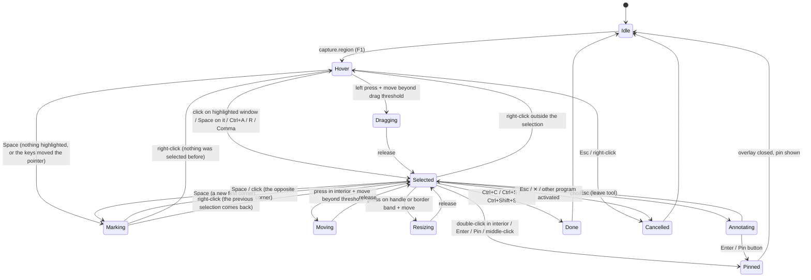

# Noeul UX specification

Status: **current** (specification; Step 49 implemented the app foundation, [ADR 0023](adr/0023-noeul-app-foundation.md); Step 50 the `F1` selection overlay with `Enter` to pin, [ADR 0026](adr/0026-noeul-capture-overlay.md), see §4.5; Step 53 the floating pin engine, [ADR 0029](adr/0029-noeul-pin-engine.md), see §4.6; Step 51 the double-click-to-pin gesture, the toolbar, the selection menu, copy, save and the gesture settings, [ADR 0032](adr/0032-noeul-double-click-pin-and-outputs.md), see §4.7; Step 52 window and element detection, the magnifier, the precision keys, snapping and the rectangle history, [ADR 0035](adr/0035-noeul-smart-selection-and-precision.md), see §4.8; Step 56 annotation in the overlay and on pins, [ADR 0038](adr/0038-noeul-annotation.md), see §4.9; Step 57 mosaic, blur, the eraser and the solid redaction, [ADR 0041](adr/0041-noeul-privacy-tools.md), see §4.10; Step 54 the pin transforms, border resizing, outline and shadow, click-through with its ways back, thumbnails and groups, [ADR 0044](adr/0044-noeul-pin-transforms-and-control.md), see §4.11; Step 55 `F3` paste of images, image files, colours, HTML and text cards, drops and `noeul pin <file>`, [ADR 0047](adr/0047-noeul-clipboard-paste-and-rich-sources.md), see §4.12; Step 58 whole-monitor and active-window capture, the pointer in a capture and the rules for changing displays, [ADR 0050](adr/0050-noeul-displays-and-capture-backends.md), see §4.13 with the physical test matrix; Step 59 the colour picker in the overlay and the colour clipboard workflow, [ADR 0053](adr/0053-noeul-color-picker.md), see §4.14) · Step 48 ·
Philosophy: [NOEUL_PHILOSOPHY](NOEUL_PHILOSOPHY.md) · Requirements: [NOEUL_REQUIREMENTS](NOEUL_REQUIREMENTS.md) ·
Parity: [NOEUL_SNIPASTE_MATRIX](NOEUL_SNIPASTE_MATRIX.md) · Shortcuts: [HOTKEY_CONTRACT §13.3](HOTKEY_CONTRACT.md) ·
Decision: [ADR 0021](adr/0021-noeul-product-definition.md)

This document says what the user sees and does: journeys and click paths, wireframes, the
exact rules of the double-click-to-pin flow and its tests, the default keys, and how Noeul
behaves where a desktop is not available. The wireframes are original sketches for Noeul; they
show layout and order, not final pixels (those follow [DESIGN_SYSTEM](DESIGN_SYSTEM.md)).

## 1. Words

| Word | Meaning |
| --- | --- |
| **Overlay** | The full-desktop window shown after `F1`: the frozen picture, dimmed outside the selection |
| **Frozen picture** | The image of every monitor taken when the capture started. Everything is cut from it, never from the live screen. |
| **Selection** | The rectangle the user is choosing. It is **confirmed** once the button is released after a drag, a detected window is clicked, the second corner is marked by keyboard, or `Ctrl+A`, `R` or a history step set it. |
| **Interior** | The confirmed selection minus its handle zones and border band, and minus any part covered by the toolbar |
| **Handle zone** | Eight squares of 9×9 logical pixels centered on the corners and the edge midpoints of the selection |
| **Border band** | 3 logical pixels on each side of the selection's edges, used to resize by an edge |
| **Toolbar** | The floating bar of buttons next to the confirmed selection |
| **Pin** | A floating, always-on-top window showing an image or a card |
| **Card** | A pin made from text, HTML or a color value |
| **System values** | The user's Windows settings: double-click time (`GetDoubleClickTime`), double-click rectangle (`SM_CXDOUBLECLK` × `SM_CYDOUBLECLK`) and drag threshold (`SM_CXDRAG` × `SM_CYDRAG`); Windows defaults are 500 ms, 4×4 and 4×4 pixels (*documented*) |

When a selection is smaller than three handle zones in either direction (27 logical pixels),
the handles and the border band move outside the rectangle, so its whole area is interior.

## 2. User journeys and click paths

Each journey has a mouse path and a keyboard-only path; both reach the same result.

| # | Journey | Mouse path | Keyboard-only path | Result | Requirements |
| --- | --- | --- | --- | --- | --- |
| J1 | **Capture and pin** (the signature flow) | `F1` → drag a rectangle → double-click inside it | `F1` → `W A S D` to the first corner → `Space` → to the opposite corner → `Space` → `Enter` | A pin of exactly that rectangle at the same place; overlay gone; clipboard untouched | NOEUL-FR-020…022, NOEUL-FR-043 |
| J2 | Capture a window and pin it | `F1` → hover the window (it is highlighted) → click → double-click inside | `F1` → move the pointer over it → `Space` → `Enter` | Pin of the window's rectangle | NOEUL-FR-040 |
| J3 | Copy a region | `F1` → drag → toolbar **Copy** (or right-click → Copy) | `F1` → select → `Ctrl+C` | Image on the clipboard (PNG and bitmap); overlay gone; no pin | NOEUL-FR-023, NOEUL-FR-030 |
| J4 | Save a region | `F1` → drag → **Save** (`Shift`+click: quick save) | `Ctrl+S` (dialog) or `Ctrl+Shift+S` (quick save) | A PNG file; no pin, clipboard untouched | NOEUL-FR-023, NOEUL-FR-031, NOEUL-FR-032 |
| J5 | Mark up, then pin | `F1` → drag → pick a tool on the toolbar → draw → `Esc` (leave the tool) → double-click inside | … → `Tab` to the tool → `Enter` → draw with the pointer keys → `Enter` (pins with the drawing) | A pin carrying editable annotations | NOEUL-FR-080, NOEUL-FR-081 |
| J6 | Pin the clipboard | Tray middle-click, or tray menu → Pin clipboard | `F3` | A pin (image) or a card (text, HTML, color) at the pointer | NOEUL-FR-070, NOEUL-FR-071 |
| J7 | Work with a pin | Drag to move, wheel to zoom, `Ctrl`+wheel for opacity, middle-click to reset, right-click for the menu | Click or create it (it has focus) → arrows, `Plus`/`Minus`, `0`, `1`–`4`, `Shift+F10` for the menu | Moved, zoomed, rotated, flipped pin | NOEUL-FR-061, NOEUL-FR-062 |
| J8 | Close and reopen | `Esc` or menu → Close; tray → Reopen closed pin | `Esc` / `Ctrl+W`; `noeul pin reopen` | The pin comes back with its transform | NOEUL-FR-065 |
| J9 | Look through a pin (click-through) and back | Menu → Click-through; tray → Make all pins clickable | `Ctrl+Shift+T` on the pin; start `noeul` again → settings → Pins | Pin ignores the mouse, shows a marker; recovered on demand | NOEUL-FR-063, NOEUL-SEC-013 |
| J10 | Change a shortcut or the gesture | Tray → Settings → Shortcuts → row → Change → press keys; Gestures → Double-click inside a selection: Pin / Copy / Save / Nothing | `noeul hotkeys set capture.region Shift+F1`; settings by keyboard | New binding active at once; conflicts reported | NOEUL-FR-024, NOEUL-FR-100, NOEUL-FR-101 |
| J11 | Without the tray icon | — | Hotkeys work; start `noeul` again to open settings; `noeul status --json` | Everything reachable | NOEUL-FR-004 |
| J12 | A script or agent captures | — | `noeul capture --region 0,0,800,600 --output shot.png --json` | A file and a JSON result; a visible notice; no window | NOEUL-FR-112, NOEUL-SEC-010 |

## 3. Wireframes

### 3.1 Overlay with a confirmed selection and the floating toolbar

```text
+--------------------------------------------------------------------------+
|//////////////////////////// dimmed frozen picture ///////////////////////|
|///////  [ 640 × 360  at 412, 188 ]  <- size chip (device pixels) ////////|
|///////  o-----------------o-----------------o  ///////////////////////////|
|///////  |                                   |  ///////////////////////////|
|///////  |                                   |  //////  +-------------+  //|
|///////  o     selection (not dimmed)        o  //////  | magnifier   |  //|
|///////  |     double-click here = PIN       |  //////  |   [ + ]     |  //|
|///////  |                                   |  //////  | 412, 188    |  //|
|///////  o-----------------o-----------------o  //////  | #3A6EA5     |  //|
|///////  +--------------------------------------------+ +-------------+  //|
|///////  | [Pin] | Copy  Save | ▭ ◯ ／ → ✎ ▮ T ▦ ◌ ⌫ █ | ↶ ↷ |  ✕  | ///////|
|///////  +--------------------------------------------+ //////////////////|
|//////////////////////////////////////////////////////////////////////////|
+--------------------------------------------------------------------------+
  o = resize handle   [Pin] = primary button (accent fill, first in tab order)
  ▭ ◯ ／ → ✎ ▮ T ▦ ◌ ⌫ █ = rectangle, ellipse, line, arrow, pen, marker, text,
  mosaic, blur, eraser, solid redaction (N3)   ↶ ↷ = undo, redo   ✕ = cancel (Esc)
```

- The toolbar sits below the selection, or above it when there is no room, or inside its
  bottom edge when the selection fills the monitor. It never covers the size chip.
- Tooltips name the action, its keys and its gesture: "Pin — double-click inside or Enter",
  "Copy — Ctrl+C", "Save — Ctrl+S (Shift: quick save)".
- First run only: a one-line hint above the toolbar, "Double-click inside to pin it. Ctrl+C
  copies, Ctrl+S saves." It disappears after the first pin, copy or save and can be turned off.

Shipped since Step 51 ([ADR 0032](adr/0032-noeul-double-click-pin-and-outputs.md)): the toolbar
with this build's buttons only — **Pin** (accent-filled, first in tab order), Copy, Save
(`Shift`+click quick-saves) and Cancel — placed as above (right-aligned with the selection), 32
logical pixels high, with a `bg.hover` highlight under the pointer and a 2-pixel `focus.ring` on
the button that has the keyboard focus. Step 56 ([ADR 0038](adr/0038-noeul-annotation.md), §4.9)
added the rectangle, ellipse, line, arrow, pen, marker and text tools, the colour and width buttons,
Undo and Redo between Save and Cancel (icons are original vector drawings; the active tool has an
accent bar; Undo and Redo grey out with nothing to undo or redo); on a monitor narrower than the bar
the buttons wrap into rows. Step 57 ([ADR 0041](adr/0041-noeul-privacy-tools.md), §4.10) added
mosaic, blur, the eraser and the solid redaction after the text tool (the bar is 744 logical pixels
wide). Tooltips are
not shown yet; the first-run hint is the overlay's keyboard help box, which now reads "Double-click
inside pins it · Ctrl+C copies · Ctrl+S saves · Ctrl+Shift+S quick-saves" from the effective
gesture and keys (`[capture] keyboard_help`, ADR 0026 §6).

### 3.2 Selection context menu (right-click inside, or `Shift+F10`)

```text
+-------------------------------+
| Pin              Enter        |
| Copy             Ctrl+C       |
| Save…            Ctrl+S       |
| Quick save       Ctrl+Shift+S |
|-------------------------------|
| Select monitor   Ctrl+A       |
| Last rectangle   R            |
|-------------------------------|
| Cancel           Esc          |
+-------------------------------+
```

Shipped since Step 51: exactly these items, with the effective keys; it opens on a right-click
inside the selection (or on its handles), `Shift+F10` or the menu key (then at the selection's
corner). Under the debug-build test hook it is recorded, never shown.

### 3.3 A pin and its menu

```text
   +--------------------------+         +----------------------------------+
   |                          |         | Copy                 Ctrl+C      |
   |   pinned image (100 %)   |  right  | Save…                Ctrl+S      |
   |                     [⇣]  |  click  | Copy text            Ctrl+Shift+C|  (cards)
   |                          |  ---->  |----------------------------------|
   +--------------------------+         | Zoom 100 %           0           |
     1 px subtle border, soft shadow    | Rotate right / left  1 / 2       |
     [⇣] = click-through marker         | Flip                 3 / 4       |
           (only in that mode)          | Opacity ▸  100 90 75 50 25 %     |
                                        | Thumbnail            T           |
                                        | Click-through        Ctrl+Shift+T|
                                        | Annotate             Space       |
                                        | Group ▸                          |
                                        |----------------------------------|
                                        | Hide                 H           |
                                        | Close                Esc         |
                                        | Destroy              Shift+Esc   |
                                        +----------------------------------+
```

Shipped since Step 53 ([ADR 0029](adr/0029-noeul-pin-engine.md)): the menu opens on a right-click,
`Shift+F10` or the menu key, and lists the implemented items only — Zoom in, Zoom out, Zoom 100 %,
Hide, Close, Destroy — each with its effective key. Step 51 added Copy, Save… and Quick save
(`pin.copy`, `pin.save`, `pin.quick-save`: the pin's picture at 100 %, whatever its zoom; since
Step 56 with its annotations). Step 56 added Annotate (`pin.annotate`, `Space`, §4.9). Step 54
([ADR 0044](adr/0044-noeul-pin-transforms-and-control.md), §4.11) added Rotate right / left
(`1`/`2`), Flip horizontally / vertically (`3`/`4`), More opaque / More transparent
(`Ctrl+Plus`/`Ctrl+Minus`; the opacity steps of the sketch are 10 % steps instead of a submenu),
Thumbnail (`T`, checked while on), Click-through (`Ctrl+Shift+T`, checked while on; greyed while
neither the tray icon nor a `pins.clickable` key offers a way back) and "Move to a new group"
(the sketch's Group submenu; joining another group is a `Ctrl`-drop onto one of its pins);
"Zoom 100 %" became "Zoom 100 %, opaque". A pin made from an animated GIF ends the menu with a
greyed "Animated GIF: first of N frames only". The pin's outline and shadow of §10 are drawn; the
click-through marker is a badge in the picture's top-right corner. Step 55
([ADR 0047](adr/0047-noeul-clipboard-paste-and-rich-sources.md), §4.12) added Copy text
(`pin.copy-text`, `Ctrl+Shift+C`) on cards only, and, on a pin pasted from a clipboard that offered
several kinds, one "Pin clipboard as: …" entry per other kind (Image, Image file, Color swatch,
Formatted text (HTML), Plain text, File names) at the end of the menu.

### 3.4 Tray menu (optional tray icon)

```text
+-----------------------------------+
| Capture region            F1      |
| Pin clipboard             F3      |
|-----------------------------------|
| Show all pins / Hide all pins     |
| Make all pins clickable           |
| Bring pins on screen              |
| Reopen closed pin                 |
| Groups ▸                          |
|-----------------------------------|
| Keyboard shortcuts: On            |
| Settings…                Ctrl+,   |
| Quit Noeul                        |
+-----------------------------------+
```

Shipped since Step 53: Hide all pins (while every pin shows) or Show all pins (while one is
hidden), and Bring pins on screen (only while a pin lies where no monitor shows it). Step 54:
Make all pins clickable (only while a pin lets clicks through) and, while there are several
groups, one checked entry per group ("Group: work"; choosing one switches to it) instead of the
sketch's Groups submenu. Step 60 ([ADR 0074](adr/0074-noeul-history-and-pin-backup.md)): "Pin last
capture again" (while the capture history holds a picture) and "Restore pins from last time"
(while the opt-in pin backup holds pins that are not open; a restore never duplicates an open pin).

### 3.4a Capture history and pin backup (Step 60)

Every capture that ends with pin, copy or save keeps **the picture it produced** (annotations and
redactions drawn in) in memory: `[history] count` captures (default 20) within `memory_mb`
(default 256 MiB). `P` in the overlay marks the capture **private**: it joins no history. Earlier
pictures are pinned again from the tray or `noeul history pin [n]`; `noeul history list|forget|
clear` show and remove them. Writing them to disk (`[history] disk`, kept `keep_days`) and the pin
backup (`[pins] backup`) are **off by default**; with the backup on, Noeul writes the pins a
second after they change and, at the next start, offers them ("Noeul can restore 3 pins from last
time …") — it never restores them by itself.

### 3.5 Settings: Gestures and Shortcuts

```text
+- Noeul settings ---------------------------------------------------------+
| General      | Gestures                                                  |
| Capture      |                                                           |
| Gestures   < |  Double-click inside a selection   ( Pin  v )             |
| Pins         |  Middle-click inside a selection   ( Pin  v )             |
| History      |  Double-click on a pin             ( Nothing  v )         |
| Privacy      |  [ ] Snipaste-style gestures (double-click and Enter copy, |
| Shortcuts    |      Ctrl+T and middle-click pin)                         |
| About        |  Uses your Windows double-click speed: 500 ms  [Windows…]  |
|              |                                     [Reset this section]  |
+--------------+-----------------------------------------------------------+

+- Shortcuts --------------------------------------------------------------+
|  Keyboard shortcuts: [On]                             [Reset all…]       |
|  Action                     Keys            Scope            State       |
|  Capture a region           F1              global           default     |
|  Pin the clipboard          F3              global           taken ⚠     |
|    ⚠ Another program uses F3. Try Shift+F3.  [Change] [Disable] [Keep]  |
|  Pin the selection          Enter           capture overlay  default     |
|  (gesture) Double-click     inside selection capture overlay  Pin        |
|  …                                                                       |
|  Row: [Change] [Disable] [Reset]                                         |
+--------------------------------------------------------------------------+
```

Shipped since Step 51, before the settings window (Step 61): the Gestures section's values are
`config.toml` settings changed with `noeul config set gestures.double_click pin|copy|save|none`,
`gestures.middle_click pin|copy|none` and `gestures.preset noeul|snipaste`, and reset with
`noeul config reset gestures --yes` (all with `--dry-run` and `--json`). A running Noeul uses
them from the next capture. `noeul config show` and `noeul hotkeys list` show the gestures and
name the "Snipaste-style gestures" preset; the preset also writes its keys (`Enter` copies,
`Ctrl+T` pins) into `hotkeys.json`, and reset undoes them. The double-click on a pin does nothing
and is not a setting yet.

### 3.6 Notices

Small non-modal toasts near the pointer's monitor corner, 2 s, never stealing focus, announced to
screen readers: "Pinned", "Copied", "Saved to Pictures\Noeul", "Nothing to pin", "F3 is used by
another program". A capture requested by the CLI or an agent shows "Noeul captured a region
(command line)" (NOEUL-SEC-010). Since Step 55 a paste that pins nothing says why without naming
the content: "Nothing to pin.", "Nothing pinned: the copied content is marked private (for example
by a password manager).", "The clipboard is in use by another program; try again.", "The picture
could not be read (malformed or too large).", "That file is not on this PC; Noeul pins local files
only."; a paste that pinned something may add "Pinned N of M files…", "This TIFF has N pages…",
"This GIF has N frames…", "The text is long: the card shows its beginning…" or "Images in the
copied HTML are shown as placeholders: Noeul never downloads anything." Notices are tray balloons:
**with the tray icon off they are not shown in this build** (a toast window is not implemented).

## 4. The signature flow: precise rules

### 4.1 States



### 4.2 Rules

1. **Only a confirmed selection can be pinned.** In `Hover` and `Dragging` there is nothing to
   pin, so no gesture pins.
2. **What a double-click is.** Two left-button presses P1 and P2 such that: both are in the
   interior; P2 comes within the system double-click time after P1 and inside the system
   double-click rectangle centered on P1; the pointer did not move beyond the drag threshold
   while P1 was held; no modifier key (`Ctrl`, `Alt`, `Shift`, `Win`) is down at P1 or P2; the
   state is `Selected` (not `Annotating`). Noeul counts presses itself from raw button events with
   the system values; it does not rely on the window class's double-click messages.
3. **The pin fires on P2's press**, not on its release, so it appears immediately. The release of
   P2 and any pointer movement until that release are ignored by the new pin; it cannot be
   dragged by the tail of the gesture.
4. **Presses that do something else never start a double-click.** A press that became a drag,
   move or resize (moved beyond the threshold while held) is not P1. The release that ends a
   drag is not a click. A press on a handle, the border band, the toolbar, the size chip or the
   magnifier is not P1 or P2.
5. **Outside means nothing.** A double-click outside the selection, or with one press inside
   and one outside, pins nothing and leaves the selection as it is. A drag outside the confirmed
   selection starts a new selection that replaces it.
6. **Annotation first.** While a tool is active, presses draw (a double-click may end a polyline
   or select a word in a text label). `Esc` leaves the tool; then the double-click pins again.
   `Enter` and the Pin button always pin, with the annotations.
7. **Keyboard focus rule.** `Enter` pins while the selection (the canvas) has keyboard focus.
   When a toolbar button, a menu or a text field has focus, the reserved navigation keys
   (`Enter`, `Space`, `Tab`, `Esc`, arrows) go to that control first, so `Enter` on **Copy**
   copies. This is how Noeul applies HOTKEY_CONTRACT §7.2 ("a context may bind navigation keys")
   without breaking keyboard navigation (ADR 0021).
8. **The pin.** Its top-left corner is the selection's top-left in device pixels, its size is
   the selection's size in device pixels, zoom 100 %, opacity 100 %, in the current group; it
   shows the frozen picture's pixels (and annotations as editable layers). The overlay closes and
   the new pin has keyboard focus, so `Esc`, arrows and `0` work at once; "Pinned" is announced.
9. **No side effects.** Pinning opens neither the clipboard nor any file. The clipboard
   sequence number is unchanged and no file appears (NOEUL-SEC-005).
10. **The new pin ignores the rest of the gesture.** For one system double-click time after it
    appears, a pin ignores presses, so a triple or quadruple click yields one untouched pin. A
    double-click on a pin has no default action at any time (NOEUL-FR-026).
11. **Failure keeps the work.** If the pin cannot be created, the overlay stays in `Selected`
    with an error banner; copy and save still work (NOEUL-FR-025).
12. **Other paths.** Middle-click in the interior pins (setting: Pin, Copy, Nothing). The
    gesture setting (NOEUL-FR-024) changes only what the double-click does; `capture.pin` keeps
    its own keys. The Snipaste-style preset changes both and is shown by name.
13. **Settings follow Windows.** When the user changes the double-click speed or drag
    threshold, Noeul uses the new values from the next press (`WM_SETTINGCHANGE`), without a
    restart.

### 4.3 Test specification

Each case is written so that it can be automated (§4.4). `T` = system double-click time, `D` =
system double-click rectangle, `H` = drag threshold; tests inject these values.

| Case | Given | When | Then | Requirements |
| --- | --- | --- | --- | --- |
| FLOW-01 | Overlay on one 100 % monitor, confirmed selection (100,100)–(500,400) | Two left presses at (300,250), 120 ms apart, no movement | One pin at (100,100), 400×300, 100 %, the frozen pixels; overlay closed; clipboard sequence unchanged; no file written | NOEUL-FR-020, NOEUL-SEC-005 |
| FLOW-02 | As FLOW-01 | P2 at T − 1 ms | Pin | NOEUL-FR-021 |
| FLOW-03 | As FLOW-01 | P2 at T + 1 ms | No pin; selection unchanged; overlay open | NOEUL-FR-021 |
| FLOW-04 | As FLOW-01 | P2 offset inside D / outside D | Pin / no pin | NOEUL-FR-021 |
| FLOW-05 | As FLOW-01 | Both presses outside the selection | No pin; selection unchanged | NOEUL-FR-021 |
| FLOW-06 | As FLOW-01 | P1 inside, P2 outside (and the reverse) | No pin | NOEUL-FR-021 |
| FLOW-07 | As FLOW-01 | Double-click on a corner handle; on the border band; on the size chip | No pin | NOEUL-FR-021 |
| FLOW-08 | As FLOW-01 | Double-click on the toolbar's Copy button | Copy runs once (overlay closes); no pin | NOEUL-FR-021, NOEUL-FR-023 |
| FLOW-09 | As FLOW-01 | Press in interior, move 20 px, release (a move); then two quick presses | The move does not count; the two later presses pin the moved rectangle | NOEUL-FR-021 |
| FLOW-10 | As FLOW-01 | P1, move by less than H, release, P2 | Pin; the selection did not move | NOEUL-FR-021 |
| FLOW-11 | As FLOW-01 | Resize by dragging the right handle, release, then double-click in interior | Pin of the resized rectangle | NOEUL-FR-012, NOEUL-FR-021 |
| FLOW-12 | Overlay in `Hover` | Drag a selection ending at (x,y), release, one press at (x,y) within T | No pin (the drag's press is not P1) | NOEUL-FR-021 |
| FLOW-13 | Pen tool active | Double-click inside; then `Enter` | First: drawing only, no pin; then a pin carrying the stroke | NOEUL-FR-021, NOEUL-FR-080 |
| FLOW-14 | Editing a text label | Double-click on a word | Word selected; no pin | NOEUL-FR-021 |
| FLOW-15 | Pen tool active | `Esc`, then double-click inside | Tool left, drawing kept; pin | NOEUL-FR-081 |
| FLOW-16 | Confirmed selection, canvas focused | `Enter` | Same result as FLOW-01 | NOEUL-FR-022 |
| FLOW-17 | Confirmed selection | `Tab` to Copy, `Enter`; again with `Tab` to Pin, `Enter` | Copy (no pin); then pin | NOEUL-FR-022, NOEUL-FR-023 |
| FLOW-18 | Overlay, keyboard only | `W A S D` to (100,100), `Space`, to (500,400), `Space`, `Enter` | Pin of (100,100)–(500,400) | NOEUL-FR-043, NOEUL-NFR-012 |
| FLOW-19 | Confirmed selection | `Ctrl+C` | Clipboard holds PNG and `CF_DIBV5` with the frozen pixels; no pin; overlay closed | NOEUL-FR-023, NOEUL-FR-030 |
| FLOW-20 | Confirmed selection | `Ctrl+Shift+S` | One new PNG in the quick-save folder with the frozen pixels; no pin; clipboard unchanged | NOEUL-FR-023, NOEUL-FR-032 |
| FLOW-21 | As FLOW-01 | Middle-click inside; middle-click outside | Pin; nothing | NOEUL-FR-022 |
| FLOW-22 | As FLOW-01 | Double-click with `Ctrl`, `Shift` or `Alt` held | No pin | NOEUL-FR-021 |
| FLOW-23 | As FLOW-01 | Right-button double-click inside | Menu opens; no pin | NOEUL-FR-021 |
| FLOW-24 | Gesture setting `copy` | Double-click inside | Copy, no pin; `Enter` still pins | NOEUL-FR-024 |
| FLOW-25 | Gesture setting `none` | Double-click inside | Nothing | NOEUL-FR-024 |
| FLOW-26 | Pin creation made to fail | Double-click inside | Overlay stays, error shown, selection intact; `Ctrl+C` still copies | NOEUL-FR-025 |
| FLOW-27 | Another process keeps the clipboard open | Double-click inside | Pin created normally | NOEUL-FR-025 |
| FLOW-28 | As FLOW-01 | Triple and quadruple click | Exactly one pin, not moved, not closed | NOEUL-FR-026 |
| FLOW-29 | Idle | Ten times: `F1`, select, double-click, as fast as possible | Ten pins with distinct IDs; none lost; one overlay at a time | NOEUL-FR-013, NOEUL-FR-060 |
| FLOW-30 | Overlay open | `F1` again, then double-click inside | Still one overlay; one pin | NOEUL-FR-013 |
| FLOW-31 | Two side-by-side monitors at the same scale | Selection across the seam; double-click | One pin across both monitors with exact pixels | NOEUL-FR-090 |
| FLOW-32 | One monitor at 150 % | Select 600×450 device pixels; double-click | Pin is 600×450 device pixels; readout said 600 × 450 | NOEUL-FR-090 |
| FLOW-33 | Monitors at 100 % and 150 % (N4) | Pin on one, drag it to the other | Pixel size unchanged | NOEUL-FR-091 |
| FLOW-34 | A text editor had focus before `F1` | Pin, then `Esc` | Pin focused after creation; `Esc` closes it; the editor received no input | NOEUL-FR-060, NOEUL-SEC-012 |
| FLOW-35 | Session locked | `F1`; `noeul capture --region 0,0,10,10 --output x.png` | No overlay; the command fails with `desktop_unavailable` and writes nothing | NOEUL-SEC-003 |
| FLOW-36 | Windows double-click time changed to 900 ms while Noeul runs | Presses 800 ms apart | Pin | NOEUL-NFR-012 |
| FLOW-37 | Selection of 10×10 pixels | Double-click on it | Pin (the whole rectangle is interior) | NOEUL-FR-021 |
| FLOW-38 | Selection filling the monitor, toolbar inside it | Double-click on the toolbar; elsewhere inside | No pin; pin | NOEUL-FR-021 |

### 4.4 How later Steps automate this

| Layer | Step | What runs | Covers | Rules |
| --- | --- | --- | --- | --- |
| Gesture unit tests | 51 | A platform-independent gesture module fed with sequences of (time, position, button, press/release/move, modifiers), selection and hit-zone geometry, tool state and the system values; it returns commands (pin, copy, move, resize, …). Table-driven, part of `cargo test`. | FLOW-02…15, 21–25, 28, 36–38 | No window, no OS input |
| Window integration tests | 51, 53 | A real overlay and real pin windows on a test-supplied frozen picture, positioned off-screen (for example at −6000,−6000), never activated, no taskbar entry; events posted to Noeul's own windows only; assertions on pin windows, the clipboard sequence number and the file system | FLOW-01, 16–20, 26, 27, 29–32, 34 | Headless rules of the brief: nothing visible on the maintainer's screen, no `SendInput` |
| e2e scenario | 51 (`e2e/tests/step51_noeul_double_click_pin.rs`) | The real debug `noeul` binary with the test hook (synthetic off-screen desktop, outputs kept off the user's clipboard and folders); pointer and key events are messages posted to Noeul's own overlay window (no IPC test method was needed, ADR 0032); `noeul pin list --json` and `noeul status --json` check the result | FLOW-01, 03, 05, 17, 20, 29 | Runs only through `cargo xtask e2e` (AGENTS.md §4) |
| Manual script | 51, then 63 | The real-Windows script below, with a physical mouse and keyboard | Everything that needs real input, DPI and focus | Windows build, scales and date recorded in the Step report and the matrix Evidence column |

**Real-Windows script** (Windows 10 19045 and Windows 11; 100 % and 150 %; two monitors where
available):

1. Copy some text in Notepad. Start Noeul. `F1`, drag around part of the Notepad window,
   double-click inside: a pin appears at once, at the same place and size. Paste in Notepad: the
   earlier text comes out (the clipboard was not touched).
2. Click into Notepad and type: the pin stays on top and Notepad gets the keys.
3. `F1`, select, `Enter`: a pin. `F1`, select, `Ctrl+C`, paste into Paint: same pixels, no pin.
4. `F1`, select, double-click outside, then on a handle: nothing is pinned.
5. `F1`, select, quadruple-click inside: exactly one pin, still there.
6. Set the Windows double-click speed to the slowest setting; repeat step 1 with slow clicks.
7. On a 150 % monitor, save a pinned 600×450 selection and check the file is 600×450 pixels.
8. Lock the session (`Win+L`), press `F1`, unlock: no overlay appeared; no capture was taken.
9. Ten captures in a row as fast as possible: ten pins.
10. Measure capture and pin latency with Noeul's debug metric and record them (NOEUL-NFR-003,
    NOEUL-NFR-004).

### 4.5 Step 50: manual check of the real `F1` overlay

Step 50 ships the overlay of §4.1 up to `Selected`, `Moving` and `Resizing`, with `Enter`
(`capture.pin`) as its output; the double-click gesture, toolbar, menu, copy and save follow in
Step 51, detection and the magnifier in Step 52 ([ADR 0026](adr/0026-noeul-capture-overlay.md)).
Automated tests cover the state machine, geometry, DPI math and the composed pixels with synthetic
layouts, a real but off-screen, never-activated overlay window fed with its own window messages,
the trigger on an obscure chord, `taken` reporting and rapid triggers. They never register `F1`,
never show an overlay on the visible desktop and never synthesize input, so these steps need the
maintainer, on the real desktop with a physical mouse and keyboard (record the Windows build, the
monitors and their scales, and the date in the Step report and the matrix Evidence column):

1. `cargo build --release -p noeul`, then `target\release\noeul.exe start` (default profile).
   `noeul status` lists `capture.region F1: registered` (if another program owns `F1` it says
   `taken`; then `noeul hotkeys set capture.region Shift+F1` and use that key below).
2. Press `F1`: within about a tenth of a second every monitor shows its frozen picture, dimmed;
   the pointer is a crosshair even before it moves; a size readout follows the pointer; the
   keyboard help box sits at the top of the monitor under the pointer.
3. Drag a rectangle (also starting the drag after resting the pointer for a few seconds): the
   rectangle is undimmed with a lilac border, and the readout shows `W × H  at X, Y` in device
   pixels. Hold `Shift` while dragging: a square.
4. Drag inside the rectangle to move it; drag a corner and an edge handle to resize; press the
   arrows, `Ctrl`+arrows and `Shift`+arrows; `Ctrl+A` (the monitor, again all monitors).
5. `Esc`: the overlay disappears; nothing was pinned; `noeul status --json` shows
   `memory.bytes` 0.
6. Copy some text in Notepad. `F1`, select, `Enter`: a pin of exactly that rectangle appears at
   the same place and has focus (`Esc` closes it). Paste in Notepad: the earlier text comes out.
7. `F1`, then press `F1` repeatedly and hold it down: still one overlay; `noeul status --json`
   counts `captures.ignored`.
8. `F1`, right-click without a selection: cancelled. `F1`, select, right-click outside: the
   selection is cleared. `F1`, then `Alt+Tab` to another program: cancelled.
9. On a monitor at 150 %, and with two monitors where available: the readout is in device
   pixels and a selection across the seam pins with exact pixels.
10. Lock the session (`Win+L`), press `F1`, unlock: no overlay appeared and nothing was captured.
11. After about twenty captures, `noeul status --json` → `captures.first_frame` gives p50/p95 of
    the first frame on this machine (NOEUL-NFR-003); `noeul quit --yes` ends it.

### 4.6 Step 53: manual check of real pins

Step 53 ships the pin engine ([ADR 0029](adr/0029-noeul-pin-engine.md)): independent topmost pin
windows that move, zoom, hide, show, close and are destroyed on their own, their menu, focus
hand-back, placement in work areas, display-change handling, `noeul pin …` and the IPC methods.
Automated tests run every pin off-screen, never activated, never on top of the user's programs,
and never show a menu or synthesize input, so the visible behaviour needs the maintainer, on the
real desktop with a physical mouse and keyboard (record the Windows build, the monitors and
their scales, and the date in the Step report and the matrix Evidence column):

1. `cargo build --release -p noeul`, then `target\release\noeul.exe start` (default profile).
2. Open Notepad and type a line. `F1`, select a part of Notepad, `Enter`: a pin of exactly that
   rectangle appears in place and has focus. Click into Notepad and type: Notepad gets the keys
   while the pin stays on top. The pin has no taskbar button and is not in `Alt+Tab`.
3. Drag the pin around, also over the taskbar: it follows the pointer and stays above every
   window. Click it, then press the arrows: it moves one pixel per press.
4. Over the pin, turn the wheel away from you and back: it zooms in and out around the pointer;
   `Plus`/`Minus` do the same; `0` and a middle-click return to 100 % (`noeul pin list` shows
   `ZOOM 100 %`).
5. Right-click the pin: the menu lists Zoom in, Zoom out, Zoom 100 % (greyed at 100 %), Hide,
   Close and Destroy with their keys. `Shift+F10` and the menu key open it at the pin's corner.
   Choose Hide: the pin disappears and typing goes to Notepad again.
6. Tray → Show all pins: the pin comes back on top without taking focus (Notepad keeps typing).
   `noeul pin hide --all` and `noeul pin show --all` in a console: the console keeps the focus.
7. Make three pins. Click the middle one and press `Esc`: only it closes and the keyboard goes
   back to the program you were in before, not to another pin; a second `Esc` reaches that
   program and closes nothing. `Shift+Esc` on another pin destroys it (`noeul pin reopen` then
   reopens only the one closed with `Esc`).
8. Copy an image larger than the screen (e.g. a 4K picture in Paint, `Ctrl+A`, `Ctrl+C`) and
   press `F3`: the pin fits inside the monitor's work area, clear of the taskbar;
   `noeul pin list` shows its zoom below 100 %.
9. `noeul capture --region <x,y,w,h of the whole virtual desktop> --pin`: the pin covers every
   monitor. Click it and press `Esc` (or right-click → Close, or `noeul pin close --all --yes`):
   it is gone.
10. With two monitors: put a pin on the secondary monitor, then disconnect that monitor (or set
    it to "Show only on 1"): the pin keeps its place off-screen, a notice says so, and
    `noeul status` shows `1 off-screen`. Tray → Bring pins on screen (or
    `noeul pin show --all --on-screen`): it appears on the remaining monitor inside its work area.
    Reconnect the monitor: pins that were not brought back are where they were.
11. With monitors at different scales (100 % and 150 %): drag a pin from one to the other; its
    pixel size does not change.
12. With pins showing, press `F1`: the overlay covers the pins; `F3` while the overlay is open
    pins nothing; `Esc` leaves the overlay and the pins are still there.
13. `noeul quit` with pins open asks for `--yes`; `noeul quit --yes`, then `noeul start`: no pin
    comes back (pins live in memory only), and `%LOCALAPPDATA%\mouv\noeul` holds no picture.

### 4.7 Step 51: manual check of the signature flow

Step 51 ships the double-click gesture of §4.2, the toolbar of §3.1, the menu of §3.2, copy,
save, quick save and the gesture settings ([ADR 0032](adr/0032-noeul-double-click-pin-and-outputs.md)).
What the automated tests cover, without any window on the visible desktop, registered `F1`,
synthesized input or touch of the real clipboard:

| Layer | Where | FLOW cases |
| --- | --- | --- |
| Gesture model (table-driven, injected system values) | `crates/noeul/src/overlay.rs` tests | 01–12, 21–25, 28, 31, 32, 36–38; the toolbar's placement, buttons, keyboard focus and pixels |
| Instance core (fake windows, fake clipboard, sandbox folders) | `crates/noeul/src/app.rs` tests | 01, 16, 17, 19, 20, 24–30, 36; the menu, save dialog request, preset, pin copy and save |
| Real binary, off-screen synthetic desktop, posted window messages | `crates/noeul/tests/double_click.rs` | 01, 03, 05, 07, 08, 17, 20, 21, 23, 24, 27, 28, 29, 31, 32 |
| Real off-screen overlay window (GDI text of the toolbar at 150 %) | `crates/noeul/src/win/overlay.rs` tests | 32 (drawing) |
| e2e (ignored; `cargo xtask e2e` only) | `e2e/tests/step51_noeul_double_click_pin.rs` | 01, 03, 05, 17, 20, 29 |

FLOW-13 to FLOW-15 need the annotation tools (automated since Step 56, §4.9); FLOW-18 needs the keyboard marking of
Step 52 (automated since Step 52, §4.8); FLOW-33 is N4; FLOW-34 and FLOW-35 are covered by Step 53's focus hand-back and Step
50's desktop check. So these steps need the maintainer, on the real desktop with a physical mouse
and keyboard (record the Windows build, the monitors and their scales, and the date in the Step
report and the matrix Evidence column):

1. `cargo build --release -p noeul`, then `target\release\noeul.exe start` (default profile).
   `noeul status` lists `capture.region F1: registered`.
2. Copy a line of text in Notepad. Press `F1`, drag around part of the Notepad window, release,
   then **double-click inside the rectangle**: on the second press a pin of exactly that
   rectangle appears at the same place and size, and the overlay is gone. Paste in Notepad: the
   earlier text comes out (pinning never touched the clipboard).
3. Click into Notepad and type: Notepad gets the keys and the pin stays above it; drag Notepad
   over the pin: the pin stays on top.
4. `F1`, drag, then double-click **outside** the rectangle, then on a corner handle, then on the
   size chip and on the toolbar's empty bar: nothing is pinned and the selection stays. Click
   once inside, wait longer than your double-click speed, click again: nothing is pinned.
5. `F1`, drag, then **quadruple-click** inside as fast as you can: exactly one pin, not moved, not
   closed, and the third and fourth clicks did nothing to it.
6. `F1`, drag, move the rectangle by dragging its inside and resize it by a handle, then
   double-click inside: the pin shows the moved and resized rectangle.
7. `F1`, drag, `Enter`: a pin. `F1`, drag, `Ctrl+C`: no pin; paste into Paint: the same pixels.
   `F1`, drag, `Tab`, `Tab` (Copy has a lilac focus ring), `Enter`: copied, no pin. `F1`, drag,
   click the toolbar's **Copy**: copied. `F1`, drag, right-click inside: the menu lists Pin, Copy,
   Save…, Quick save, Select monitor, Last rectangle and Cancel with their keys.
8. `F1`, drag, `Ctrl+S`: the save dialog opens above the overlay in `Pictures\Noeul` with
   `noeul-YYYYMMDD-HHMMSS.png`; Cancel keeps the overlay; Save writes the file and closes it.
   `F1`, drag, `Ctrl+Shift+S` twice (two captures): two files, the second with `-2` when within
   the same second; nothing was overwritten. `Shift`+click on Save quick-saves too.
9. Click a pin, press `Ctrl+C` and paste into Paint; `Ctrl+S` saves it (the dialog sits above the
   pin); its right-click menu lists Copy, Save… and Quick save.
10. Open another program that holds the clipboard (or start a large copy), then `F1`, drag,
    double-click: the pin appears regardless; `Ctrl+C` says the clipboard is busy and keeps the
    overlay.
11. Set the Windows double-click speed to the slowest setting (Control Panel → Mouse) while Noeul
    runs, and repeat step 2 with slow clicks: it pins without restarting Noeul.
12. `noeul config set gestures.double_click copy`: the next double-click copies, `Enter` still
    pins. `noeul config set gestures.preset snipaste`: double-click and `Enter` copy, `Ctrl+T` and
    a middle-click pin; `noeul hotkeys list` names "Snipaste-style gestures: on".
    `noeul config reset gestures --yes`: the double-click pins again.
13. On a monitor at 150 % (and across two monitors where available): select 600×450 device
    pixels (the size chip says so), double-click: the pin is 600×450; quick-save it and check the
    file is 600×450 pixels; the toolbar's text is crisp at that scale.
14. Ten captures in a row as fast as possible (`F1`, drag, double-click): ten pins, none lost;
    `noeul pin list` shows ten IDs.

### 4.8 Step 52: manual check of smart selection and precision

Step 52 ships detection, the magnifier, the precision keys, snapping and the rectangle history
([ADR 0035](adr/0035-noeul-smart-selection-and-precision.md)). The rules:

1. **Detection** (`detect.cycle`, `E`: window → element → off; `[capture] detection`). While
   nothing is selected and no button is held, the window under the pointer is shown as a selection
   would be (undimmed, the accent border, its size in the chip), without handles or toolbar. In
   element mode the UI element under the pointer is shown once UI Automation answers (the window
   until then). A click without a drag, or `Space`, selects what is shown; that click is not the
   first press of a double-click. With a selection, nothing is detected; a right-click outside it
   clears it and detection comes back.
2. **What is detected.** The windows are listed right after the picture is frozen, as rectangles
   and flags only; hidden, minimized, cloaked (other virtual desktops), click-through and fully
   transparent layered windows are not offered, nor windows excluded from capture
   (`WDA_EXCLUDEFROMCAPTURE`: absent from the picture, so the window below is what shows). A window
   protected from capture (`WDA_MONITOR`, shown black) is never highlighted or selected by a click;
   the chip says "Protected window: Windows captures it as black" and the plain region selection
   remains. Elements come from UI Automation bounding rectangles; a window of an elevated program
   (UIPI), one that does not answer within 300 ms, one without UI Automation, or an answer that
   does not fit the window, falls back to the window rectangle and is not asked again during that
   capture. Nothing else is read: no title, name, value or text (NOEUL-SEC-007).
3. **The pointer keys** `W A S D` are physical keys (`code:`): the same positions on AZERTY and
   other layouts. Each press moves the pointer one device pixel, also during a drag, a move or a
   resize; the real cursor follows. While the keyboard moved the pointer last, detection and
   snapping pause, so `Space` marks a corner exactly there; moving the mouse resumes them.
4. **`Space` (`selection.mark`)** selects the highlighted window or element; otherwise (or after the
   pointer keys) it sets the first corner at the pointer — the rubber band then follows the pointer
   (phase `marking`) — and the next `Space` or a click sets the opposite corner. A right-click
   undoes the mark (a previous selection comes back); `Esc` cancels the capture.
5. **Acceleration.** A held key moves 1 pixel for the press and nine repeats, then 2, 5 and 10 per
   repeat: the pointer keys, the arrows and `Ctrl`/`Shift`+arrows.
6. **Snapping.** While dragging, marking or resizing with the mouse, a moving edge within 6
   logical pixels of a monitor edge or a detected window's edge snaps to it. Holding `Alt` turns it
   off for that movement; with detection off only monitor edges remain.
7. **The magnifier** (`magnifier.toggle`, `M`; `[capture] magnifier`) follows the pointer while
   selecting and outside or on the handles of a confirmed selection: 15 × 15 pixels of the frozen
   picture enlarged (8 logical pixels each), a crosshair through the centre pixel, the position in
   device pixels (and, on a scaled monitor, the logical position on that monitor, "200, 300 at
   150 %"), and the pixel's colour as HEX and RGB (since Step 59 written as the colour picker
   copies them, `rgb(…)`, with the format `C` copies marked, §4.14). It hides while moving the
   selection, over its inside, the toolbar and the size chip.
8. **History.** `Comma` (`history.previous`) shows the rectangle of the last successful capture,
   again the one before, down to the oldest of 20; `Period` (`history.next`) goes forward. Only
   rectangles are kept, in memory; cancelled captures are never kept (NOEUL-FR-050).

What the automated tests cover, without anything on the visible desktop, synthesized input, a
moved cursor or a look at the user's windows:

| Layer | Where | What |
| --- | --- | --- |
| Model (table-driven) | `crates/noeul/src/overlay.rs`, `detect.rs`, `dpi.rs` tests | detection and click-to-select, protected/excluded/click-through/unavailable fallbacks, element answers and their fallbacks, pointer keys and acceleration, FLOW-18 marking, snapping (`Alt`, keyboard), the magnifier's pixels, crosshair and colour lines at 100 % and 150 %, history, mixed-DPI conversions on synthetic layouts |
| Instance core (fake windows) | `crates/noeul/src/app.rs` tests | the window list is taken once (and only when detection is on), element requests and answers, warps of the real pointer, status and its schema, history across captures, FLOW-18 to a pin |
| Real Win32 (own off-screen windows) | `crates/noeul/src/win/detect.rs`, `win/overlay.rs` tests | the window list over plain, raised, layered, transparent, click-through, capture-excluded, protected, hidden and DPI-unaware own windows; UI Automation finds a child button of an own window and reads no text; the magnifier drawn into the real back buffer at 150 %; scan codes become physical chords; the test placement never moves the cursor |
| Real binary, test hook | `crates/noeul/tests/smart_selection.rs` | own windows in another process detected through the real instance (window, protected, excluded), click-to-select and pin, UI Automation across processes, W/Z/D at W's and D's positions, `M`, `Comma`, keyboard marking to a pin |
| e2e (ignored; `cargo xtask e2e` only) | `e2e/tests/step52_noeul_smart_selection.rs` | the keys and settings headlessly; detection, protected report, click, pin, history and marking on the synthetic desktop |

These steps need the maintainer, on the real desktop with a physical mouse and keyboard (record the
Windows build, the monitors and their scales, and the date in the Step report and the matrix
Evidence column):

1. `cargo build --release -p noeul`, then `target\release\noeul.exe start` (default profile).
2. Open Notepad and Explorer side by side. Press `F1` and move the pointer over Notepad: Notepad's
   frame is undimmed with the lilac border and the chip shows its size; over Explorer, Explorer's;
   over the taskbar, the taskbar. Click: that window is selected with handles and toolbar;
   double-click inside: a pin of exactly the window.
3. `F1`, press `E` (element detection), hover Notepad's menu bar and the text area, Explorer's
   address bar and a file: the highlight follows the elements; click one: it is selected.
   `E` again: nothing is detected; `E` again: windows.
4. Open a browser page: with `E`, hover parts of the page; elements appear where the browser
   exposes them, otherwise the browser window is highlighted (no error, no hang).
5. Start a program as administrator (for example Notepad via "Run as administrator"). `F1`, `E`,
   hover it: the window rectangle is highlighted (not its elements); `noeul status --json` shows
   `detection.fallback: "denied"`.
6. Play a DRM-protected video or open a program that excludes itself from capture, then `F1`: the
   picture shows it black or absent, nothing of it is highlighted as content; over a `WDA_MONITOR`
   window the chip says "Protected window: Windows captures it as black".
7. `F1`, look at the magnifier: it follows the pointer, shows the enlarged pixels with a crosshair,
   the position and the colour. Move over a known colour (for example a pure white area) and check
   `#FFFFFF  rgb(255, 255, 255)`. Press `M`: it disappears; `M` again: it is back.
8. `F1`, press `W A S D` (also on an AZERTY layout, the keys at those positions): the pointer and
   the magnifier move one pixel per press; hold a key: it speeds up. Press `Space`, move with the
   keys, `Space`: a rectangle; `Enter` pins it with the size the chip said.
9. `F1`, drag towards a window edge slowly: the selection's edge snaps to the window edge within a
   few pixels; hold `Alt` and repeat: no snapping. Resize a selection by a handle near the monitor
   edge: it snaps to the edge.
10. Make three captures (pin, copy, save). `F1`, press `Comma` three times and `Period` once: the
    three rectangles come back in reverse order and then forward again. Restart Noeul: the history
    is empty (`noeul status --json` → `captures.history` 0) and nothing was written to disk.
11. On a monitor at 125 % or 150 % (and across monitors of different scales where available):
    hover a window that is not DPI-aware and one that is: the highlight fits each window exactly;
    the magnifier's cells are larger and it shows the logical position "x, y at 150 %".
12. Hover Noeul's own pins: they are detected like other windows.

### 4.9 Step 56: annotation, its rules and the manual check

Step 56 ships the annotation tools in the overlay and on pins
([ADR 0038](adr/0038-noeul-annotation.md); NOEUL-FR-080, NOEUL-FR-081, NOEUL-FR-083,
NOEUL-NFR-014). The rules:

1. **Tools.** The toolbar's rectangle, ellipse, line, arrow, pen, marker and text buttons (or their
   bindable `annotate.*` actions) choose a tool; choosing it again leaves it. While a tool is active
   (phase `annotating`) the selection's handles are hidden and presses inside the selection draw
   (clipped to it): rectangle and ellipse from corner to corner (`Shift`: square, circle), line and
   arrow from point to point (`Shift`: 45° steps), pen and marker freehand (the marker is one
   translucent coat), text where pressed. Nothing pins while a tool is active, not even a
   double-click (FLOW-13); `Enter`, Pin and the toolbar still pin, copy and save, with the
   annotations.
2. **Style.** The colour button cycles eight colours (`Shift`: backwards); the width button, `[`
   and `]` (`annotate.width-down`/`-up`, `char:` keys) and the wheel change the width level (1, 2,
   3, 4, 6, 8, 12 logical pixels; the marker and text have their own sizes). Widths are logical
   pixels of the monitor where the object was drawn: 3 pixels at 100 % are 5 device pixels at 150 %.
   A selected object takes a chosen colour or width.
3. **Objects.** With a tool active, a press on an object picks it (the pen and marker always draw;
   the text tool edits the label it presses on): a drag moves it, its handles resize it (box
   handles; a line's or arrow's two ends). `N` / `Shift+N` select objects by keyboard; while one is
   selected the arrows move it, `Ctrl`+arrows grow it, `Shift`+arrows shrink it; `Delete` removes
   it; `PageUp`, `PageDown`, `Shift+PageUp`, `Shift+PageDown` change its order. The size chip's
   second line measures the object drawn or selected ("120 × 80", or a line's "144 px 33.7°").
4. **Undo.** `Ctrl+Z` undoes, `Ctrl+Y` and `Ctrl+Shift+Z` redo, also after the tool was left; one
   stroke, one move, one whole label is one step; `annotate.clear-all` (no default key) is one step
   too. Undo and redo restore exactly the earlier objects.
5. **Leaving.** `Esc` ends the label being edited, else aborts the shape being drawn, else leaves
   the tool and keeps the drawing (then the double-click pins again, FLOW-15); with nothing of that
   left, `Esc` cancels the capture and nothing remains (no picture, no annotation). A right-click
   finishes the shape being drawn, else leaves the tool (no menu while a tool is active).
6. **Text.** A label is typed where the text tool pressed; the window takes the input method only
   while a label is edited (the overlay and pins otherwise have none, so letter shortcuts work in
   Hangul mode), and the composition shows inline at the caret, underlined, until it is committed.
   While a label is edited every shortcut is suspended except its editing keys (`Backspace`,
   `Delete`, arrows, `Home`, `End`, `Enter` for a new line) and `Esc`, which ends it. A double-click
   on a word selects it (FLOW-14); typing replaces the selection. Characters are drawn with the
   first Windows face that has them (Segoe UI, Malgun Gothic for Hangul, Segoe UI Emoji for emoji,
   …); emoji are monochrome, and a line mixing right-to-left and left-to-right text across fonts is
   not reordered between them (*limitations*).
7. **Keyboard drawing.** With a tool active, `Space` (`selection.mark`) sets a shape's start at the
   pointer, the pointer keys (`W A S D`) move its end, and `Space` sets it; with the text tool,
   `Space` starts a label at the pointer. `Tab` reaches every toolbar button, and `Enter` on a tool
   hands the keyboard back to the canvas (J5).
8. **Pins.** A pin keeps its picture unchanged and its annotations as objects; its window, Copy and
   Save show them drawn. `Space` (`pin.annotate`) or the pin's menu opens the pin editor: the pin at
   100 % with its toolbar (Done, the tools, colour, width, Undo, Redo, Cancel) in a window whose
   background is transparent; the pin's own window hides meanwhile. Drawing works as in the
   overlay; dragging the selection's handles (or `Ctrl`/`Shift`+arrows) crops. `Enter` or Done
   keeps the annotations and the crop (the kept part stays where it was shown); `Esc` or Cancel
   leaves the pin exactly as it was. Clicking another window keeps the editor open. While a pin is
   edited no capture opens (and the reverse); closing the pin ends the edit without keeping it.
9. **Privacy.** `status` reports the tool, counts and IDs only, never a label's text.

What the automated tests cover, without anything on the visible desktop, synthesized input, the
user's input method or clipboard:

| Layer | Where | What |
| --- | --- | --- |
| Model | `crates/noeul/src/annotation/tests.rs` | every tool's create, undo and redo; moving, resizing, ordering, recolouring, deleting, clear all; keyboard editing and drawing; `Esc` precedence; typing, Korean composition, emoji and Hebrew text, word selection, long text; a 23-step lossless undo session; DPI-scaled widths; ASCII goldens of a rectangle at 100 % and 150 %; lines, arrows, ellipses; the marker's single coat; text masks; transparent pictures; cropping |
| Overlay model | `crates/noeul/src/overlay.rs` tests | FLOW-13, FLOW-14, FLOW-15; drawing never moves the selection; the toolbar's buttons, geometry, wrapping and icons; J5 keyboard-only drawing; the readout; undo/redo, wheel, width, object keys, order, delete, clear all; text and IME; right-click; the pin editor's selection, crop, commit and cancel; layered compositing |
| Instance core (fake windows) | `crates/noeul/src/app.rs` tests | the overlay's composed pixels equal the copied PNG, at 100 % and 150 %; lines keep their DPI across the monitor seam (quick save); undo, redo and cancel leave nothing; a pin keeps its objects, the pin editor commits, crops and cancels losslessly; a label suspends shortcuts and takes compositions; keyboard-only annotation to a pin |
| Pins | `crates/noeul/src/pins.rs` tests | annotations over a transparent picture; crops land where they were shown at any zoom; reopen keeps annotations |
| Real Win32 (own off-screen windows) | `crates/noeul/src/win/overlay.rs`, `win/typeset.rs` tests | the layered pin editor is clear around the pin and opaque under its toolbar; `WM_CHAR` (surrogate pairs), `WM_IME_*` and the wheel become events; the input context is associated with the window only while asked; Hangul is drawn by Malgun Gothic and emoji by Segoe UI Emoji; Hebrew is ordered right to left |
| Real binary, test hook | `crates/noeul/tests/annotation.rs` | shapes, a bound tool key, undo/redo, the wheel and `Esc`, then a quick save with exactly the annotations; a label typed with posted characters and IME messages, pinned, edited in the layered editor, committed, cancelled, and the pin's quick save |
| e2e (ignored; `cargo xtask e2e` only) | `e2e/tests/step56_noeul_annotation.rs` | the annotate keys headlessly; drawing, a Korean label, undo/redo, pin, pin editor and quick save on the synthetic desktop |

These steps need the maintainer, on the real desktop with a physical mouse and keyboard and the
Microsoft Korean IME installed (record the Windows build, the monitors and their scales, and the
date in the Step report and the matrix Evidence column):

1. `cargo build --release -p noeul`, then `target\release\noeul.exe start` (default profile).
2. Press `F1`, drag a rectangle over some text, click the toolbar's rectangle tool and drag inside:
   a red 3-pixel outline appears as you drag and the chip's second line shows its size. Hold
   `Shift` with the ellipse (a circle) and the line (45° steps); draw an arrow, a pen squiggle and a
   marker stroke over text (translucent, overlapping parts not darker).
3. Click the colour button (orange), `Shift`+click (red again), the width button, `[` and `]`, and
   turn the wheel: new strokes follow. With a tool, click a shape's outline: it shows handles; drag
   it, drag a handle, press `Delete`; press `N`, then the arrows: the selected shape moves.
4. `Ctrl+Z` three times, `Ctrl+Y` and `Ctrl+Shift+Z`; then the toolbar's Undo and Redo.
5. Choose the text tool, click, type `Hello`; switch the IME to Korean (한/영) and type 한글: the
   composition shows inline, underlined, the candidate window (`Hanja`) opens at the caret, and the
   committed text joins the label; add an emoji with `Win+.`. `Enter` starts a new line; `Esc`
   ends the label. Double-click a word of the label (text tool active): it is selected; type: it is
   replaced.
6. With the IME still in Hangul mode and no label edited, press `E`, `M` and `W A S D`: the
   overlay's shortcuts work (the overlay has no input method).
7. `Esc` (leave the tool), then double-click inside: a pin with the annotations. Click the pin,
   `Ctrl+C`, paste into Paint: the annotations are in the picture.
8. `F1`, annotate, `Ctrl+C`, paste into Paint or Word: exactly what the overlay showed, nothing of
   the toolbar or the chip. `F1`, annotate, `Ctrl+S`: the saved PNG holds the annotations.
9. Click a pin and press `Space`: the editor opens over the pin, its toolbar below, nothing around
   it covers the desktop. Draw, `Enter`: the pin shows the new drawing. `Space`, draw, `Esc`: the
   pin is unchanged. `Space`, drag the bottom-right handle inwards, `Enter`: the pin is cropped and
   its kept part stays where it was. While the editor is open, click another window, come back and
   press `Enter`: the work is kept.
10. On a monitor at 150 % (and across two monitors where available): strokes are 1.5 times as thick
    in device pixels, the toolbar's icons and labels are crisp, and a copy is pixel-exact.
11. Keyboard only: `F1`, `Ctrl+A`, `Tab` four times (the rectangle tool has the focus ring),
    `Enter`, `Space`, `W A S D`, `Space`, `Enter`: a pin with a rectangle.

### 4.10 Step 57: the privacy tools, their rules and the manual check

Step 57 ships mosaic, blur, the eraser and the solid redaction in the overlay and on pins
([ADR 0041](adr/0041-noeul-privacy-tools.md); NOEUL-FR-082). The rules:

1. **Tools.** The toolbar's mosaic, blur, eraser and redaction buttons (after the text tool; or
   their bindable `annotate.mosaic`, `.blur`, `.eraser`, `.redact` actions, no default keys) choose
   a tool. Mosaic, blur and redaction draw a **box** from corner to corner (`Shift`: a square);
   the eraser paints a **brush** stroke. Holding `Ctrl` at the press swaps the form (a brush
   stroke for mosaic, blur and redaction; a box for the eraser). Everything else is as for the
   other tools (§4.9): drawing is clipped to the selection, nothing pins while a tool is active,
   `Esc` aborts the box being drawn, `Enter` and Pin still pin.
2. **What each does.** Mosaic gives every cell of the area the average colour of its pixels; blur
   is a Gaussian blur of the area; both read only the pixels inside their own area. The eraser
   wipes drawings — shapes, strokes, labels, mosaic and blur — back to the picture under it, in
   drawing order (what is drawn after it stays on top), and **never brings back what a redaction
   covers**. The redaction is an opaque fill, black by default; with the redaction tool active the
   colour button chooses its colour (always opaque), and a selected redaction takes a chosen
   colour.
3. **Weak and strong protection.** While the mosaic or blur tool is active, or such an object is
   drawn or selected, the size chip's second line says "Visual only, weak protection: use Redact to
   hide for good"; with the redaction: "Solid fill: nothing under it is copied or saved"; with the
   eraser: "Erases drawings, never a redaction". The redaction tool's name is "Solid redaction
   tool (irreversible on export)".
4. **Strength and size.** The width level (`[`, `]`, the wheel, the width button) sets a mosaic's
   cell size (4, 6, 8, 12, 16, 22, 30 logical pixels) and a blur's strength (standard deviation 2,
   3, 4, 6, 8, 11, 15), and the brush width of a brush stroke (8, 12, 16, 24, 32, 44, 60); a box's
   size is its drag and its handles. A selected effect takes the new level at once: the overlay
   shows the result live — the preview — and nothing is applied to the picture before an output.
5. **Objects.** A privacy box is picked by a press on its edge (a press inside draws another one
   over it), then moved, resized by its handles, reordered, re-levelled or deleted like any other
   object; an eraser stroke shows nothing of its own and is picked by keyboard only (`N`). Every
   edit is one undo step (§4.9 rule 4).
6. **Outputs.** Copy, Save, Quick save and a pin's window and outputs contain the flattened pixels
   only: under a redaction the opaque fill and nothing else — no hidden layer, no metadata, no PNG
   chunk beyond IHDR, IDAT and IEND, no original anywhere; a blur or mosaic drawn before or after a
   redaction never spreads what it covers. No intermediate picture is written anywhere (Save
   writes the finished PNG; replacing a file goes through a temporary file beside it holding the
   same finished PNG).
7. **Who restores the original.** Until an output the picture stays in memory under the objects,
   so only the user brings it back: undo, delete, cancel the capture, or delete the redaction in
   the pin editor and commit. A failed output (a busy clipboard, a folder that cannot be written)
   keeps every object as it was. A pin keeps its picture and its redactions as objects in memory
   (a pin is not an export); everything it outputs is redacted.
8. **Privacy and cost.** `status` reports the tool, counts per kind and IDs only. The effects run
   on the CPU, only when an edit or an output asks for pixels — nothing is processed while idle.

What the automated tests cover, without anything on the visible desktop, synthesized input, the
user's clipboard or real screen pixels on disk:

| Layer | Where | What |
| --- | --- | --- |
| Model and pixels | `crates/noeul/src/annotation/privacy_tests.rs` | every tool's box and brush forms with exact undo and redo; strength and brush per level and DPI; the redaction's own colour and the chip's notes; picking on the edge, the eraser never by the mouse, `Ctrl` always draws; a redaction on opaque, translucent and transparent pictures of odd sizes leaves only the fill (no soft edge); the output does not depend on what lies under a redaction, whatever is drawn before or after it, in any order; mosaic cell averages with partial cells, alpha edges and a grid that moves with the object; the blur's Gaussian approximation, flat pictures stay exact, it reads only its box and makes no colour fringe at alpha edges; the eraser over strokes, mosaic and a redaction; the overlay's refresh equals a fresh export after every edit; repeated undo and redo restore exact pixels; clipping off the picture, a 1-pixel picture, `Esc` while drawing; a 1280 × 720 blur and mosaic |
| Instance core (fake windows) | `crates/noeul/src/app.rs` tests | the overlay shows what the in-memory clipboard stand-in's PNG and `CF_DIBV5` and a quick save hold: the fill, nothing of the original, IHDR, IDAT and IEND only, no temporary file; a failed save and a busy clipboard keep the redactions editable (undo and redo only) and leave no file; a pin's window and copy are redacted and only the user's delete-and-commit restores the picture; all four tools in the pin editor of a captured pin and of a clipboard pin, committed, with the pin's window equal to its copy; idle redraws and pointer moves process nothing |
| Real binary, test hook | `crates/noeul/tests/annotation.rs` | the redaction tool chosen on the toolbar, a redaction and a blur quick-saved with the fill only and only the needed chunks, and a pinned redaction in the pin's quick save |
| e2e (ignored; `cargo xtask e2e` only) | `e2e/tests/step57_noeul_redaction.rs` | the four tool actions headlessly; redaction, mosaic and an eraser through it on the synthetic desktop, quick-saved with the fill only and nothing in the temporary folder |
| Measurement | `crates/noeul/examples/redact_measure.rs` | `flatten` with each effect on a 3840 × 2160 picture, the refresh after an edit next to a blur, and no work while idle (numbers in ADR 0041) |

These steps need the maintainer, on the real desktop with a physical mouse and keyboard (record
the Windows build, the monitors and their scales, and the date in the Step report and the matrix
Evidence column):

1. `cargo build --release -p noeul`, then `target\release\noeul.exe start` (default profile).
2. Press `F1`, select a region with text in it, click the toolbar's redaction tool (the solid bar
   after the eraser): the chip reads "Solid fill: nothing under it is copied or saved". Drag over a
   word: a black box covers it while you drag.
3. Click the mosaic tool and drag over another word: the chip warns "Visual only, weak protection:
   use Redact to hide for good"; press `]` twice: the cells grow. Hold `Ctrl` and drag: a mosaic
   brush stroke. Do the same with the blur tool.
4. Click the eraser and paint across the mosaic, the blur and the redaction: the mosaic and blur
   are wiped back to the picture under the stroke, the redaction stays black.
5. Press on the redaction's edge with the redaction tool: it is selected; drag it, drag a handle,
   click the colour button (it turns red, still opaque); `Ctrl+Z` undoes each step.
6. `Ctrl+C`, paste into Paint: the redacted words are a solid box, nothing shows through; zoom in
   on its edges: no half-covered pixel. `F1`, redact, `Ctrl+S`: open the saved PNG in an image
   viewer and a metadata viewer (for example `exiftool`, if installed): one picture, no text or
   extra chunks.
7. `F1`, redact, double-click inside (pin): the pin shows the box. `Space` on the pin, `N`,
   `Delete`, `Esc`: the pin is still redacted; `Space`, `N`, `Delete`, `Enter`: the word is back
   (your choice, before any export).
8. On a monitor at 150 %: the brush and cells are 1.5 times as large in device pixels, and the
   toolbar (wider now) wraps into rows only on a narrow monitor.
9. With a redaction drawn, leave the overlay idle for a minute: the CPU use of `noeul.exe` in Task
   Manager stays at 0 %.

### 4.11 Step 54: manual check of pin transforms and controls

Step 54 ([ADR 0044](adr/0044-noeul-pin-transforms-and-control.md)) ships the pin transforms
(rotation, flips, opacity, thumbnails, border resizing, precise placement), the outline and
shadow, click-through with its ways back, groups, the honest notice for animated GIFs, the keys
and their customisation, and `noeul pin set` / `noeul pin group`. Automated tests run every pin
off-screen, never activated, never on top of the user's programs; they check styles, the system's
hit-testing at points no monitor shows, the pixels DWM renders and the events of the windows' own
messages, and never synthesize input or read the clipboard:

| Area | Automated evidence |
| --- | --- |
| Every transform and its inverse, per pin | `crates/noeul/src/transform.rs` (8 tests), `crates/noeul/src/pins/tests.rs` every_transform_is_reversible_and_touches_only_its_pin, `crates/noeul/src/app.rs` transform_keys_are_reversible_per_pin, `crates/noeul/tests/pin_transform.rs` transforms_through_the_cli_and_the_windows_messages_are_reversible |
| With annotations and redactions | `crates/noeul/src/pins/tests.rs` transforms_compose_with_annotations_and_redactions, a_crop_of_a_turned_pin_stays_where_it_was_shown |
| High DPI (synthetic 100 % and 150 % layouts), low opacity, extreme zoom, scroll direction | `crates/noeul/src/pins/tests.rs` high_dpi_layouts_scale_the_look_never_the_picture, thumbnails_extreme_zoom_and_border_resizing; `crates/noeul/src/app.rs` the_wheel_direction_ctrl_opacity_shift_double_click_and_border_drag; `crates/noeul/src/win/pinwnd/tests.rs` the_outline_surrounds_the_exact_picture_on_screen |
| Click-through and its recovery by keyboard, tray model, global action, second start and CLI | `crates/noeul/src/app.rs` click_through_always_has_a_way_back; `crates/noeul/src/win/pinwnd/tests.rs` a_click_through_window_lets_the_mouse_pass_and_comes_back; `crates/noeul/tests/pin_transform.rs` click_through_lets_the_mouse_pass_and_always_comes_back |
| Multiple pins and groups | `crates/noeul/src/app.rs` groups_are_switched_and_organised_by_menu_drop_tray_and_cli; `crates/noeul/tests/pin_transform.rs` groups_switch_and_act_together |
| Hidden pins use no CPU | `crates/noeul/tests/pin_transform.rs` hidden_pins_use_no_cpu; `crates/noeul/examples/pin_measure.rs` (numbers in ADR 0044) |
| GIF: honest first-frame notice | `crates/noeul/src/gif.rs`, `crates/noeul/src/app.rs` an_animated_gif_is_never_flattened_silently |

These steps need the maintainer, on the real desktop with a physical mouse and keyboard (record
the Windows build, the monitors and their scales, and the date in the Step report and the matrix
Evidence column). None of them was run by the Step 54 worker:

- [ ] 1. `cargo build --release -p noeul`, then `target\release\noeul.exe start` (default profile,
  tray icon on).
- [ ] 2. `F1`, select part of a window with text, `Enter`: the pin has a thin dark outline and a soft
  shadow below it; the picture sits exactly where the selection was.
- [ ] 3. Press `1`: the pin turns right around its centre; `2` turns it back to the very same place.
  `3` and `4` flip it; pressing each again undoes it.
- [ ] 4. `Ctrl`+wheel towards you: the pin fades in 10 % steps and stops at 10 % (still visible);
  away from you it comes back. `Ctrl+Minus`/`Ctrl+Plus` do the same. The wheel without `Ctrl`
  still zooms (away: larger).
- [ ] 5. Point at the pin's shadow on its right: the pointer becomes the left-right sizing arrow;
  drag right: the pin grows with its proportions kept and its left edge in place; the corners
  resize diagonally; the middle of the picture still moves the pin.
- [ ] 6. `T` (or `Shift`+double-click): the pin becomes a small thumbnail at its corner; `T` again
  restores its size. A middle-click restores 100 %, full opacity and the full size.
- [ ] 7. Open Notepad behind the pin. With the pin focused, `Ctrl+Shift+T`: a small badge appears in
  its corner and a notice names the ways back; click through the pin into Notepad and type: the
  text goes to Notepad. Tray → Make all pins clickable: the badge disappears and clicks hit the
  pin again.
- [ ] 8. Make the pin click-through again, then `noeul start` in a console (or the Start menu): the
  pin is clickable again and a notice says so. Again, then `noeul pin set --all --click-through
  off`: clickable.
- [ ] 9. `noeul hotkeys set pins.clickable Ctrl+Alt+F11` (if that key is free), make a pin
  click-through, click elsewhere, press `Ctrl+Alt+F11`: clickable again. `noeul hotkeys reset
  pins.clickable` afterwards.
- [ ] 10. `noeul config set general.tray_icon false`, restart Noeul with `--no-tray`: the pin menu's
  Click-through item is greyed and `Ctrl+Shift+T` does nothing (no way back without a terminal);
  `noeul pin set pin-1 --click-through on` still works and `noeul start` brings it back. Reset
  the setting afterwards.
- [ ] 11. Make three pins. Right-click one → Move to a new group (a notice names `group-2`); drag a
  second pin onto it with `Ctrl` held: "joined group-2". Tray → Group: group-2: only those two
  show; Tray → Group: default: the third shows again. `noeul pin close --group group-2` asks for
  `--yes`.
- [ ] 12. With monitors at 100 % and 150 %: drag a pin across; its picture keeps its pixel size,
  its outline and shadow become thicker on the 150 % monitor after it is dropped.
- [ ] 13. Copy an animated GIF in a browser that offers the GIF format (e.g. right-click → Copy
  image), press `F3`: the pin shows the first frame and a notice says "This GIF has N frames;
  Noeul shows only the first"; the pin's menu ends with the same note. (Whether a browser offers
  the `GIF` format varies; note the browser and version.)
- [ ] 14. `noeul pin hide --all` with a few transformed pins, leave Noeul idle for a minute: the
  CPU use of `noeul.exe` in Task Manager stays at 0 %.
- [ ] 15. `noeul config set pins.shadow off`: every pin loses its shadow at once (and can then only
  be resized by the 4 pixels inside its edge); `noeul config reset pins --yes` restores it.

### 4.12 Step 55: clipboard paste, cards and file sources — rules and the manual check

Step 55 ([ADR 0047](adr/0047-noeul-clipboard-paste-and-rich-sources.md)) makes `F3`
(`paste.float`, also the tray's middle click) pin what the clipboard holds.

**Rules.**

1. **One read, only on a paste.** `F3`, "Pin clipboard as…" and `noeul pin --clipboard` read the
   clipboard once, at that moment (retried for at most 500 ms when another program holds it);
   nothing listens or polls. While the capture overlay is open, `F3` does nothing.
2. **What is pinned, in this order:** an **image** (`PNG`, `CF_DIBV5`, `CF_DIB`, `GIF`, `JFIF`),
   **image files** (copied in Explorer, or the text of one copied local path such as Explorer's
   "Copy as path"; `[paste] paths`, on), a **colour value** (`#RGB`, `#RGBA`, `#RRGGBB`,
   `#RRGGBBAA`, `rgb(…)`, `rgba(…)`, three integers 0–255, three numbers 0–1), **HTML**, **plain
   text**, and the **names of copied non-image files** (`[paste] file_cards`, off). The pin's
   menu offers the other kinds the clipboard had ("Pin clipboard as: …"), and
   `noeul pin --clipboard --as text|html|color|image|image_file|files` chooses one from a script;
   both read the clipboard again, once. HTML above 4 MiB (a whole document) is pinned as its
   plain text unless HTML was asked for.
3. **Pictures** are decoded by Noeul itself (PNG, JPEG, GIF, BMP, ICO, TIFF, TGA): alpha kept, an
   embedded colour profile converted to sRGB, a photo's EXIF orientation applied; at most
   128 MiB, 32767 pixels a side and 40 million pixels; a malformed or oversized picture pins
   nothing ("could not be read"). An animated GIF shows its first frame, a TIFF its first page,
   an icon its largest size, and a notice says so; GIFs do not play.
4. **Cards** (text, HTML, colours, file names) are pictures made once, at the scale of the
   monitor they land on, on the Kim surface (or the HTML's own background); they move, zoom,
   turn, flip, fade, become thumbnails, copy and save as images, close and reopen like any pin.
   `Ctrl+Shift+C` (`pin.copy-text`) copies a card's text back (all of it; a colour card copies its
   HEX value). Content is at most 560 logical pixels wide; a long text ends with "… more is not
   shown" after 240 lines.
5. **HTML is rendered by Noeul's own sanitizer**: text and basic formatting, an editor's syntax
   colours; no script, no style sheet, no frame, no form; every image is a placeholder
   ("[image: alt]") and **nothing is ever downloaded**; a colour that would hide text (white on
   white, transparent) is drawn in the card's text colour.
6. **Files** — `noeul pin <file>`, copied image files, image files dropped on a pin — are read only
   from local drives: never a network path or network drive, never a cloud placeholder whose data
   is not on this PC (OneDrive "online-only"), never a link or a folder. At most 16 files of one
   paste or drop are pinned, 24 logical pixels apart; the others are counted in a notice.
7. **Private content is never pinned**: when the program that copied it (a password manager)
   marked it for exclusion from clipboard history and monitors, Noeul pins nothing and says so.
8. **Reports never contain content**: notices, `pin.list`, `noeul status` and every `--json`
   result name kinds, pin IDs and error codes, never text, file names or paths.
9. **From the command line** a clipboard paste works only through the running instance on the
   caller's own unlocked interactive desktop (`desktop_unavailable` otherwise), never takes focus,
   and is announced by a notice of the running Noeul ("Noeul pinned the clipboard (command
   line)."); a dry run reads nothing. The setting to allow it silently or deny it is Step 62
   (NOEUL-SEC-010).

**Automated evidence** (nothing touches the user's clipboard: unit tests use in-memory snapshots;
the real binary runs under the debug-build test hook, whose paste reads only the stand-in folder a
test fills with synthesized formats; every picture and file is generated by the tests):

| Area | Automated evidence |
| --- | --- |
| Each format, alpha, ICC, orientation | `crates/noeul/src/decode/tests.rs` every_format_decodes_with_its_alpha, formats_are_recognised_by_their_bytes_not_their_names, an_embedded_icc_profile_is_converted_to_srgb |
| Invalid, oversized and decompression-bomb pictures | `crates/noeul/src/decode/tests.rs` oversized_pictures_and_decompression_bombs_are_refused_from_their_headers, malformed_pictures_fail_cleanly_in_every_format; `crates/noeul/src/app/paste_tests.rs` invalid_and_oversized_pictures_pin_nothing_and_leak_nothing; `crates/noeul/tests/paste.rs` bad_sources_fail_with_their_codes_and_leave_nothing |
| Format priority, Pin clipboard as | `crates/noeul/src/paste/tests.rs` the_format_priority_is_image_file_color_html_text; `crates/noeul/src/app/paste_tests.rs` the_format_priority_and_pin_clipboard_as; `crates/noeul/tests/paste.rs` every_kind_pins_from_the_stand_in_clipboard |
| Multi-image data (GIF frames, TIFF pages, ICO sizes, several files) | `crates/noeul/src/decode/tests.rs` multi_image_data_is_counted_without_decoding; `crates/noeul/src/paste/tests.rs` multi_file_pastes_are_bounded_and_local; `crates/noeul/src/app/paste_tests.rs` copied_image_files_are_pinned_and_others_counted |
| File drop and path paste | `crates/noeul/src/win/pinwnd/tests.rs` files_dropped_on_a_pin_are_reported_with_the_point (a synthetic `HDROP` sent to a real off-screen pin); `crates/noeul/src/app/paste_tests.rs` files_dropped_on_a_pin_are_pinned_there, a_copied_path_pins_its_image_file_and_network_paths_are_text, pin_create_from_a_file; `crates/noeul/src/win/files.rs` only_local_image_files_are_read |
| Empty, held and private clipboards | `crates/noeul/src/paste/tests.rs` an_empty_clipboard_or_one_with_nothing_pinnable_takes_nothing, private_content_is_refused_before_anything_is_read; `crates/noeul/src/app/paste_tests.rs` empty_busy_and_private_clipboards_pin_nothing |
| Malicious HTML: script, remote images, CSS tricks, huge nesting | `crates/noeul/src/html/tests.rs` (9 tests); `crates/noeul/src/card/tests.rs` illegible_colours_fall_back_to_the_text_colour; `crates/noeul/tests/paste.rs` html_with_remote_resources_makes_no_request (a 127.0.0.1 listener never sees a connection) |
| Colour parsing | `crates/noeul/src/paste/tests.rs` colors_parse_in_every_documented_notation_and_nothing_else; `crates/noeul/src/html/tests.rs` colours_parse_like_css_but_never_translucent |
| Secrets never in reports | `crates/noeul/src/app/paste_tests.rs` pasted_content_never_appears_in_reports |
| Cards transform and close like pins; Copy text | `crates/noeul/src/app/paste_tests.rs` cards_transform_and_close_like_pins, copy_text_returns_the_cards_text; `crates/noeul/tests/paste.rs` a_card_turns_copies_its_text_and_reopens; `crates/noeul/src/win/card.rs` gdi_draws_every_script_with_fallback, a_card_renders_with_gdi |
| e2e | `e2e/tests/step55_noeul_clipboard.rs` (runs only through `cargo xtask e2e`) |

These steps need the maintainer, on the real desktop with real applications and the real
clipboard (record the Windows build, the applications and their versions, and the date in the
Step report and the matrix Evidence column). **None of them was run by the Step 55 worker**: the
automated runs never touch the user's clipboard.

- [ ] 1. `cargo build --release -p noeul`, then `target\release\noeul.exe start` (default profile,
  tray icon on, `F3` free).
- [ ] 2. In a browser, right-click an image → Copy image; press `F3`: the image is pinned at the
  pointer at 100 % (zoomed out when larger than the screen) with its transparency. Right-click
  the pin: "Pin clipboard as: Formatted text (HTML)" exists when the browser also offered HTML;
  choosing it pins a card whose image is a placeholder.
- [ ] 3. Select a paragraph with a link and bold text on a web page, `Ctrl+C`, `F3`: an HTML card
  with the bold text and the underlined link, no image loaded (with a network monitor such as
  Resource Monitor open, `noeul.exe` makes no network connection). `Ctrl+Shift+C` on the card,
  paste into Notepad: the paragraph's text.
- [ ] 4. In Visual Studio Code, copy a few lines of code, `F3`: a card with the editor's
  background and syntax colours, indentation kept, in Consolas.
- [ ] 5. In Excel, copy a range of cells, `F3`: Excel offers a picture of the cells, which is
  pinned; the menu offers "Pin clipboard as: Formatted text (HTML)" and "Plain text".
- [ ] 6. In Explorer, select three image files (PNG, JPEG, GIF) and a `.docx`, `Ctrl+C`, `F3`:
  three pins, cascading from the pointer; a notice "Pinned 3 of 4 files…". Shift+right-click
  one image → Copy as path, `F3`: that image is pinned.
- [ ] 7. Drag an image file from Explorer onto a pin: it is pinned where it was dropped.
- [ ] 8. In Paint, select part of a picture, `Ctrl+C`, `F3`: the same pixels are pinned.
- [ ] 9. Type `#1E90FF` in Notepad, copy it, `F3`: a swatch card with `#1E90FF` and
  `rgb(30, 144, 255)`; `Ctrl+Shift+C` copies `#1E90FF`. Try `255, 136, 0` and `0.5 0.5 1.0`.
- [ ] 10. Copy Korean text from Notepad (`노을 카드 테스트`), `F3`: a text card in Malgun Gothic,
  no boxes or question marks.
- [ ] 11. Copy a password from a password manager (KeePass, 1Password, Bitwarden), `F3`: nothing
  is pinned and the notice says the content is marked private. (Note the program and version;
  not every password manager marks its copies.)
- [ ] 12. Empty the clipboard (copy nothing after a restart, or Win+V → Clear all) and press `F3`:
  "Nothing to pin."; a held clipboard (another program keeping it open) gives "in use by another
  program".
- [ ] 13. With a OneDrive file that is "online-only" (cloud icon), Copy as path, `F3`: nothing is
  pinned and nothing is downloaded (the cloud icon stays); the notice says the file is not on this
  PC.
- [ ] 14. Turn, fade and thumbnail a text card (`1`, `Ctrl+Minus`, `T`), close it with `Esc` and
  reopen it from the tray: it comes back as the same card; `Ctrl+Shift+C` still copies its text.
- [ ] 15. `noeul pin C:\path\to\picture.png` and `noeul pin --clipboard --as text --json` in a
  console: pinned without taking focus, a notice "Noeul pinned … (command line)" appears, and the
  JSON names kinds and pin IDs only.

### 4.13 Step 58: displays, capture targets and the physical test matrix

Step 58 ([ADR 0050](adr/0050-noeul-displays-and-capture-backends.md)) adds whole-monitor and
active-window capture without the overlay, the pointer in a capture, and the rules for changing
displays. Every rectangle stays in device pixels of the virtual desktop; Noeul's own drawing stays
in logical pixels of the monitor it is on.

**Capture targets** (`noeul capture … --pin`, and the keys `capture.monitor` and
`capture.window`, which have **no default key**: `noeul hotkeys set capture.window Ctrl+Alt+F1`):

| Target | What is captured | The pin | When there is nothing to capture |
| --- | --- | --- | --- |
| `--region x,y,w,h` | That rectangle | In place, 100 % | `usage` when it is not on the desktop |
| `--monitor <n>`, `primary`, `pointer`; key `capture.monitor` (the monitor under the pointer) | The whole monitor at its native resolution; monitors are numbered in `noeul status`'s order, left to right, then top to bottom | In place, covering that monitor; `Esc` closes it | `monitor_not_found` (3) |
| `--window active`; key `capture.window` | The visible frame of the window that has the keyboard focus (no invisible resize border), cut from the screen as you see it — whatever covers it is in the picture | In place, over the window | `window_not_found` (3): no window has focus, the desktop has it, or the window is minimized, hidden or off every monitor |

- From the CLI the pin takes no focus and a notice says Noeul captured (command line); from a key
  it takes focus like the overlay's pin. A failure from a key is a short notice.
- **The pointer** is drawn in with `--pointer`, or with `noeul config set capture.pointer on` for
  the keys and the `F1` freeze (off by default): at the image's own size, its hotspot on its
  device pixel, inverting the pixels under a monochrome pointer as the screen does. A hidden
  pointer, or one outside the captured area, is not drawn and the result says why. (The overlay's
  own pointer toggle is not in this build.)
- **What every result says** (`--json` `data`, and the human line): the monitor that holds the
  rectangle's centre (number, scale, rotation, HDR), the rectangle in that monitor's logical
  pixels ("Pinned monitor 2 −2880,0,2880,1620 (1920×1080 logical at 150 % on monitor 2) as
  pin-3."), how many monitors it touches, and warnings: monitors of different scales (every
  monitor keeps its device pixels, nothing is rescaled), HDR converted to SDR by Windows, a
  window that protects itself (black) or excludes itself (left out) from capture — Noeul never
  gets around either — and a window partly off the monitors (only the part on them).
- **Gaps** of the virtual desktop (corners no monitor shows) are opaque black in every picture.
- No tray items for these two captures: opening the tray menu makes the taskbar the active window,
  and the menu's fade-out would be in a monitor capture.

**Display changes** (NOEUL-FR-093): attaching, removing, moving, turning or rescaling a monitor,
or moving the taskbar, sends Noeul a burst of notifications; it looks at the displays **once**, when
they have been quiet for 250 ms (at most 1 s after the first). Then:

| Open thing | Monitors attached, removed, moved, resized or turned | Only a scale, a work area, HDR or the primary changed |
| --- | --- | --- |
| Capture overlay | Ends: "The displays changed, so the capture was cancelled …"; nothing is pinned, copied or kept; press the key again | Stays with its selection; handles, toolbar, magnifier and labels are drawn for the new scales |
| Pin editor | Stays and follows the new scales | Same |
| Pins | Stay where Windows left them, at their pixel size; a pin no monitor shows is reported with the way back ("Bring pins on screen", `noeul pin show --all --on-screen`) | Keep their place and pixel size; their outline, shadow and resize band follow their monitor's scale |

**Automated over synthetic layouts** (no real display is touched; `crates/noeul/src/displays/tests.rs`,
`crates/noeul/src/app/display_tests.rs`, `crates/noeul/src/win/displays.rs`,
`crates/noeul/tests/displays.rs`, `e2e/tests/step58_noeul_displays.rs`):

| Case | Layout | Checked |
| --- | --- | --- |
| DISP-01 | 150 % monitor at negative coordinates, 100 % primary, 125 % portrait HDR monitor, gaps | Monitor numbers, `primary`, `pointer` (also in a gap); every captured pixel equals the synthetic pattern; gaps opaque black; logical sizes (2880×1620 at 150 % → 1920×1080) |
| DISP-02 | Same | A window across the 150 %/100 % seam: mixed-scale warning; a window partly off the desktop: clipped and said; protected and excluded windows: said; minimized, cloaked, hidden, off-screen: `window_not_found` |
| DISP-03 | Same | The pointer's sprite exactly at its hotspot, clipped at the picture's edge, hidden and outside reported; `[capture] pointer` puts it into the `F1` freeze |
| DISP-04 | Same | `capture.monitor` / `capture.window` pin with focus; failures are notices; busy while an overlay is open; nothing on a locked desktop |
| DISP-05 | Bursts | Ten notifications → one handling (250 ms quiet, at most 1 s); a pin's and the overlay's `WM_DPICHANGED` count |
| DISP-06 | Rescale, rotate, attach, detach | Pins keep place and pixel size, their outline follows the scale; detached pins are brought back onto a portrait monitor at its scale; the overlay survives a rescale and a work-area change and is cancelled by a detach or an attach, freeing its picture |
| DISP-07 | The real binary, layout file rewritten while it runs | CLI captures compared pixel by pixel from quick-saved pins; ten posted `WM_DISPLAYCHANGE` → one handling; `WM_DPICHANGED` sent to a pin and to the overlay |
| DISP-08 | This machine, read-only | The display configuration matches the monitors; the system arrow and I-beam drawn into the test's own memory bitmap only inside their box |

**Physical test matrix (manual, for the maintainer).** It needs real monitors and changes real
display settings, which automated runs on this shared machine never do. Record Windows edition
and build, GPU and driver, each monitor's resolution, scale, position, rotation and HDR state, and
the date, in the Step report and the parity matrix (`DISP-*` rows). Use a release
build, the tray icon on, and bind the keys first: `noeul hotkeys set capture.monitor Ctrl+Alt+F1`
and `noeul hotkeys set capture.window Ctrl+Alt+F2`.

| Config | Monitors (arrange in Settings → System → Display) |
| --- | --- |
| A | One monitor at 100 % (baseline) |
| B | One monitor at 150 % (or 125 %) |
| C | Two side by side: primary at 100 % on the right, a second at 150 % on its **left** (negative x) |
| D | C with the second monitor **above** the primary and offset (negative y, a gap in the corner) |
| E | One monitor turned to portrait (90°) next to the primary |
| F | Two monitors of different resolutions (e.g. 1920×1080 and 3840×2160) at different scales |
| G | An HDR-capable monitor with "Use HDR" on (Windows 10 or 11) |

For each configuration (✓ in the result table, with notes):

- [ ] 1. `noeul status --json`: every monitor's `rect`, `dpi`, `rotation` and `hdr` match Settings;
  the numbers run left to right.
- [ ] 2. For each monitor `n`: `noeul capture --monitor n --pin --json`, then `Ctrl+S` on the pin
  and open the PNG: it has the monitor's resolution (e.g. 3840×2160 at 200 %), is upright on a
  turned monitor, and `mapping.logical` is the resolution divided by the scale.
- [ ] 3. `F1`, select across the seam of C or D and pin it: one pin, no seam, no rescaling; the
  corner gap of D is black in the pin.
- [ ] 4. Drag a pin from the 100 % to the 150 % monitor and back: its picture keeps its pixel size
  (FLOW-33); its outline and shadow grow and shrink with the scale.
- [ ] 5. Open Notepad, click into it, press `Ctrl+Alt+F2`: a pin exactly over Notepad's frame (no
  extra border); press `Esc`. Repeat with Notepad maximized, and spanning two monitors (the result
  says "different scales").
- [ ] 6. `noeul config set capture.pointer on`; hover a link (hand pointer) and press
  `Ctrl+Alt+F1`; then over text (I-beam): the pointer is in the pin at the right place and size on
  each scale. Note whether a scaled monitor or the accessibility pointer size shows a larger
  pointer than the pin.
- [ ] 7. With a pin on the second monitor, unplug it (or switch it off / "Disconnect this display"):
  a notice says pins are off-screen; tray → Bring pins on screen brings it back. Plug it in again:
  nothing moves by itself.
- [ ] 8. `F1` and, while the overlay is open, change the primary's scale in Settings: the overlay
  stays and its toolbar and handles change size. `F1` again and, while it is open, rearrange the
  monitors: the overlay closes with "The displays changed …".
- [ ] 9. Change the scale while a pin is in its editor (`Space`): the editor stays.
- [ ] 10. Config G: capture an HDR video or game frame and an ordinary window: the result warns
  "shows HDR"; note how the PNG compares with the screen (Noeul promises no exact match).
- [ ] 11. A protected window (e.g. a DRM video in a browser, or a password manager window with
  screen protection): monitor and window captures show it black or absent, never its content.
- [ ] 12. During steps 7–8, `noeul status --json` → `displays.changes` grows by several per
  rearrangement while `displays.handled` grows by one; Task Manager shows no CPU while idle
  afterwards.

| Config | 1 | 2 | 3 | 4 | 5 | 6 | 7 | 8 | 9 | 10 | 11 | 12 | Windows build, GPU, date |
| --- | --- | --- | --- | --- | --- | --- | --- | --- | --- | --- | --- | --- | --- |
| A | | | | | | | | | | | | | |
| B | | | | | | | | | | | | | |
| C | | | | | | | | | | | | | |
| D | | | | | | | | | | | | | |
| E | | | | | | | | | | | | | |
| F | | | | | | | | | | | | | |
| G | | | | | | | | | | | | | |

### 4.14 Step 59: the colour picker and the colour clipboard workflow

Step 59 ([ADR 0053](adr/0053-noeul-color-picker.md)) makes the magnifier a colour picker: `C`
copies the hovered pixel's colour as text, and `F3` turns copied colour text into a floating
swatch (§4.12).

**Rules.**

1. **What `C` copies** (`color.copy`): the pixel of the **frozen picture** under the magnifier's
   crosshair — the centre cell, the pixel the overlay's pointer is on — and only **while the
   magnifier is shown** (while selecting, next to a selection or on its handles). Inside the
   selection, over the toolbar, after `M`, while a tool draws or in the pin editor nothing is
   copied. `W A S D` move the crosshair one device pixel per press (accelerating when held), on
   every monitor and scale.
2. **Formats** (CSS, so they paste into style sheets and design tools as they are):

   | Format | Opaque | With `[color] alpha = "on"` |
   | --- | --- | --- |
   | HEX | `#3A6EA5` (`[color] hex_case = "lower"`: `#3a6ea5`) | `#3A6EA5FF` |
   | RGB | `rgb(58, 110, 165)` | `rgba(58, 110, 165, 1)` |
   | HSL | `hsl(211, 48%, 44%)` | `hsla(211, 48%, 44%, 1)` |

   HEX and RGB are exact; HSL is whole degrees and percent, so its colour can differ from the
   pixel by up to 3 units per channel. A screen picture is opaque: the alpha is always `FF` / `1`.
3. **The readout** writes exactly what `C` copies: the position (and the logical one on a scaled
   monitor), then HEX and RGB, and HSL when it is the chosen format; the chosen line is bright
   with an accent bar beside it. `color.format-next` (`Shift+C`) cycles HEX → RGB → HSL.
   `[color] format` (`hex`, `rgb`, `hsl`) is the format a capture starts with; the one chosen with
   `Shift+C` stays for the next captures until Noeul quits or the settings change.
4. **After the copy.** With nothing selected, the capture ends at once: nothing is pinned, copied
   as a picture or kept in the history (`noeul status` → `captures.colors`). With a selection (or
   annotations) the capture **stays** with them and a banner says "Copied #3A6EA5 (HEX). After
   the capture, F3 pins it as a swatch." A clipboard held by another program keeps the overlay
   with a banner.
5. **Back as a swatch.** `F3` (or `noeul pin --clipboard`) pins every text the picker copies as a
   colour card: HEX, `rgb()`/`rgba()` and, since Step 59, `hsl()`/`hsla()`.
6. **Keys and conflicts.** Both keys can be changed or turned off (`noeul hotkeys set color.copy
   X`); the keyboard help names the effective keys. While a label is typed every overlay key is
   suspended, so `C` and `Shift+C` type `c` and `C`; the overlay has no input context, so `C`
   works in Korean Hangul mode, and no key fires during a composition. The `annotate` keys are
   matched first while a selection is confirmed and none is `C` by default; an `annotate` action
   bound to `C` wins there (`hotkeys check` does not report it: different contexts). The
   contract has no bare `Shift`, so the format switch is `Shift+C` (Snipaste: `Shift`).
7. **Privacy.** One pixel, of the picture the overlay shows, read only on `C`; one clipboard write,
   no read, nothing listens. Status, IPC, logs and `--json` report the format, case, alpha and a
   count, never a colour. The overlay window's accessible name carries the readout while it is on
   screen (§9).
8. **Colour management and HDR.** The values are the captured picture's: 8-bit values Windows'
   GDI capture gives, treated as sRGB, before the monitor's calibration and profile (a
   colour-managed program's content is already in the monitor's space). On a monitor with HDR on,
   Windows converts the picture to SDR; the readout then adds "HDR shown as SDR", and the values
   are that SDR picture's. Noeul corrects nothing and promises no match with what the display
   emits (NOEUL-FR-092).
9. **From the command line** the picker's settings (`noeul config set color.format|hex_case|alpha`),
   its keys (`noeul hotkeys …`), its state (`noeul status`: `captures.overlay.color`) and the
   swatch (`noeul pin --clipboard`) are reachable, but no command picks a pixel: that would be a
   capture without the overlay with a pixel in the JSON (NOEUL-SEC-008).

**Automated evidence** (no visible window, no real clipboard, no synthesized input, no screen of
the user's: known synthetic pictures, the test hook's off-screen overlay and its stand-in
clipboard):

| Layer | Where | What |
| --- | --- | --- |
| Text formats | `crates/noeul/src/color.rs` (6 tests) | the exact strings of every format, case and alpha; HSL against known values and over the cube (≤ 3 units back); every alpha back from its text; every copied text pastes back through `F3`'s parser |
| Paste | `crates/noeul/src/paste/tests.rs` colors_parse_in_every_documented_notation_and_nothing_else | `hsl()`/`hsla()` with commas, spaces, `deg`, `/ alpha`; invalid HSL refused |
| Model | `crates/noeul/src/overlay.rs` c_copies_the_pixel_under_the_crosshair_only_while_the_magnifier_shows_it, the_picker_reads_exact_pixels_across_monitors_scales_hdr_and_pointer_keys, the_accessible_name_reads_the_selection_and_the_magnifier | when `C` copies (magnifier, selection, tool, drag, pin editor); the readout, its marked line and the accent bar; exact values on a 150 % monitor at negative coordinates, a 100 % primary, a 125 % HDR monitor and a gap; `W A S D` nudging; case and alpha; the HDR note; the accessible name |
| Instance core | `crates/noeul/src/app/color_tests.rs` (6 tests) | exact HEX on both monitors of a mixed-DPI layout, the capture ended and freed, one write and no read, `F3` pins each copied HEX, RGB and HSL as a swatch of that colour; settings, `Shift+C` and the remembered format; `C` typed into a label, nothing copied while drawing, a selection and its annotation kept and pinned; rebound and disabled keys and the help; a busy clipboard; status never names the colour; the accessible name and the HDR note |
| Real Win32 | `crates/noeul/src/win/overlay.rs` ui_automation_names_the_overlay_with_the_magnifiers_colour | UI Automation reads the real (hidden, off-screen) overlay window's Name with the magnifier's colour and copy format, and its change after `Shift+C` |
| Real binary, test hook | `crates/noeul/tests/color_picker.rs` | known pixels on the 100 % and 150 % monitors and in a gap copied to the stand-in clipboard, `K` bound next to `Shift+C`, the `[color]` settings through a running instance, three swatches pinned back with `noeul pin --clipboard`, a selection kept, the Name read cross-process through UI Automation, no focus taken, no temporary file |
| e2e (ignored; `cargo xtask e2e` only) | `e2e/tests/step59_noeul_color_picker.rs` | the keys and settings headlessly; picking, switching formats and pinning swatches on the synthetic desktop |

These steps need the maintainer, on the real desktop with a physical mouse and keyboard, the real
clipboard and real applications (record the Windows build, the monitors with their scales and HDR
state, the applications and the date in the Step report and the matrix Evidence column). **None of
them was run by the Step 59 worker.**

- [ ] 1. `cargo build --release -p noeul`, then `target\release\noeul.exe start` (default profile,
  `F1` and `F3` free).
- [ ] 2. `F1`, hover a pure white area: the magnifier reads `#FFFFFF` (marked) and
  `rgb(255, 255, 255)`. Press `C`: the overlay closes. Paste into Notepad: `#FFFFFF`.
- [ ] 3. Press `F3`: a swatch card at the pointer with `#FFFFFF` and `rgb(255, 255, 255)`.
- [ ] 4. In Paint, fill an area with pure red (255, 0, 0) and next to it pure blue. `F1`, hover the
  red: `#FF0000`; press `D` (or `A`) one pixel at a time across the border: the value changes
  exactly at the border. `C`, paste into Notepad: `#FF0000`.
- [ ] 5. `F1`, `Shift+C`: the RGB line is marked; `Shift+C` again: an HSL line appears, marked.
  `C`, paste into Notepad: `hsl(0, 100%, 50%)` over the red; `F3` pins a red swatch. `F1` again: it
  starts in HSL; `Shift+C` back to HEX.
- [ ] 6. `noeul config set color.hex_case lower` and `noeul config set color.alpha on`: `F1`, `C`
  over the red gives `#ff0000ff`; `noeul config reset color --yes` restores `#FF0000`.
- [ ] 7. `F1`, drag a selection, draw a rectangle with the toolbar's rectangle tool, `Esc` (leave
  the tool), move the pointer outside the selection and press `C`: the banner "Copied …" appears,
  the selection and the rectangle stay; `Enter` pins them.
- [ ] 8. `F1`, select, choose the text tool, click inside and type `Color`: the label says
  `Color` and the clipboard is unchanged (paste into Notepad).
- [ ] 9. Switch the keyboard to Korean Hangul mode (한/영), `F1`, `C`: the colour is copied, no
  Hangul character appears anywhere.
- [ ] 10. Start Narrator (`Win+Ctrl+Enter`), `F1`, move the pointer: note what Narrator reads
  ("Capture overlay. Magnifier at …"); `Esc`, stop Narrator.
- [ ] 11. With monitors at different scales (UX spec §4.13 configurations C or F): hover the same
  known colour on each monitor: the same values; the magnifier shows the logical position on the
  scaled one.
- [ ] 12. On an HDR monitor with "Use HDR" on: the readout adds "HDR shown as SDR"; compare the
  value with another picker (for example PowerToys Color Picker) over the same pixel and note the
  difference. On a monitor with a wide-gamut or calibrated profile, note that Noeul gives the
  drawn values.
- [ ] 13. With clipboard history on (`Win+V`), pick three colours: three entries appear, one per
  `C`, and nothing else; leave Noeul idle for a minute: 0 % CPU in Task Manager.
- [ ] 14. `noeul hotkeys set color.copy X`, `F1`: `X` copies, `C` does nothing; the keyboard help
  says "X copies the colour"; `noeul hotkeys reset color.copy`.

## 5. Toolbar, menus and the tray

- **Toolbar order** (tab order): Pin · Copy · Save · tools (N3) · Undo · Redo · Cancel. Pin is the
  only accent-filled button. Every button has a text tooltip with its keys; icons are original
  Noeul artwork.
- **Keyboard:** `Tab`/`Shift+Tab` move between the canvas and the toolbar buttons, `F6` moves
  between the canvas, the toolbar and the magnifier readout, `Shift+F10` opens the context menu
  of the focused element. Arrow keys move the selection while the canvas has focus and move
  between buttons while the toolbar has focus.
- **Tray icon:** optional. Left-click captures, middle-click pins the clipboard, right-click
  opens the menu (§3.4), double-click opens settings. Its tooltip reads "Noeul — 3 pins".

## 6. Default shortcuts and gestures

The final hotkey manifest is
[`kim-hotkey-manifest-v1/noeul.json`](contracts/examples/kim-hotkey-manifest-v1/noeul.json)
(backend `register`). It is the target for the first release; each Step ships the subset it
implements (NOEUL-FR-114) under exactly these IDs and defaults. Every binding can be changed,
disabled and reset (HOTKEY_CONTRACT §8–§12).

**Global and app actions** (also summarized in the Kim catalog):

| Action | Default | Scope | What it does |
| --- | --- | --- | --- |
| `capture.region` | `F1` | global (or app) | Start a region capture |
| `paste.float` | `F3` | global (or app) | Pin the clipboard (an image, image files, a colour, HTML or text; Step 55) |
| `settings.open` | `Ctrl+Comma` | app | Open settings |

Planned global actions without defaults (show or hide all pins, make all pins clickable, reopen
the last closed pin, capture the active window) are added to the manifest in the Steps that
implement them, together with the catalog's shortcut summary (NOEUL-FR-005). No other global
default will be added (HOTKEY_CONTRACT §7.5). Shipped since Step 54: `pins.clickable` (make every
pin clickable again) and `pins.toggle-hidden` (hide all pins, or show them when one is hidden),
scopes `global` and `app`, **no default keys**: the user binds them (`noeul hotkeys set
pins.clickable Ctrl+Alt+F11`), so nothing new is registered and no other program loses a key;
the catalog lists them (catalog v5). Shipped since Step 58 (§4.13): `capture.monitor` (capture the
monitor under the pointer and pin it) and `capture.window` (capture the active window and pin it),
scopes `global` and `app`, also **without default keys**; the catalog's shortcut summary lists them.

**Context `capture-overlay`** (while the overlay has focus):

| Action | Default | Action | Default |
| --- | --- | --- | --- |
| `capture.pin` | `Enter` | `selection.move-up`/`-down`/`-left`/`-right` | arrows (repeat) |
| `capture.copy` | `Ctrl+C` | `selection.grow-up`/`-down`/`-left`/`-right` | `Ctrl`+arrows (repeat) |
| `capture.save` | `Ctrl+S` | `selection.shrink-up`/`-down`/`-left`/`-right` | `Shift`+arrows (repeat) |
| `capture.quick-save` | `Ctrl+Shift+S` | `pointer.move-up`/`-down`/`-left`/`-right` | `code:KeyW`/`code:KeyS`/`code:KeyA`/`code:KeyD` (repeat) |
| `capture.cancel` | `Escape` | `detect.cycle` | `E` |
| `selection.mark` | `Space` | `magnifier.toggle` | `M` |
| `selection.full` | `Ctrl+A` | `color.copy` | `C` |
| `selection.last` | `R` | `color.format-next` | `Shift+C` |
| `history.previous` | `Comma` | `history.next` | `Period` |
| `capture.private` | `P` | | |

Shipped since Step 50 ([ADR 0026](adr/0026-noeul-capture-overlay.md)): `capture.pin`,
`capture.cancel`, `selection.full`, `selection.last` and the `selection.move-*`, `-grow-*` and
`-shrink-*` keys (one device pixel per press, no acceleration yet). The overlay also leaves on
`Escape` as the reserved `nav.cancel` when no overlay binding uses it, so it never traps the user.
Step 51 ([ADR 0032](adr/0032-noeul-double-click-pin-and-outputs.md)) added `capture.copy`,
`capture.save` and `capture.quick-save`, and the toolbar's navigation: `Tab`/`Shift+Tab` and the
arrows move the focus, `Enter`/`Space` run the focused button, `Escape` on a button cancels,
`Shift+F10` or the menu key open the selection's menu. Step 52
([ADR 0035](adr/0035-noeul-smart-selection-and-precision.md), §4.8) added `selection.mark`,
`pointer.move-*` (physical keys, matched from the scan code), `detect.cycle`, `magnifier.toggle`,
`history.previous` and `history.next`, and acceleration of every held key with `repeat` (1 device
pixel for the press and nine repeats, then 2, 5 and 10). Step 59
([ADR 0053](adr/0053-noeul-color-picker.md), §4.14) added `color.copy` (`C`: copy the colour under
the magnifier's crosshair) and `color.format-next` (`Shift+C`: HEX, RGB, HSL); while a label is
typed both are suspended with the other overlay keys, so `C` types a "c".

**Context `annotate`** (while a drawing tool is active, in the overlay or on a pin; it is inside
the other contexts, so its keys win there):

| Action | Default |
| --- | --- |
| `annotate.done` | `Escape` (leave the tool, keep the drawing) |
| `annotate.undo` | `Ctrl+Z` |
| `annotate.redo` | `Ctrl+Y`, `Ctrl+Shift+Z` |
| `annotate.width-down` / `annotate.width-up` | `char:[` / `char:]` (repeat) |
| `annotate.rectangle`, `.ellipse`, `.line`, `.arrow`, `.pen`, `.marker`, `.text`, `.mosaic`, `.blur`, `.eraser`, `.redact`, `.clear-all` | none (bindable) |
| `annotate.delete` | `Delete` |
| `annotate.select-next` / `annotate.select-previous` | `N` / `Shift+N` |
| `annotate.bring-forward` / `annotate.send-backward` | `PageUp` / `PageDown` |
| `annotate.bring-to-front` / `annotate.send-to-back` | `Shift+PageUp` / `Shift+PageDown` |

Shipped since Step 56 ([ADR 0038](adr/0038-noeul-annotation.md), §4.9): every `annotate` action
above except `mosaic`, `blur`, `eraser` and `redact`, which Step 57 shipped ([ADR 0041](adr/0041-noeul-privacy-tools.md), §4.10); the object keys `annotate.delete`,
`annotate.select-*` and the order keys were added to the final manifest by ADR 0038. The context is
matched whenever the overlay has a confirmed selection (and in the pin editor), so `Ctrl+Z` works
after the tool was left; `annotate.done` only while there is a label, a shape being drawn, a tool or
a selected annotation to end — otherwise `Escape` cancels the capture as before. While an
annotation is selected the overlay's selection keys act on it. `pin.annotate` (`Space`) shipped in
the `pin` context.

**Context `pin`** (while a pin has focus):

| Action | Default | Action | Default |
| --- | --- | --- | --- |
| `pin.close` | `Escape`, `Ctrl+W` | `pin.rotate-cw` / `pin.rotate-ccw` | `1` / `2` |
| `pin.destroy` | `Shift+Escape` | `pin.flip-horizontal` / `pin.flip-vertical` | `3` / `4` |
| `pin.copy` | `Ctrl+C` | `pin.zoom-in` / `pin.zoom-out` | `Plus`, `NumpadAdd` / `Minus`, `NumpadSubtract` |
| `pin.save` | `Ctrl+S` | `pin.zoom-reset` | `0`, `Numpad0` |
| `pin.quick-save` | `Ctrl+Shift+S` | `pin.opacity-up` / `pin.opacity-down` | `Ctrl+Plus` / `Ctrl+Minus` |
| `pin.copy-text` | `Ctrl+Shift+C` | `pin.move-up`/`-down`/`-left`/`-right` | arrows (repeat) |
| `pin.thumbnail` | `T` | `pin.click-through` | `Ctrl+Shift+T` |
| `pin.hide` | `H` | `pin.annotate` | `Space` |

Shipped since Step 53 ([ADR 0029](adr/0029-noeul-pin-engine.md)): `pin.close`, `pin.destroy`,
`pin.zoom-in`, `pin.zoom-out`, `pin.zoom-reset`, `pin.hide` and `pin.move-*` (one device pixel per
press). A focused pin also closes on `Escape` as the reserved navigation key when no pin binding
uses it, so it never traps the user, even with `--no-hotkeys`. Of the mouse gestures below, drag,
wheel zoom (around the pointer), middle-click (back to 100 %), right-click (menu) and the
double-click that does nothing are shipped; `Ctrl`+wheel (opacity), border resizing and
Shift+double-click (thumbnail) are not in this build (border resizing of NOEUL-FR-061 is proposed
for Step 54 with the transforms; zooming covers resizing until then). Step 51 added `pin.copy`,
`pin.save` and `pin.quick-save`.
Step 54 ([ADR 0044](adr/0044-noeul-pin-transforms-and-control.md)) added `pin.rotate-cw`/`-ccw`,
`pin.flip-horizontal`/`-vertical`, `pin.opacity-up`/`-down`, `pin.thumbnail` and
`pin.click-through` with the defaults above, and `pin.group-new` (Move the pin to a new group,
no default); `Ctrl+Plus`/`Ctrl+Minus` differ from the zoom keys by the modifier, so nothing in the
context conflicts. `pin.zoom-reset` and the middle-click now also restore full opacity and end
thumbnail mode. Of the mouse gestures, `Ctrl`+wheel (away from the user: more opaque),
border resizing (the outline, the shadow and 4 logical pixels inside the edge; the aspect ratio
kept) and `Shift`+double-click (thumbnail) shipped, and dropping a pin with `Ctrl` held onto
another pin joins that pin's group. The pin's double-click setting is still not in this build.

**Choices and where they differ from Snipaste** (the matrix lists each):

- `Enter` pins (Snipaste: copies). `Ctrl+T` is free; the Snipaste-style preset binds it.
- `Tab` stays keyboard navigation; detection cycles with `E` (Snipaste: `Tab`).
- The contract has no bare-modifier keys, so the magnifier toggles with `M` (Snipaste: hold
  `Alt`) and the color format switches with `Shift+C` (Snipaste: `Shift`).
- `W A S D` are physical keys (`code:`), so they keep their position on AZERTY and other
  layouts.
- `Ctrl+Shift+Z` is redo; "clear all" is an ordinary undoable command (Snipaste: `Ctrl+Shift+Z`
  removes all edits without undo).
- No `F` keys are used inside contexts, so the global `F1`/`F3` and their remap offers
  (`Shift+F1`, `Shift+F3`, …) never collide with Noeul's own bindings.

**Mouse gestures** (configured in settings, listed with the shortcuts, HOTKEY_CONTRACT §11.1):

| Where | Gesture | Default | Keyboard alternative |
| --- | --- | --- | --- |
| Inside a confirmed selection | Double-click | **Pin** (setting: Pin, Copy, Save, Nothing) | `Enter` |
| Inside a confirmed selection | Middle-click | Pin (setting) | `Enter` |
| Selection | Right-click | Context menu (inside), clear (outside), cancel (no selection) | `Shift+F10`, `Esc` |
| Pin | Drag / wheel / `Ctrl`+wheel | Move / zoom / opacity | arrows / `Plus` `Minus` / `Ctrl+Plus` `Ctrl+Minus` |
| Pin | Middle-click | Reset to 100 % and opaque | `0` |
| Pin | Double-click | **Nothing** (setting: Nothing, Close, Thumbnail, Reset) | — |
| Pin | Shift+double-click | Thumbnail | `T` |
| Tray icon | Left / middle / double-click | Capture / pin clipboard / settings | `F1` / `F3` / start `noeul` again |

Shipped since Step 51: the double-click (`[gestures] double_click`: `pin`, `copy`, `save`,
`none`), the middle-click (`[gestures] middle_click`: `pin`, `copy`, `none`) and the right-click
menu of a selection; the pin's double-click setting is not in this build (it always does nothing).

**Input method.** The overlay and pins switch the IME off for their windows, so letter keys work
in Korean Hangul mode; the text tool switches it on and suspends the other contexts while a
label is edited (only `Esc` ends editing). No shortcut fires during a composition
(HOTKEY_CONTRACT §6.2).

## 7. Headless and session limitations

| Situation | Hotkeys | Overlay and pins | CLI desktop commands | CLI headless commands |
| --- | --- | --- | --- | --- |
| Unlocked interactive desktop | work while Noeul runs | yes | yes | yes |
| Locked session (`Win+L`), sign-in screen | not delivered (secure desktop, *documented*) | no overlay; pins stay but are hidden behind the lock screen | `desktop_unavailable` | yes |
| UAC prompt or `Ctrl+Alt+Del` screen | not delivered | no | `desktop_unavailable` | yes |
| An elevated window has focus | may not be delivered (UIPI, *documented*); Noeul never elevates | capture works; detection falls back to window rectangles | yes | yes |
| Remote Desktop, connected | as local | as local (captures the remote session's desktop) | yes | yes |
| Remote Desktop, disconnected or minimized client | no input | no display to capture | `desktop_unavailable` | yes |
| SSH session, service, scheduled task (no interactive desktop) | none | never reaches into another session | `desktop_unavailable` | yes |
| No display or GPU (CI runner, VM without display) | none | none | `desktop_unavailable` (or a capture of what the OS provides, never a fake image) | yes |
| Sleep, hibernate, display off | none while asleep | pins remain; nothing is captured on wake | after wake, as unlocked or locked | yes |

Noeul learns the session state from session notifications (lock, unlock, connect, disconnect;
*documented* `WTSRegisterSessionNotification`), not by polling, and re-checks the input desktop
when a capture starts.

## 8. Privacy and sensitive screens

**What is stored, and where** (Windows; Linux paths follow ADR 0006 in N7):

| Data | Where | When | Default |
| --- | --- | --- | --- |
| Settings | `%APPDATA%\mouv\noeul\config.toml` | on change | — |
| Shortcuts | `%APPDATA%\mouv\noeul\hotkeys.json` (+ `.bak`) | on change; only the user's changes | — |
| Frozen picture, selection, annotations | memory | while the overlay is open | freed when it closes |
| UI state ("first-run keyboard help seen") | `%LOCALAPPDATA%\mouv\noeul\ui-state.json` | once, after the first capture finished from the overlay | no picture, no content |
| Pins, closed pins (for reopen) | memory | while open; reopen memory default 1 | freed at quit |
| Capture history | memory (20 captures) | after a successful capture | disk: **off**; since Step 52 the rectangles only (images are N4) |
| Detection | memory: rectangles and flags of the windows on the desktop, UI element rectangles | while the overlay is open | never stored or logged; no title, name, value or text is read |
| Colour picker | the one pixel of the frozen picture under the crosshair, read on `C` and put on the clipboard as text; the format chosen with `Shift+C` in memory | on `C`; the format until Noeul quits | never stored, logged or reported (status names the format only); the overlay's accessible name shows the readout while it is on screen (Step 59) |
| History on disk, auto-save | `%LOCALAPPDATA%\mouv\noeul\history\` or the chosen folder | only after the user turned it on | **off** |
| Pin backup | `%LOCALAPPDATA%\mouv\noeul\pins\` (atomic, user-only) | only after the user turned it on | **off** |
| Copy as file | `%LOCALAPPDATA%\mouv\noeul\outbox\`, deleted at quit | only after the user turned it on | **off** |
| Saved images | the file the user chose, or the quick-save folder | on Save / Quick save | — |
| Logs | `%LOCALAPPDATA%\mouv\noeul\logs\` (10 MB cap) | errors and lifecycle | no content, titles or paths |
| Clipboard | the Windows clipboard | on Copy | excluded from cloud sync |

**Sensitive screens:**

- The secure desktop, the lock screen and UAC prompts cannot be captured and Noeul never tries
  (NOEUL-SEC-003).
- Windows that ask Windows to exclude them from capture, and DRM-protected video, come out black
  or missing; Noeul does not bypass this (NOEUL-SEC-004).
- Password fields show what the screen shows (usually dots). Detection never reads them, and
  nothing is kept on disk by default, so a capture the user discards leaves no trace.
- Before sharing, the user can redact with a solid fill, which is irreversible in the exported
  pixels; blur and mosaic are labeled as weak protection (NOEUL-FR-082). Shipped since Step 57
  (§4.10): every output holds the flattened pixels only, under a redaction the opaque fill, and the
  original stays in memory until the output so only the user can restore it.
- Noeul's pins are part of the screen, so they appear in later captures; hiding pins while
  capturing is a planned option (NOEUL-FR-069).
- Captures made from the CLI or an agent are announced by a notice and can be denied in the
  Privacy settings (NOEUL-SEC-010).

## 9. Accessibility

- Every journey has a keyboard-only path (§2); pin, copy, save and cancel are one key each.
- Noeul uses the user's double-click speed, double-click area and drag threshold
  (NOEUL-NFR-012); no gesture depends on speed beyond those settings, and no gesture is the only
  way to do anything.
- UI Automation names: the overlay ("Capture overlay, selection 640 by 360 at 412, 188"), each
  toolbar button, the magnifier readout, each pin ("Pin 3, 640 by 360, 100 percent"); results are
  announced (NOEUL-NFR-013). Shipped since Step 59: the overlay window's Name — its window text,
  read by UI Automation's window proxy and announced on change — is the overlay and its selection
  and, while the magnifier is shown, its position, colour values and the format `C` copies
  ("Capture overlay, selection 640 by 360 at 412, 188. Magnifier at 1100, 700 (733, 467 at
  150 %): #3A6EA5, rgb(58, 110, 165); copy format HEX"). The toolbar buttons and the pins have
  no names of their own yet (N5).
- Focus is always visible (2 px focus ring); the overlay never traps focus: `Esc` always leaves.
- Contrast themes switch to system colors; reduced motion removes the overlay fade and toast
  animations.

## 10. Visual language

- Kim tokens ([DESIGN_SYSTEM §2](DESIGN_SYSTEM.md)): toolbar, menus and toasts on `bg.overlay`
  with `border.subtle` and the single soft shadow; the Pin button and the selection border in
  `accent`; text in `text.primary`/`text.secondary`; focus in `focus.ring`.
- Overlay: the frozen picture under a black veil at about 45 % outside the selection; the
  selection border is one device pixel of `accent` with a one-pixel dark halo so it stays visible
  on light content; handles are 7×7 logical pixels.
- The size chip and magnifier readout use the mono family at caption size, in device pixels
  ("640 × 360  at 412, 188").
- Pins: a one-pixel `border.subtle` outline and the soft pin shadow (`pin.shadow`,
  `0 2 10 rgba(0,0,0,0.40)`: smaller than the menus' because a pin's shadow is also its resize
  band and catches clicks), both switchable off (`noeul config set pins.border off`,
  `pins.shadow off`); nothing else around the image. The click-through marker is a small badge
  in the picture's top-right corner: a dark halo, an `accent` ring and a white centre (since
  Step 54).
- Motion: the overlay appears without animation (speed matters more); toasts fade in
  `duration.base`; none with reduced motion.
