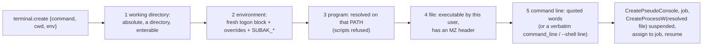

# Subak PTY and shell process management

Status: **current** (implemented in Step 11, verbatim command lines in Step 12; Windows only) · Decision:
[ADR 0025](adr/0025-pane-programs-environment-and-backpressure.md) · Builds on
[ADR 0004](adr/0004-pty-and-process-ownership.md), [ADR 0016](adr/0016-conpty-host-validation.md)
([CONPTY_PROOF](CONPTY_PROOF.md)), [ADR 0019](adr/0019-secure-host-supervisor-and-ipc-v1.md),
[ADR 0020](adr/0020-terminal-session-lifecycle.md) ([SESSION_MODEL](SESSION_MODEL.md)),
[ADR 0011](adr/0011-portability-boundary.md) · Requirements: `SUBAK-FR-001`, `SUBAK-FR-003`,
`SUBAK-FR-011`, `SUBAK-FR-013`, `SUBAK-FR-016`, `SUBAK-FR-070`, `KIM-SEC-013`, `KIM-NFR-011`,
`KIM-NFR-013`

This document says what runs in a pane, where, with which environment, how its terminal I/O,
signals and exit status travel, how its process tree is contained, and what keeps a slow client
from hurting anyone. Every "measured" line comes from a run on Windows 10 Pro 22H2 (build
19045.6466, inbox ConPTY) listed in §10; the same tests run on every push on the
`windows-2025` CI runner.

Code: [`crates/subak/src/pty.rs`](../crates/subak/src/pty.rs) (the platform-neutral interface),
[`win/launch.rs`](../crates/subak/src/win/launch.rs) (what to start, Windows),
[`win/conpty.rs`](../crates/subak/src/win/conpty.rs) (pseudo console and job),
[`host.rs`](../crates/subak/src/host.rs) (reader, fan-out, teardown).

## 1. Starting a pane

Steps 1–5 create no OS object. A start that fails there leaves nothing behind, not even the handle
Windows 10's ConPTY keeps per pseudo console (§9). Only failures that `CreateProcessW` alone can
detect (a corrupt image it can read, policy blocks) happen after the pseudo console exists; it is
then closed at once.

## 2. Programs

| What | Default and rules |
| --- | --- |
| No command | `%ComSpec%` of the Host (normally `C:\Windows\system32\cmd.exe`), no arguments |
| Command Prompt | `-- cmd.exe /d` (or `cmd`); `/d` skips `AutoRun`, without it cmd runs the user's `AutoRun` as usual |
| Windows PowerShell 5.1 | `-- powershell` resolves to `%SystemRoot%\System32\WindowsPowerShell\v1.0\powershell.exe`; `-NoLogo`, `-NoProfile` are the user's choice |
| PowerShell 7 | `-- pwsh`, found wherever the user installed it on `PATH` (MSI, zip, or the Store's App Execution Alias in `%LOCALAPPDATA%\Microsoft\WindowsApps`). **Subak never installs it.** When it is missing, `spawn_failed` (`not_found`) says so and names `powershell` as the inbox alternative; `subak new --dry-run -- pwsh` detects it without starting anything |
| Any program | `-- <program> [args…]`: each argument is one word |

**Resolution** (`win::launch::resolve`; the Host does it itself, ADR 0025 §1):

- A **bare name** (`pwsh`, `git`) is looked up in the directories of the **pane's** `PATH` (the
  logon `PATH` plus overrides, §3), in order, with the `PATHEXT` extensions appended (`python3.11`
  → `python3.11.exe`). Relative `PATH` entries are skipped. The Host's own folder and working
  directory are **never** searched, so a `cmd.exe` planted in the user profile cannot shadow the
  real one (unit test `bare_names_resolve_on_the_panes_path_only`).
- A **path** is taken as given; a relative one is relative to the pane's working directory.
- The resolved file is passed to `CreateProcessW` as `lpApplicationName` and reported as the
  pane's `executable` (and `would_create.executable` of a dry run).
- **Scripts are refused** (`not_executable`): `.bat`/`.cmd` would run through an implicit
  `cmd.exe /c` with cmd's own parsing of every argument, a shell the user did not ask for (the
  class of CVE-2024-24576); `.ps1` cannot start directly. The hint shows the explicit form:
  `-- cmd.exe /d /c C:\path\build.cmd`, `-- powershell.exe -NoLogo -File C:\path\setup.ps1`.
  A bare name that resolves to a batch file on `PATH` (e.g. `npm` → `npm.cmd`) gets the same
  answer.
- A file without an executable header, or one this user may not execute, is refused before any
  pseudo console exists (`not_executable`, `access_denied`). App Execution Aliases (reparse
  points) are left to `CreateProcessW`, which alone can resolve them.

**Command lines.** Windows passes one string; the program splits it. Subak quotes every word by
the rules of `CommandLineToArgvW` and the MSVC runtime (`win::quote_arg`): words without blanks
or quotes stay as they are, others are quoted, backslashes before a quote are doubled, and quotes
are escaped. Checked against the OS parser for 22 hand-picked and 500 generated argument lists
(unit test), and end to end through a real child's runtime (`explicit_programs_…`, §10).
`host serve --shell "<line>"` and, since Step 12, `terminal.create` `command_line` (`subak new
--command-line "<line>"`) pass the user's line **verbatim** (only its first word is resolved, by
the same rules and checks as any program), because a line may rely on the program's own parsing.
The pane reports it as `command_line`, with secret-looking words shown as `***`.

> **cmd.exe.** cmd does not split its command line by those rules; it reads the text after `/c`
> itself. An argument that contains `"` reaches cmd with MSVC escaping (`\"`), which cmd does not
> understand. Use a verbatim line for such text: measured, `cmd.exe /d /s /c "(echo "a  b"&echo
> ^&x&echo two)>"…\out.txt""` wrote `"a  b"`, `&x` and `two`, while the same text as separate words
> wrote nothing ([SUBAK_CLI §6](SUBAK_CLI.md), ADR 0027 §4).

**Working directory** (`cwd`): absolute, existing, a directory, and enterable (opened for
traversal as `CreateProcessW` does). Each failure is `bad_cwd` with the precise cause: does not
exist, is not a directory, access denied. The default is the user profile.

## 3. Environment

A pane's environment has three layers, applied in this order:

| Layer | Source | Notes |
| --- | --- | --- |
| 1. Logon environment | `CreateEnvironmentBlock(user token, inherit = FALSE)`, **built fresh for every pane** | System and user variables from the registry (`HKLM\…\Environment`, `HKCU\Environment`), `USERPROFILE`, `HOMEDRIVE`, `HOMEPATH`, `APPDATA`, `LOCALAPPDATA`, `USERNAME`, `USERDOMAIN`, `LOGONSERVER`, `COMPUTERNAME`, `SESSIONNAME`, the user's `PATH`, `TEMP`/`TMP`, and `HOME` only if the user defined it. A variable set with `setx` or System Properties after the Host started reaches the next new pane (measured, §10), as a new Explorer window would. If the block cannot be built, the Host's own environment (itself the logon block when the client started the Host) minus hidden `=C:` entries is used |
| 2. Overrides | `terminal.create` `env: {NAME: "value" \| null}`; CLI `--env NAME=VALUE`, `--env NAME` (copies the caller's value), `--unset-env NAME` | Applied in order; names compare case-insensitively (character by character, as Windows does); a set replaces any spelling of the name; `null` removes it. At most 256; a name is 1–255 characters without `=` or control characters; a value at most 32 767 UTF-16 units without NUL. Malformed overrides are `invalid_params` (`details.field = "env"`), CLI `usage` |
| 3. Host variables | `SUBAK_PANE_ID=p-…`, `SUBAK_TERMINAL_ID=t-…` (ADR 0010 §1), `SUBAK_ENDPOINT=<the Host's endpoint>` (Step 27, ADR 0061) | Always set last; an override of them is refused |

The block is sorted case-insensitively, as Windows keeps environment blocks, and copied as UTF-16
(values are never passed through a lossy conversion).

**Not inherited:** anything only the launching terminal had (ADR 0003 §6, ADR 0019). Measured: a
launcher with `HOME=C:\launcher-home` (a Git Bash `HOME`), `GITHUB_TOKEN`, `CLAUDE_CODE_SESSION_ID`
and a custom variable started the Host; the pane saw none of them (§10). A Claude Code or agent
session that runs `subak new` therefore does not leak its tokens into the pane. To pass
one deliberately, name it: `--env GITHUB_TOKEN` copies the caller's value, so the token never
appears on a command line (`--env NAME=VALUE` does put the value on the CLI's own command line,
which other processes of the same user can read; prefer `--env NAME` for secrets).

**The user's tools keep their locations.** Git for Windows (`%USERPROFILE%\.gitconfig` when `HOME`
is unset), Windows OpenSSH (`%USERPROFILE%\.ssh`; its agent is the `ssh-agent` service on a fixed
pipe, no variable needed) and Claude Code (`%USERPROFILE%\.claude`, or `CLAUDE_CONFIG_DIR` if the
user set it persistently) derive their locations from layer 1, which is the user's own
(`USERPROFILE`, `HOMEDRIVE`+`HOMEPATH`, `APPDATA`, `LOCALAPPDATA` measured equal to the user's,
§10). Credential stores (Windows Credential Manager, used by Git Credential Manager) work because
the Host runs as the user in the user's logon session. A variable the user wants in every pane
but defined only in one terminal (e.g. a non-Windows `SSH_AUTH_SOCK`) is passed with `--env`.

**Secrets** (`KIM-SEC-013`, CLI_CONTRACT §10): override **values are used once, to build the
block, and never stored, logged or shown**. Panes report only the names
(`env: {set: [...], unset: [...]}` in `terminal.info`, `terminal.list` (full), `terminal.create`,
`terminal.created`, and dry runs); error messages name a variable but never echo a value. Measured:
17 documents and streams (create, info, list, `host status`, `host.stats`, dry runs, a failed start,
`-v` diagnostics, every event) contained neither an explicit nor a copied value (§10). Arguments
keep the Step 10 redaction (`--token=***`) and, since Step 16, go through the same detector as
captures, so token shapes inside an argument or a verbatim command line (`cmd.exe /c "echo
ghp_…"`) are hidden too (CLI_CONTRACT §10). Subak writes no log files.

## 4. Terminal I/O

- **Size.** The pane starts at `--size` (default 120×30) or the attaching client's size;
  `pane.resize` calls `ResizePseudoConsole`. Measured: 401 resizes pipelined on one connection
  while `ping -t` printed were all answered in 16–20 ms, and the last size (97×33) reached the
  shell (`mode con`) and `terminal.info`.
- **Unicode.** ConPTY's input and output pipes are always UTF-8 and VT, independent of the pane's
  console code page; the Host passes bytes through unchanged, and a UTF-8 character split across
  input frames (even one byte per frame) arrives whole (conhost decodes incrementally). Korean
  typed into cmd and PowerShell and Korean printed by them round-tripped (§10). The pane's
  console **code page** is the system's default for new consoles (65001 on the measuring machine,
  whose system locale uses UTF-8; usually the OEM code page such as 437 or 949): Unicode console
  programs (cmd, PowerShell, most tools) are unaffected, byte-oriented programs follow the code
  page exactly as in any console window, and `chcp 65001` or PowerShell's
  `[Console]::OutputEncoding` change it per pane. Subak does not change it (ADR 0025 §4).
- **Ctrl+C** is the input byte `0x03`; ConPTY turns it into `CTRL_C_EVENT` for the pane's
  processes (the Host first clears the "ignore Ctrl+C" flag `CREATE_NEW_PROCESS_GROUP` would give
  them, ADR 0016). Measured: `ping` in cmd interrupted within 15 ms; `Start-Sleep` and a native
  `ping` in PowerShell interrupted, the shells kept running. PowerShell discards keys typed while
  it stops a pipeline, as it does in any console.
- **Ctrl+Break** is **not delivered**: VT input has no encoding for it, and the Windows 10 inbox
  ConPTY ignores a win32-input-mode `VK_CANCEL` key event (measured with four encodings; `ping`
  printed no statistics). Delivering `CTRL_BREAK_EVENT` would need the Host to attach to the
  pane's console; that is deferred (§11). A Ctrl+Break pressed in an attaching console reaches
  only that client.
- **win32-input-mode requests** (`ESC[?9001h`) from newer ConPTY builds are dropped by the
  attaching CLI client, as Step 08 found.

## 5. Exit status

When a pane's root process exits, the Host records its exit status: `last_exit.exit_code` in
`terminal.info` (for a Terminal kept as `stopped` with `--remain-on-exit`, or stopped explicitly)
and `exit_code` in the `pane.exited` event (always, also when the Terminal is then removed).
Measured: 42 (`cmd /c exit 42`), 9 (`powershell -Command exit 9`), 3 (removed; event only),
0 (a test program), and `0xC000013A` (`STATUS_CONTROL_C_EXIT`, what a console program returns when
its console closes or Ctrl+C ends it). Human output shows NTSTATUS-like values in hex as well
(`3221225786 (0xC000013A)`). A Terminal ended by `kill` reports exit code 1 and `forced: true`.

## 6. Process tree containment

Every pane's root process is created suspended, assigned to a new kill-on-close job, then
resumed (ADR 0004). Descendants stay in the job: the job does not allow breakaway, so a child
asking for `CREATE_BREAKAWAY_FROM_JOB` is refused with access denied (measured from inside a pane).
When the root exits by itself, whatever it left in the job is terminated during teardown
(`forced: true`); killing a Terminal ends its whole tree and nothing of the others. The job may
first take up to 1 s to empty: Windows takes an exiting process out of its job only after it has
woken the threads that wait for its exit, so right after the root's exit the job still counts it
(measured: in 300 of 300 runs of `cmd /c exit 42`, for up to 3.8 ms on an idle machine, longer
under load). Checking at once reported a program that ended by itself as `forced: true` under a
parallel build (found in Step 73's run, fixed in Step 19; `host::tests::a_job_that_empties_just_after_its_root_exits_ended_by_itself`,
`pty_shells.rs::programs_that_end_by_themselves_are_never_reported_forced`). Each shell is
a direct child of the Host with its own `conhost.exe` (the pseudo console host, which is not in
the job and ends with `ClosePseudoConsole`). Measured with cmd and Windows PowerShell side by
side, each with a background `ping` (§10).

## 7. Backpressure and memory

- **Output.** One reader thread per pane drains ConPTY continuously (a full pipe would block the
  pane's programs) and never waits for a client: each chunk goes to the pane's terminal model (Step 13,
  [SCROLLBACK](SCROLLBACK.md); until Step 12 a 64 KiB raw replay ring) and, as one data frame,
  to every attached client's send queue. A read also takes whatever is already
  waiting in the pipe, so a backlog becomes one larger chunk. Frames are shared (`Arc`) by all
  clients of the pane, so several slow clients hold one copy of the output.
- **Send queue per connection:** bounded by **16 MiB, counting each frame's bytes plus 64**
  (IPC_PROTOCOL §1). The writer thread sends runs of small frames in one write. Output for a client
  that falls that far behind is skipped: its queued output is dropped, and once it has caught up
  it gets `pane.resync` and a fresh snapshot (Step 13, [SCROLLBACK §5](SCROLLBACK.md);
  `ipc.lagging_resyncs`, `ipc.output_frames_skipped`); until Step 12 it was disconnected. A
  control message that does not fit still disconnects (`ipc.lagging_clients_dropped`). The pane
  and the other clients are never slowed. (Until Step 11 the queue was also limited to 4096
  frames; ConPTY on Windows 10 delivers ~83-byte chunks at full speed, so that limit dropped a
  client after about 0.35 s of lag.)
  Measured: 20 MiB typed through ConPTY reached a reading client in 21–26 s (0.8–0.9 MiB/s; the
  inbox conhost is the bottleneck: 1.0 MiB/s in-process without any client) as ~253 000 frames of
  ~83 bytes; two attached clients that never read were dropped (Step 11) — since Step 13 they
  stay connected and are resynced (0.85 MiB/s, peak +26 MiB); the Host's peak private memory
  grew by 21 MiB; `host.health` answered within 2 ms throughout.
- **Input** is written to the pane synchronously by the connection that sent it, so a client that
  types faster than the pane accepts waits on its own connection; nothing is buffered in the
  Host. conhost itself keeps reading input into its console input buffer even while the program
  does not read (measured: ~0.7 MB/s accepted for a `ping` that never reads). Measured: during an
  input flood into such a pane, another client's commands and `host.health` round trips stayed
  under 20 ms, and killing the flooded Terminal took 40–46 ms. conhost's buffer of unread input is
  outside the Host's control (§11).
- `host.stats` reports `host.memory.{working_set_bytes, private_bytes, peak_private_bytes}` and
  `host.handle_count` (local metrics, ADR 0012).

## 8. The platform-neutral interface

`pty::Pty` is what the Host needs from a platform for one pane: `pid`, `take_output` (a byte
stream), `write_input`, `resize`, `close` (graceful), `wait_exit`, `running`, `processes` and
`kill_tree`. `pty::spawn(&Spec)` starts one and `pty::plan(&Spec)` checks one without starting it
(dry runs); `Spec` carries the program as named, its arguments (or a verbatim line), the working
directory, the overrides, the Host's variables and the size. Failures are `pty::SpawnError` with a
stable `Reason` (§9). Windows implements it with ConPTY and a job (`win::launch`,
`win::conpty::ConPty`); every other target gets a stub that answers `unsupported_platform`
(ADR 0011). It covers both rows `Pty` and `ProcessTree` of ADR 0011 §1 for a pane, because the
pseudo terminal and the container are created together; the foreground-process query of
`ProcessTree` comes with Step 21. The Linux Host (M4, `SUBAK-FR-070`) implements the same trait
with `openpty` and a process group or cgroup.

## 9. Errors

`spawn_failed` (CLI exit 1) carries `details.reason`, a `hint` when there is a next step, and
`os_error` when the OS reported one. Messages name the program and directory, never an
environment value.

| `reason` | When (examples measured in §10) |
| --- | --- |
| `not_found` | a path that does not exist; a bare name not on the pane's `PATH`; `pwsh` when PowerShell 7 is not installed (hint: Subak never installs it; use `powershell`) |
| `not_executable` | a batch or PowerShell script (hint: the explicit interpreter form); a file without an executable header; an image for another machine type (os error 216, also what Windows 10 reports for a text file named `.exe` that passes the header check) |
| `access_denied` | the user may not execute the file (os error 5); software restriction or application control policy (1260, 4551); a program that requires elevation (740: Subak never elevates, and `CreateProcessW` never shows a UAC prompt) |
| `bad_cwd` | the working directory does not exist, is not a directory, is relative, or cannot be entered |
| `other` | anything else, e.g. a command line longer than 32 766 characters |

Malformed parameters (`env`, `command`, `cwd` not absolute, `size`) are `invalid_params` before
anything is reserved; `profile` is still refused until Step 33.

**OS limitation (measured):** Windows 10's inbox ConPTY keeps one handle per pseudo console after
`ClosePseudoConsole`, also for one that never ran a process (50 bare create/close pairs: +53
handles in the creating process; 50 full sessions: +50, i.e. nothing beyond it). A Host that has
run N panes holds about N such handles until it exits. The bounded tests (§10) allow exactly that
and fail on any leak of Subak's own (a pane's pipes, job, process and thread are about 8 handles).
A newer ConPTY (bundling is decided in Step 15) may not have it.

## 10. Evidence

`cargo test -p subak --test pty_shells -- --nocapture` (16 tests, 26 s) and the unit tests
(`cargo test -p subak --bin subak`, 65 tests), on the machine above, 2026-11-04. `EVIDENCE` lines
print the numbers. PowerShell 7 is not installed on this machine, so its branch of the first test
ran only on the CI runner (which ships it; the test fails on CI if it is missing).

| Test | Shows |
| --- | --- |
| `powershell_and_cmd_run_interactively_in_independent_trees_under_the_host` | cmd and Windows PowerShell 5.1 (and pwsh on CI) interactive, each a child of the Host with its own conhost and job; a background `ping` in each; killing one Terminal ended its shell and `ping` only |
| `explicit_programs_get_their_arguments_exactly_and_report_exit_codes` | 10 tricky arguments (empty, quotes, backslashes, `%^&\|<>()`, Korean, trailing backslash) arrive unchanged in a real child's runtime; the working directory, `SUBAK_PANE_ID`/`SUBAK_TERMINAL_ID`, a Unicode override and an unset arrive; the launcher's variable does not; breakaway is refused; exit codes 0, 42, 9, `0xC000013A`, 3 in `terminal.info` and `pane.exited` |
| `startup_failures_are_precise_and_leave_nothing_behind` | 10 failure kinds × 3 rounds (§9 table, scripts on `PATH`, a denied file and a denied directory via `icacls`): precise reasons and hints, no Terminal, conhost or child left, Host handles 81 → 83 over 30 failures; dry runs check the same; malformed and reserved overrides refused; `keep_on_failure` keeps `not_executable` |
| `ctrl_c_and_unicode_reach_programs_in_cmd_and_powershell` | §4 Ctrl+C and Unicode |
| `resize_storms_and_input_floods_never_block_the_host` | §4 resize storm, §7 input flood |
| `large_output_streams_to_fast_clients_while_stalled_ones_are_resynced` | §7 output numbers |
| `the_pane_environment_keeps_the_users_locations_and_secrets_never_leak` | §3 layers, locations and the 17 leak checks |
| `many_shell_runs_and_failed_launches_do_not_leak_host_handles` | 20 refused launches: 88 → 88 handles; 20 cycles (an exiting program, a failed launch, a shell typed into, resized and killed; 40 pseudo consoles): 88 → 128, the OS's one per pseudo console |
| `each_new_pane_gets_a_fresh_logon_environment` (ignored; run by hand) | a variable written to `HKCU\Environment` after the Host started reached the next new pane, and the panes before and after it did not; the variable was removed again |
| unit: `quoting_round_trips_through_the_os_parser`, `bare_names_resolve_on_the_panes_path_only`, `paths_extensions_and_scripts`, `unusable_program_files_are_refused_before_any_os_object_exists`, `working_directories_are_checked_precisely`, `overrides_replace_remove_and_add_case_insensitively`, `sessions_hold_no_handle_beyond_the_one_the_inbox_conpty_keeps`, `preparing_a_start_holds_no_handle`, `env_overrides_are_validated_without_echoing_values` | §2, §3, §9 |

The e2e scenario is `e2e/tests/step11_pty_shells.rs` (release binaries; run only by
`cargo xtask e2e`, AGENTS.md §4).

## 11. Not done, limits and where they go

- **Ctrl+Break** is not delivered (§4); attaching to a pane's console to raise
  `CTRL_BREAK_EVENT` is a candidate for `pane.send_keys` (Step 24). An attaching `subak` uses Ctrl+Break to detach itself ([SUBAK_CLI §5](SUBAK_CLI.md)).
- **A verbatim command line** (for cmd's own quoting, §2): done in Step 12 (`command_line`,
  [SUBAK_CLI §6](SUBAK_CLI.md)); Step 29 must persist it for respawn.
- **Profiles** (`profile`, shell presets, `TERM`): Steps 25 and 33. **Persistence** of the
  non-secret environment (`SUBAK-FR-040`): Step 29; values are never persisted today because they
  are never stored.
- **Lagging clients** are disconnected, not resynchronized: Step 13.
- **conhost's input buffer** grows while a program does not read its input; the Host cannot see
  or bound it.
- **One handle per pseudo console** kept by the Windows 10 inbox ConPTY (§9); Step 15 decides
  about bundling a newer ConPTY.
- **Exit detection** waits on the root process handle; the job's completion port (ADR 0004 §5)
  is not used, since leftovers are terminated at teardown anyway.
- **Linux**: the stub only (M4).
