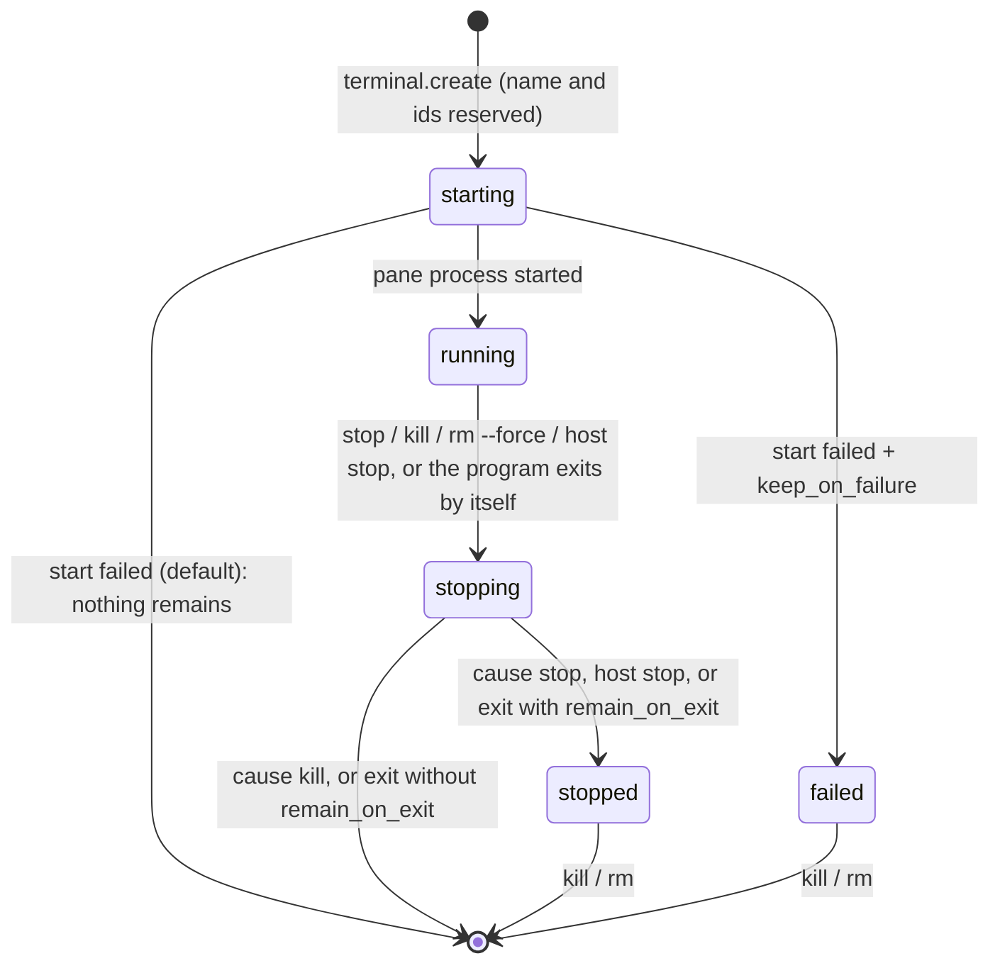

# Subak session model

Status: **current** (implemented in Step 10, pane programs and environment in Step 11, CLI verbs and detaching other clients in Step 12, pane screens and history in Step 13, internal windows and panes in Step 21; Windows only) · Decisions:
[ADR 0020](adr/0020-terminal-session-lifecycle.md), [ADR 0007](adr/0007-object-identity-and-naming.md),
[ADR 0003](adr/0003-subak-host-process-model.md), [ADR 0004](adr/0004-pty-and-process-ownership.md),
[ADR 0009](adr/0009-gui-clients-and-keyboard-dispatch.md), [ADR 0027](adr/0027-subak-cli-structure-and-headless-control.md),
[ADR 0030](adr/0030-host-terminal-model-scrollback-and-replay.md),
[ADR 0054](adr/0054-subak-internal-windows-and-panes.md) · Requirements: `SUBAK-FR-002`,
`SUBAK-FR-003`, `SUBAK-FR-010`…`SUBAK-FR-017`, `SUBAK-SEC-001`

This document states what a Terminal is inside the Host, which states it goes through, how it is
named and addressed, and what every action does to its processes. The wire format is in
[IPC_PROTOCOL §4](contracts/IPC_PROTOCOL.md); the code is `crates/subak/src/session.rs` (the
model, names, targets and the state machine) and `crates/subak/src/host.rs` (pseudo consoles,
jobs, threads and events).

## 1. Objects and identity

A Terminal is a named workspace owned by exactly one Host. It contains Windows, a Window contains
Panes, and each Pane runs one root process with its descendants:

| Object | Id | Human name | Owns |
| --- | --- | --- | --- |
| Terminal | `t-` + 12 lowercase hex | unique per Host (§3) | ≥ 1 Window; `remain_on_exit`; its lifecycle state |
| Window | `w-` + 12 hex, index from 0 (the lowest free one; kept) | automatic: its first program's file name (`cmd`) until renamed; need not be unique (§3) | ≥ 1 Pane; layout (one pane, its active one, until Step 22); active pane |
| Pane | `p-` + 12 hex, index from 0 (contiguous; renumbered when a pane goes) | — | one pseudo console (ConPTY), one kill-on-close job, a terminal model with its screen and bounded history (Step 13, [SCROLLBACK](SCROLLBACK.md)), a data stream id; its program, environment and I-O: [PTY_PROCESSES](PTY_PROCESSES.md) |

- **Windows and panes (Step 21, [ADR 0054](adr/0054-subak-internal-windows-and-panes.md)).** A
  Terminal holds any number of internal windows (a window is *not* a GUI tab: a tab is a Terminal),
  each with any number of panes, up to 64 panes per Terminal and 512 running panes per Host
  (`busy` beyond). Every pane runs its own process under its own pseudo console and job. The
  **active window** of a Terminal and the **active pane** of each window are the Host's, the same
  for every client; a Terminal- or window-level target means the active pane. Until Step 22 adds
  splits, a window's layout is one pane, its active one (a window shows one pane at a time). A
  new Terminal still starts with one window and one pane.
- **Isolation.** Each Pane has its own pseudo console and its own job object (ADR 0004). Ending
  one pane's job never touches another pane's or Terminal's processes (Step 21: killing a pane
  or window ended only its processes while the other panes and Terminals kept running,
  `windows_panes.rs`). Measured: killing a Terminal
  ended its shell and a `ping` it had started, while a second Terminal's shell and `ping` kept
  running (`zero_one_and_many_terminals_have_isolated_process_trees`).
- **Ids** are random 48-bit values. The Host remembers every id it has issued and never issues one
  again, even after the object was removed. Across Host restarts, uniqueness rests on the 48 bits
  until Step 29 persists the issued ids. A pid is a volatile hint, never an identity.
- **Order.** Terminals are listed in creation order, which is the order of GUI tabs.
- **Limit.** A Host owns at most 256 Terminals (live and stored); more get `busy`.

## 2. Lifecycle state machine

One state machine applies to every Terminal. `session::next` is this table; the Host changes a
state in no other way, and emits the event in the same critical section as the change.

| State | Meaning | Live (keeps the Host) | Allowed |
| --- | --- | --- | --- |
| `starting` | Ids and name reserved; the pane process is being started (milliseconds) | yes | info, list, rename. stop/kill/rm answer `invalid_state` ("try again") |
| `running` | The pane process runs | yes | attach, input, resize, rename, stop, kill, rm `--force` |
| `stopping` | Its processes are being ended (§4) | yes | info, list, rename; a second stop waits for the same teardown; a kill escalates it |
| `stopped` | Kept without a process: stopped explicitly, or exited with `remain_on_exit` | no | info, list, rename, kill, rm |
| `failed` | Kept after its start failed (only with `keep_on_failure`); the reason is kept | no | info, list, rename, kill, rm |

What causes the end of a running Terminal decides where it goes. When several causes meet (a kill
during a graceful stop), the strongest wins: `kill` > `stop` > `exited` > `host stop`.

| Cause (`last_exit.cause`) | Started by | Then |
| --- | --- | --- |
| `stopped` | `terminal.stop` | `stopped` |
| `killed` | `terminal.kill`, `terminal.remove` with `force` | removed |
| `exited` | the pane's root process exited by itself | removed, or `stopped` with `remain_on_exit` (tmux semantics) |
| `host_stopped` | `host.stop` with `kill_terminals` (or the Host's idle exit, which happens only with no live Terminal) | `stopped`, then the Host exits |

Events (topic `terminals`, IPC_PROTOCOL §5): `terminal.created` (with the whole Terminal, state
`starting`), `terminal.state_changed` (`state`, `previous_state`, `cause`), `terminal.renamed`,
`terminal.removed` (`reason`: `killed`, `removed`, `exited`, `spawn_failed`, `host_stopping`), and
`pane.exited` (topic `panes`, after the pane's last output). A failed start emits `created` and
then `removed` (or `state_changed` to `failed`), so a client that saw the Terminal also sees it go.

`restorable` and `unknown` (ARCHITECTURE §4.2) belong to persistence and recovery (Steps 29–30)
and are not produced yet.

**Windows and panes in the lifecycle (Step 21).** The state machine stays per Terminal. A
Terminal is `running` while any of its panes runs. Its end (stop, kill, `rm --force`, Host stop)
ends **every** pane of every window in parallel and then applies the table above once; `stopped`
keeps every window and pane with its screen. A pane whose program exits **while other panes of the
Terminal run** leaves alone: `pane.exited`, then `pane.removed` (`reason: exited`), and
`window.removed` when it was its window's last pane (tmux closes such a pane too; a per-pane
`remain-on-exit` is not implemented). The exit of the **last running pane** is the Terminal's own
end, `exited` as before (removed, or `stopped` with `remain_on_exit`). A Terminal therefore always
has at least one window with one pane. Windows and panes are created and ended only while the
Terminal is `running` and nothing ends it (`invalid_state` otherwise); selecting and renaming work
in every state.

## 3. Names and targets

**Terminal names** (ADR 0007, refined by ADR 0020):

1. The name is Unicode-NFC-normalized, then trimmed. What remains must have 1–64 characters.
2. Not allowed: control characters, invisible formatting characters that could make two names look
   alike (bidirectional overrides, zero-width characters, the byte order mark, line and paragraph
   separators, soft hyphen), `:` and `.` (they separate the parts of a target), a leading `-` (it
   would read as an option), and anything shaped like an id (`t-`/`w-`/`p-` + 12 hex digits, in any
   case). Violations are `invalid_name` (CLI exit 2).
3. **Uniqueness ignores case and composition.** Two names collide when their keys are equal: the
   NFC form, lowercased with the locale-independent Unicode mapping, NFC-normalized again. So
   `Work`, `work`, `WORK` and ` Work ` are one name, and a Hangul name typed composed (`서버`) or
   decomposed equals itself. The case the user typed is kept for display.
4. A collision is `name_conflict` (CLI exit 7) with `details.existing` naming the holder.
   **Nothing is ever renamed or suffixed silently**, so scripts see the conflict.
5. Without a name, a Terminal gets the lowest positive integer no Terminal uses as its name (`1`,
   `2`, …); a freed number is reused. An explicit numeric name takes that number away from the
   default rule.
6. **Rename** keeps the id, the processes and every attachment. Changing only the case of one's
   own name is allowed. Renaming to another Terminal's name is `name_conflict`.
7. Name checks and reservations happen under the Host's single lock: of several concurrent
   creates or renames to one name, exactly one succeeds (measured with 8 concurrent creates and
   with mixed concurrent renames and creates).

**Window names** (Step 21): the Terminal name rules 1–2 and 6 apply (NFC, trimmed, 1–64
visible characters, no `:` or `.`, no leading `-`, nothing id-shaped), and a window name must not
be only digits (a target reads digits as the window's index). Window names need **not** be unique
(tmux semantics); a target naming several windows is `ambiguous_target` with the candidates. A
window is named after its first program (`automatic_name: true`) until it is renamed. Window
indexes start at 0; a new window takes the lowest free index and keeps it while it lives, and
windows are listed by index. Pane indexes are contiguous within a window from 0 and are renumbered
when a pane goes (tmux); ids never change.

**Targets** (ADR 0007): `<terminal>[:<window>[.<pane>]]`, or an id alone. The Terminal part is a
name or a `t-` id, the window an index, a name (window names need not be unique: several matches
are `ambiguous_target`) or a `w-` id, the pane an index or a `p-` id. Names match exactly,
ignoring case as above; nothing matches by prefix. `terminal.*` operations take only a Terminal
(name or `t-` id): a pane or window id there is `invalid_params`, so no command ends a whole
Terminal through a pane reference. `pane.attach` takes any level (a Terminal or Window means its
active pane), or no target when the Host has exactly one running pane (`ambiguous_target` with the
candidates otherwise). The CLI targets the confirmed Terminal **by id** after asking, so a rename
between the question and the action cannot redirect it.

Step 21 makes every window and pane operation take **exactly one level**: `window.create`,
`window.list` take a Terminal; `window.select`, `window.rename`, `window.kill` a window;
`pane.create` and `pane.list` a Terminal (its active window, or all windows) or a window;
`pane.select` and `pane.kill` a pane. Any other level is `invalid_params` (CLI `usage`), so no
window or pane command ends a whole Terminal and no Terminal command acts through a window or pane
reference. A window or pane id is looked up only inside the Terminal the target names: another
Terminal's `w-`/`p-` id under `work:` is `target_not_found`, never that other Terminal's object.
`subak window kill` and `pane kill` act on the confirmed **id** after asking.

**Splits and the layout** (Step 22, [ADR 0056](adr/0056-subak-pane-splits-and-layout.md)). Each
window has a **layout**: a tree of splits over its panes, in cells, owned by the Host. A
*horizontal* split puts panes side by side (tmux `-h`), a *vertical* one stacks them (tmux `-v`,
the default); siblings are one cell apart (the border). `pane.split` (`subak pane split`) splits the
target pane (a window or Terminal target: its active pane) and starts a new pane at half of it, or
at `cells`/`percent`; `pane.create` is a vertical split of the window's active pane. Panes are
listed and indexed in layout order (left to right, top to bottom). Every pane keeps at least 2×2
cells; a split that cannot is refused with nothing changed. The **window's size** is the latest
interactive client's (a client's attach size or `pane.resize`), shared out among its panes; each
pane's pseudo console gets exactly its share whenever it changes. `pane.adjust` moves a pane's
border (`subak pane resize`), `pane.swap` exchanges two panes' places (processes stay with their
panes), `pane.zoom` lets one pane fill the window (the others keep their sizes, unseen; selecting
another pane unzooms), and `pane.select` takes a direction (`left/right/up/down` by geometry,
`next/previous` by index; both wrap). A closed pane's space goes to its neighbour. Every change
is announced as `window.layout`; window objects carry `layout`, `size` and `zoomed`, pane objects
`rect` and `visible`. No layout change starts or ends a process; the layout stays while clients
come and go.

## 4. Actions and what they do

These meanings are fixed. No action has two of them, and there is deliberately **no `close`**
command or IPC method: "close" in a UI is always one of the rows below.

| Action | CLI / IPC | Processes | Stored Terminal | Consent |
| --- | --- | --- | --- | --- |
| Detach a client | `Ctrl+B d`, Ctrl+Break, end of piped input / `pane.detach` | untouched | untouched | none |
| Detach other clients (from another terminal or a script; Step 12) | `subak detach <terminal>`, `subak detach --client <id>` / `client.detach` | untouched | untouched | none (it ends nothing) |
| A client disconnects or crashes; a console window running `subak attach` is closed | — | untouched | untouched | none |
| Close a GUI window, quit the GUI, a GUI crash (Steps 16–18) | detach | untouched | untouched | none |
| Close a GUI **tab** with its ×, a middle click or "Hide tab" (Step 17) | detach of that tab's pane (`pane.detach`) | untouched | untouched; still listed by `subak ls` and (Step 18) the session manager | none |
| **Stop**: end the processes, keep the Terminal | `subak stop` / `terminal.stop` | graceful, then a guarded force (below) | kept as `stopped` | CLI: ask or `--yes` while it runs. Host: `force` when busy |
| **Kill**: end the Terminal | `subak kill` / `terminal.kill`; GUI `Ctrl+W` "Close Terminal" (Step 17) | ended at once (`TerminateJobObject`) | removed | CLI: ask or `--yes`, always. Host: `force` when busy. GUI: sends no `force` first; on `busy` it asks in the window (Cancel is the default) and only "End Terminal" sends `force`, by id |
| **Remove** a Terminal that runs nothing | `subak rm` / `terminal.remove`; GUI `Ctrl+W` or "Remove Terminal" on a stopped or failed tab (Step 17) | none (a running one is refused: `invalid_state`) | removed | CLI: ask or `--yes` (it deletes the record). GUI: none (no process ends) |
| Remove a running Terminal | `subak rm --force` / `terminal.remove` with `force` | as kill | removed | as kill |
| Stop the Host | `subak host stop` / `host.stop` | every live Terminal ends as `host_stopped` | gone with the Host (until Step 29) | refused with live Terminals unless `--kill-terminals` (`terminals_running`), then ask or `--yes`; IPC `kill_terminals` |
| The program exits by itself | — | already ended; leftovers in its job are ended | removed, or `stopped` with `remain_on_exit` | — |
| Select a window or pane (Step 21) | `subak window select`, `pane select` / `window.select`, `pane.select` | untouched; clients showing the Terminal follow the selection (the GUI detaches the old pane and attaches the new one) | untouched | none |
| **Kill a window or pane** (Step 21) | `subak window kill`, `pane kill` / `window.kill`, `pane.kill` | that window's panes (or that pane) ended at once (`TerminateJobObject`); every other pane keeps running | the pane leaves, a window with its last pane; the Terminal stays. The last running window or pane is refused (`invalid_state`, `last_window`/`last_pane`): `kill` ends a Terminal | CLI: ask or `--yes`, always, then by id. Host: `force` when a pane is busy |
| A pane's program exits while others run (Step 21) | — | already ended; leftovers in its job are ended | the pane leaves (`pane.removed`, `exited`), a window with its last pane | — |

- **Graceful, then a guarded force** (stop, host stop): `ClosePseudoConsole` sends
  `CTRL_CLOSE_EVENT` to the processes attached to the pseudo console, the Host waits up to 5 s for
  the root process, and only then terminates whatever is left in the pane's job. The force step
  happens only inside a stop someone consented to, and is reported (`forced: true`). Measured on
  Windows 10 19045: an idle `cmd.exe` ends gracefully with `0xC000013A` (`forced: false`); a
  `ping` started in the background with `start /b` ended with the same stop.
- **Immediate** (kill, rm `--force`): the job is terminated first, then the pseudo console closed.
- **Busy.** A Terminal is busy when it runs more than an idle shell: its root program is not a
  known shell (`cmd`, `powershell`, `pwsh`, `bash`, `sh`, `zsh`, `fish`, `nu`), or its job holds
  more than one process. The Host refuses to stop, kill or force-remove a busy running Terminal
  without `force` (`busy`, CLI `confirmation_required`), with the processes in `details`. This is
  the Host-side guard against a client that decided "idle" a moment too early (ADR 0009's `Ctrl+W`
  rule): an idle shell may be closed without a question, anything else needs a confirmation. The
  rule is a heuristic over the job; a shell that waits in the foreground for a child shows as busy,
  which errs on the safe side.
- **The CLI is stricter than the Host**: `stop`, `kill` and `rm` are `destructive`
  (CLI_CONTRACT §4) and always ask, or need `--yes` when they cannot ask, also for an idle shell.
  Only after that consent does the CLI send `force`. `--dry-run` shows the plan (`busy`,
  `processes`, `ends_processes`, `removes_terminal`) and changes nothing.
- **One teardown.** Ending a pane is claimed once under the lock. Whoever claims it (a stop, a
  kill, a Host stop, or the pane's own exit waiter) performs it; anyone arriving later waits for
  the same result. A kill that arrives during a graceful stop terminates the job at once and
  decides the outcome (removed). Measured: a stop and a kill sent at the same moment by two clients
  always end with the Terminal removed and no process left; two simultaneous stops share one
  teardown.

## 5. Discovery and IPC operations

`terminal.list {detail: "summary" | "full"}`, `terminal.info {target}`, `terminal.create {name?,
command? | command_line?, cwd?, env?, size?, remain_on_exit?, keep_on_failure?, dry_run?}` (`env`
since Step 11, `command_line` since Step 12; what runs in a pane and with which environment is in
[PTY_PROCESSES.md](PTY_PROCESSES.md)),
`terminal.rename {target,
name, dry_run?}`, `terminal.stop | terminal.kill {target, force, dry_run}` and
`terminal.remove {target, force?, dry_run}` are part of IPC v1 (an additive change; their shapes and
results are in IPC_PROTOCOL §4.3 and typed in `ipc-v1.schema.json`). `cli` and `gui` clients may
call all of them; `mcp` clients may only list and inspect until Step 37; `hook` clients none.

- **Consistent views.** Every change and its event are made in one critical section, and a
  connection receives responses and events in order. A client that first subscribes to
  `terminals` and then lists sees every later change exactly once, after the list.
- **Client crashes leave no stale state.** A connection owns nothing but its subscriptions and
  attachments; when it disappears, they go. A create whose client vanished mid-request completes
  in the Host and is listed normally (measured).
- **Failed creates leave nothing behind.** The name is released, the pseudo console and job of a
  failed start are closed, and no record remains unless `keep_on_failure` asked for a `failed` one.
  Measured: 20 failed starts (missing program, program not on `PATH`, missing working directory, a
  file as working directory) left no Terminal, no `conhost.exe`, no child of the Host, and a
  handle count within 12 of where it started. `spawn_failed` carries `details.reason`
  (`not_found`, `access_denied`, `bad_cwd`, `not_executable` since Step 11, `other`). Since
  Step 11 the Host decides most failures before it creates a pseudo console at all, so they leave
  not even the handle Windows 10's ConPTY keeps per pseudo console (30 failures of 10 kinds: Host
  handles 81 → 83, [PTY_PROCESSES §9](PTY_PROCESSES.md)).
- **A Host stop racing a create**: a pane that finishes starting after the stop began is ended at
  once and its Terminal removed (`reason: host_stopping`); nothing outlives the Host, because every
  pane job is kill-on-close.

**Windows and panes (Step 21, IPC_PROTOCOL §4.4).** `window.create {target, name?, command? |
command_line?, cwd?, env?, size?, history_limit?, select?, dry_run?}` and `pane.create` (the same
without `name`) start a new window with one pane, or a new pane in a window, of a running Terminal;
`select` (default `true`, tmux `new-window` without `-d`) makes it the active one. The ids are
reserved under the lock, the process starts outside it, and the window or pane enters the model,
with its event, only once it runs and if its Terminal still runs and nothing ends it; otherwise the
new process is ended at once (`invalid_state` or `host_stopping`). A failed start leaves no window,
pane or pseudo console (`spawn_failed`). `window.list` and `pane.list` answer `{terminal_id, name,
state, active_window, windows}`; `window.select`, `pane.select {target, dry_run?}`; `window.rename
{target, name, dry_run?}`; `window.kill`, `pane.kill {target, force?, dry_run?}`. Events (topic
`terminals`): `window.created`, `window.renamed`, `window.removed`, `window.selected` (the
Terminal's active window changed), `pane.created`, `pane.removed`, `pane.selected` (a window's
active pane changed), each in the critical section of its change.

**Concurrency and cleanup (Step 21).** Ending is claimed once at two levels. A Terminal's end is
claimed by setting its `ending`: the claimer claims every pane and tears them down in parallel;
a pane someone else already ends is waited for. A pane-level end (`pane.kill`, `window.kill`, a
pane's own exit while others run) claims its panes under the same lock that checked that another
unclaimed pane of the Terminal still runs. So of two clients killing a Terminal's last two panes at
once, exactly one succeeds and the other is refused as the last (measured, 3 rounds); a create
racing a Terminal kill either ends with the Terminal or is refused, and no process is left
(measured, 3 rounds); 6 concurrent `window new` gave indexes 1–6 with distinct ids.

`client.detach {target?, client_id?, dry_run?}` (Step 12) ends other clients' attachments — every
client of a Terminal, window or pane, or one client by the id `host.status` lists — and nothing
else; each detached client learns it from the `pane.detached` event before its output stops.

**Screens and history (Step 13, [SCROLLBACK.md](SCROLLBACK.md)).** Each pane's output feeds a
terminal model with a bounded history (`terminal.create` `history_limit`, default 2 000 rows, and
4 MiB). An attach reproduces it (a snapshot at a `seq`, then live output from that `seq`), so a
client that attaches late sees what one attached from the start sees. The model and its history
belong to the pane: they stay while the Terminal is `stopped` (`pane.capture` still works on it)
and go when the Terminal is removed or the Host exits. Nothing of it is ever persisted yet.
`pane.capture` and `pane.clear_history` read and clear it (`cli` and `gui` clients only).

The CLI (`subak new|ls|info|status|attach|detach|rename|stop|kill|rm|capture|history|clear-history`, [SUBAK_CLI.md](SUBAK_CLI.md),
ADR 0027; `subak terminal <verb>` is the deprecated Step 10 spelling) maps onto these methods. Only
`new` starts a Host on demand (with no Terminal of its own, ADR 0019 §5; `--no-start` forbids it);
`ls` and `status` without a Host report none and start nothing.

## 6. Not implemented yet (and where it goes)

- **Persistence (Step 29).** Nothing is written to `state.json` yet. Terminals end with their Host
  (logoff, reboot, `host stop --kill-terminals`, a crash), and `stopped` or `failed` records are
  forgotten when the Host exits. A Host with only stored Terminals and no client idles out after
  its grace period, because stored Terminals are not live (ADR 0003 §4).
- **Restore and respawn (Step 30).** A `stopped` Terminal cannot be started again yet; remove it
  and create a new one.
- **Profiles** (`profile` of `terminal.create`, Step 33) are refused with `invalid_params`, never
  silently ignored. Environment overrides (`env`) exist since Step 11
  ([PTY_PROCESSES §3](PTY_PROCESSES.md)).
- Layout presets (`select-layout`, `rotate-window`) and moving panes between windows (`join-pane`,
  `break-pane`, Step 25); the prefix keys that switch windows in the GUI (Step 23; the GUI's own
  pane keys exist since Step 22); `last-window`/`last-pane`, `next`/`previous` window and
  multi-target kills (`kill-window -a`); per-pane `remain-on-exit` and dead panes; pane titles;
  window automatic renaming after the *foreground* program (a window keeps its first program's
  name); and `pane.send_keys` (Step 24; Step 12 writes input only through an attach).
  `pane.capture` exists since Step 13.
- **Persisted topology** (Step 29): windows, panes and the selection are kept by the Host for as
  long as it runs (clients may come and go, see §4), not written to disk yet.
- **Persisted history** (Steps 29+): opt-in and off by default when it comes
  ([SCROLLBACK §6](SCROLLBACK.md)).

## 7. Evidence

Automated, on real Windows 10 Pro 19045 with real `subak.exe` Hosts on private endpoints
(`crates/subak/tests/session_lifecycle.rs`; unit tests of names, targets and the state machine in
`crates/subak/src/session.rs`; the e2e scenario `e2e/tests/step10_session_lifecycle.rs`):

| Test | What it shows |
| --- | --- |
| `zero_one_and_many_terminals_have_isolated_process_trees` | 0, 1 and 5 Terminals, one `conhost.exe` each, creation order, default names, events, isolation of process trees |
| `names_are_unique_ignoring_case_and_composition_and_renames_keep_ids` | collisions with case and NFC, invalid names, renames that keep id and pid, targets |
| `concurrent_clients_create_and_rename_without_duplicates_or_orphans` | 8 concurrent creates of one name → one Terminal; 6 unnamed → `1`…`6`; racing renames and a create → one holder; a client killed mid-create |
| `failed_creations_leave_no_pty_job_process_or_record` | 20 failed starts leave nothing; `keep_on_failure` and `rm` |
| `stop_kill_and_rm_have_distinct_explicit_guarded_meanings` | the busy guard, CLI consent, `rm` refusing a running Terminal, stop keeps / kill removes, the stop–kill race |
| `detach_disconnect_and_client_crash_never_stop_a_terminal` | GUI-style attach and disconnect, explicit detach, `Ctrl+B d`, a killed client, reconnect with replay: zero lifecycle events |
| `exits_restarts_and_reconnects_leave_no_stale_state` | exit removes, `remain_on_exit` keeps, reconnects see one state, `host stop` needs `--kill-terminals`, a new Host starts clean |
| `subak_cli.rs::a_user_creates_attaches_detaches_lists_renames_and_kills_with_the_cli_only` (Step 12) | `subak detach <terminal>` and `--client <id>` end attachments only: the shell keeps running, the Terminal stays `running` with 0 clients, the other client stays attached |
| `subak_cli.rs::client_exit_during_attach_leaves_host_work_running` (Step 12) | a killed CLI client and one whose reader vanished leave `ping` running in the Host |
| `scrollback_replay.rs` (Step 13) | reattach reproduces history and screen (shell output, scrolling, `more`, a full-screen program), concurrent attaches lose or repeat nothing, resize, eviction, a stalled client resynced, idle cost, access and redaction ([SCROLLBACK §8](SCROLLBACK.md)) |
| `windows_panes.rs::a_terminal_holds_windows_with_independent_pane_processes` (Step 21) | one Terminal with 3 windows and 5 panes: 5 distinct pane processes, 5 `conhost.exe`, 5 data streams; tmux numbering; the Host's selection and its events; per-pane capture (a marker printed in one pane is in no other pane's screen); renames, digits-only and id-shaped names refused, ambiguous names; every wrong-level target refused (`usage`), another Terminal's window or pane ids not found; the last pane refused; no window or pane change in a stopped Terminal |
| `windows_panes.rs::only_an_intentional_kill_ends_and_only_its_target` (Step 21) | selecting, attaching, `subak detach`, a disconnecting and a crashing client end none of 5 pane processes; a new client sees the same topology and selection; the busy guard (CLI `confirmation_required`, Host `busy` with the plan); `pane kill` ended only its pid, `window kill` only its two panes, a bystander Terminal untouched; pane renumbering; the freed window index reused; the last window and pane refused |
| `windows_panes.rs::exits_stop_and_kill_follow_the_hierarchy` (Step 21) | a pane whose program exits (code 3) leaves with its window, the Terminal runs on; `stop` ends 3 panes and keeps them as `stopped` (capture still works); the last running pane's exit removes the Terminal; `kill` ends 5 panes of 3 windows |
| `windows_panes.rs::concurrent_operations_keep_one_consistent_topology` (Step 21) | 6 concurrent window creates; racing kills of the last two panes (one wins, 3 rounds); creates racing a Terminal kill; 10 failed starts leave no window, pane or `conhost.exe` |
| `milestone_a.rs` (Step 14) | the Milestone A journey and matrix: cmd.exe, PowerShell, a development server grandchild and an interactive program keep their pids and state through every client-side event (a closed console window, killed clients and console hosts, every kind of detach, 16 concurrent clients, 60 cycles); a killed Host ends its panes, a restarted one has no stale Terminal, a hung one is never killed ([MILESTONE_A_VALIDATION](MILESTONE_A_VALIDATION.md)) |
