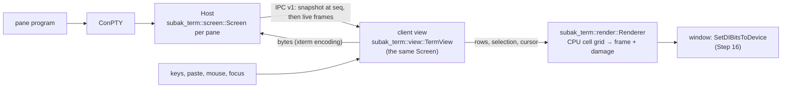

# Terminal emulator and rendering

Status: **current** (implemented, Step 15; the Subak window that uses it is Step 16; search,
keyboard selection, links and paste checks since Step 19, §3.5) · Decisions:
[ADR 0036](adr/0036-terminal-emulation-and-rendering-path.md),
[ADR 0048](adr/0048-subak-search-clipboard-and-links.md) (Step 19) · Builds on
[SCROLLBACK.md](SCROLLBACK.md) (Step 13) · Requirements: `SUBAK-FR-031`, `SUBAK-FR-036`,
`SUBAK-NFR-001`, `SUBAK-SEC-013`, `KIM-NFR-001`, `KIM-NFR-012`, `KIM-NFR-013`

This document describes Subak's terminal emulator as built: the model shared by the Host and
every client view, the client view state, input encoding, the CPU renderer, how they are tested
(conformance fixtures, golden frames, real ConPTY output) and measured (the benchmark harness),
and what is not done yet.

## 1. Components



| Module (`crates/subak-term`) | Role | Runs in |
| --- | --- | --- |
| `screen` | VT parser and xterm-subset screen, bounded scrollback, snapshot, capture | Host (every byte a pane writes) and every view |
| `view` | Viewport over the scrollback, selection and copy, hyperlink hit tests, input routing | client views |
| `input` | Keys, paste, mouse and focus as bytes, under the program's modes | client views |
| `render` (feature `render`) | Colours and themes, glyph cache, rasterizers, cell-grid frame, damage | client views (the Host builds without it) |

`subak-term` has no dependency besides `windows-sys` for the GDI rasterizer, and is checked as a
headless package by `cargo xtask deps-check`. Only `render::gdi` contains OS calls.

## 2. The model: what is emulated

The model is the Step 13 model ([SCROLLBACK §1](SCROLLBACK.md)) moved into `subak-term` and
extended. It interprets:

| Area | Sequences | Notes |
| --- | --- | --- |
| Parser | Paul Williams state machine; C0; ESC; CSI with private markers, intermediates and `:` sub-parameters; OSC (BEL or ST); DCS/SOS/PM/APC consumed | CAN/SUB cancel; an unfinished sequence is replayed in snapshots |
| Text | UTF-8 (invalid bytes → U+FFFD, split reads joined), East Asian wide characters, combining marks, DEC special graphics and UK sets (G0/G1, SI/SO) | Width table: SCROLLBACK §9; emoji presentation is wide |
| Cursor | CUU/CUD/CUF/CUB, CNL/CPL, CHA/HPA, HPR, VPA/VPR, CUP/HVP, IND, RI, NEL, BS, HT, CHT, CBT, DECSC/DECRC, SCOSC/SCORC, DECSCUSR | Pending wrap at the margin as xterm |
| Editing | ED 0/1/2/3, EL 0/1/2, ECH, ICH, DCH, IL, DL, REP, IRM, LNM, DECALN | Background colour erase |
| Scrolling | DECSTBM, SU, SD, origin mode (DECOM) | Only a full-screen region feeds the history |
| Screens | 47, 1047, 1048, 1049 | The alternate screen has no history |
| Rendition | SGR 0–9, 21–29, 30–37/90–97, 40–47/100–107, 38/48 with `5` and `2` (`;` and `:` forms), 39/49, 53/55, `4:n` | 58 (underline colour) parsed, not drawn |
| Modes | DECCKM (1), DECSCNM (5), DECOM (6), DECAWM (7), blink (12), DECTCEM (25), mouse 9/1000/1002/1003 and 1005/1006/1015/1016 (one of each at a time, as xterm), keypad (DECKPAM/DECKPNM); every other DEC mode remembered and replayed (1004 focus, 1007 alternate scroll, 2004 bracketed paste, 2026 synchronized output, 9001 win32-input-mode…) | DECCOLM (3) is ignored: the pane's size is the Host's |
| OSC | 0/2 title (controls removed, ≤ 1024 characters), 8 hyperlinks | OSC 52 and the rest are consumed and ignored (§8) |
| Hyperlinks (OSC 8) | Per cell (a wide character's both cells), `id=` kept, ≤ 2048-byte targets without controls or spaces | Kept in the history (as OSC 8 in the line) and in snapshots |
| Reports | DA1 (`CSI ? 62 ; 22 c`), DA2 (`CSI > 1 ; 10 ; 0 c`), DSR 5, CPR, DECXCPR, DECRQM (ANSI and DEC) | **Only a view answers**, and only when enabled (§3.4); the Host never does |
| Resets | RIS, DECSTR | |

The snapshot ([SCROLLBACK §2](SCROLLBACK.md)) now also reproduces **soft wraps** of screen rows
(a wrapped row is continued, not positioned, so the client's autowrap marks it too) and the
**active hyperlink**, and replays the mouse modes as the single mode each one is.

## 3. The client view

`TermView` wraps the same `Screen` and holds what is only this client's:

### 3.1 Viewport

- `scroll_lines(n)` moves the viewport into the history (up to the lines kept); the alternate
  screen has no history, so the viewport stays live there.
- While scrolled back, new output does not move the lines on screen: the offset grows by the
  lines that entered the history (as in Windows Terminal). Typing, pasting or `scroll_to_bottom`
  returns to the live screen. Switching screens resets the viewport.
- History lines are decoded on demand with the same parser (`Screen::history_row`), cut or
  padded to the view's width (no reflow).
- `cursor_in_view` hides the cursor when its row is below a scrolled-back viewport.

### 3.2 Selection and copy

Positions are `(line, col)` where `line` numbers every line that ever entered the history, so a
selection stays on its text while output scrolls; it is dropped when its first line leaves the
history, on resize and on a screen switch.

| Mode | Gesture (Step 16/19) | What is selected |
| --- | --- | --- |
| `Cell` | click-drag | from one cell to another |
| `Word` | double-click | runs of word characters; delimiters are Windows Terminal's default `` /\()"'-.,:;<>~!@#$%^&*|+=[]{}?│`` |
| `Line` | triple-click | whole logical lines (soft-wrapped rows count as one) |
| `Block` | Alt+drag | a rectangle |

`selected_text()`: a wide character once (starting on its tail cell includes it), combining marks
with their character, trailing blanks of each line removed, soft-wrapped rows joined into one
line, lines separated by `\n` (the Windows clipboard layer converts to CR LF).

### 3.3 Hyperlinks

`link_at(col, row)` returns the target of the cell under the pointer. The view never opens it;
the window shows the target and opens it only on an explicit gesture (Ctrl+click, Step 19)
(`SUBAK-SEC-013`). Since Step 19 `links::link_at` also finds `http(s)://` addresses in the text
(across soft wraps) and `links::validate` checks every target before a window may open it
([SUBAK_GUI §12.4](SUBAK_GUI.md)).

### 3.4 Device reports

Programs ask the terminal for its identity, the cursor position or a mode's state. With several
clients attached, only one must answer: `set_answer_reports(true)` is for the view that owns the
pane's size (the interactive one, ADR 0008); its `take_replies()` are written to the pane. Replies
are bounded (4 KiB) if nobody collects them. On the inbox ConPTY these queries rarely reach a
client (conhost answers its programs itself); on Linux (M4) they will.

### 3.5 Search, highlights and keyboard selection (Step 19)

- `subak_term::search`: literal or `regex` queries (linear time, size and nesting caps, a match
  cap and a time budget, newest lines first) over the view's history and screen, logical line by
  logical line; `Search::refresh` after output re-searches only new history rows and the screen.
  History rows are read as text with `Screen::history_text` (no cell decoding).
- `set_highlights(spans, current)` marks matches; the renderer tints them
  (`terminal.search-match`) and draws the current one dark on `terminal.search-current`, over the
  selection; only the rows involved are redrawn. `reveal(line)` scrolls a line into view below
  the first row (where the window's search bar is).
- `select_span`, `select_all`, `span_text`, `selected_cells` (attributes, for a copy as HTML,
  `render::html`); mark mode: `mark_begin`, `mark_move(Motion, extend)`, `mark_end` (a wide
  character is one place; a growing selection's word moves end on the word's last cell).
- `PasteCheck` (input): whether a paste would run lines (no bracketed paste), carries control
  characters (removed) or is large — the window asks first (`SUBAK-SEC-014`); `one_line` is the
  "paste as one line" clean-up.

## 4. Input

All encoders are pure functions of the event and the pane's `ModeState`.

### 4.1 Keys (xterm encoding)

| Key | No modifier | With modifiers (`m` = 1 + Shift + 2·Alt + 4·Ctrl) |
| --- | --- | --- |
| Arrows, Home, End | `CSI A`…`D`, `CSI H`, `CSI F`; `SS3 …` in application cursor mode (DECCKM) | `CSI 1 ; m A` … |
| Insert, Delete, PgUp, PgDn | `CSI 2~`, `CSI 3~`, `CSI 5~`, `CSI 6~` | `CSI n ; m ~` |
| F1–F4 / F5–F12 | `SS3 P`…`S` / `CSI 15~ 17~ 18~ 19~ 20~ 21~ 23~ 24~` | `CSI 1 ; m P` / `CSI n ; m ~` |
| Enter | CR (CR LF in LNM) | Alt: `ESC CR` |
| Tab | HT | Shift: `CSI Z` |
| Backspace | DEL | Ctrl: BS; Alt: `ESC DEL` |
| Character | UTF-8 | Ctrl: C0 (`A`–`Z`, `@`/Space → NUL, `[` `\` `]` `^` `_`, VT220 digits 2–8, `?` → DEL); Alt: `ESC` prefix |

ConPTY asks its terminal for **win32-input-mode** (9001); the view reports it in `ModeState` and
`encode_win32_key` produces `CSI Vk ; Sc ; Uc ; Kd ; Cs ; Rc _` from the window's key record. The
CLI client does not grant it (Step 12, `OutputFilter`); whether the GUI does is Step 16's choice
(it carries keys xterm cannot express, e.g. Ctrl+Break).

### 4.2 Paste

`encode_paste(text, bracketed)`: CR LF, LF and CR become CR (what Enter sends); every other
control character — C0 except tab, DEL and C1 — is removed, so pasted text can neither end a
bracketed paste early (`ESC [201~`) nor inject escape sequences (`SUBAK-SEC-013`); with mode
2004 the text is wrapped in `ESC [200~` … `ESC [201~`. Whether to ask first is `PasteCheck`
(§3.5); the question is the window's (Step 19, [SUBAK_GUI §12.2](SUBAK_GUI.md)).

### 4.3 Mouse

| Tracking | Reported |
| --- | --- |
| 9 (X10) | presses of buttons 1–3, no modifiers |
| 1000 | presses, releases, wheel (buttons 64–67), modifiers (Shift 4, Alt 8, Ctrl 16) |
| 1002 | also motion while a button is held (+32), once per cell |
| 1003 | also motion with no button (button 3 + 32) |

| Encoding | Form |
| --- | --- |
| default | `CSI M` + three bytes (value + 32); coordinates beyond 223 are not reported |
| 1005 | `CSI M` + UTF-8 values; beyond 2015 not reported |
| 1006 | `CSI < b ; x ; y M` / `m` on release (with the real button) |
| 1015 | `CSI b+32 ; x ; y M` |
| 1016 | as 1006 with pixel coordinates |

`TermView::mouse` routes an event: to the program when it tracks the mouse (Shift keeps the mouse
for selection, as in xterm); otherwise the wheel scrolls the viewport (3 lines), or sends cursor
keys on the alternate screen when the program enabled alternate scroll (1007); everything else is
`Local` (the window's selection).

### 4.4 Focus

`focus(bool)` returns `CSI I` / `CSI O` when the program enabled focus events (1004), once per
change.

## 5. Rendering

### 5.1 Pipeline

`Renderer::render(&view)` draws into a `Frame` (`width × height`, `0x00RRGGBB`, top-down):

1. For each viewport row, a hash of everything that changes its pixels (cells, attributes,
   combining marks, links, the selected columns, the cursor and its shape, focus). Unchanged
   rows are skipped; a size, theme, scale, focus or reverse-video change redraws everything.
2. A changed row is drawn in four passes: backgrounds (a focused block cursor inverts its cells),
   glyphs clipped to the row (italic and fallback overhang may cross into a neighbour cell),
   decorations (underline, double underline, strike, overline, a dotted underline for
   hyperlinks), then the bar, underline or hollow (unfocused) cursor.
3. The drawn rows are returned as `Damage` (half-open row runs) so the window invalidates only
   them.

Nothing runs between frames: no timer, thread, or GPU context. Cursor blink is not animated
(mode 12 and DECSCUSR are modelled; animating it needs a timer and must honour reduced motion —
Step 16).

### 5.2 Colours and themes

`Theme::kim_dark()` is the design system's terminal palette (checked against
`design/tokens.json` by a test); `Theme::high_contrast(window, text, highlight)` builds a contrast
theme from the system colours (DESIGN_SYSTEM §4.3). Indexed colours 16–255 are xterm's cube and
grey ramp; 24-bit colours are exact. Bold text in ANSI colours 0–7 uses the bright colour
(Windows Terminal's default); dim mixes 40 % toward the background; inverse swaps; hidden draws
nothing; the selection background is `terminal.selection`; DECSCNM swaps the default colours.
Since Step 20, `Theme::kim_light()` is the light palette of `tokens.json` (every ANSI foreground
≥ 4.5:1 on its background), and `RenderOptions::bold_is_bright` is a user setting.

### 5.3 Glyphs and fallback

| Characters | Drawn by |
| --- | --- |
| Box drawing U+2500–U+257F (except dashes and diagonals), blocks and shades U+2580–U+259F | procedurally, edge to edge, so lines join at any line height (double-line corners approximated) |
| Everything else | the `Rasterizer`, cached per (cluster, bold/italic, cells), cache capped at 8 MiB |

On Windows the rasterizer is **GDI** with the mono chain of DESIGN_SYSTEM §2.3: Cascadia Mono →
Consolas → D2Coding (if installed) → Malgun Gothic → Segoe UI Emoji → Segoe UI Symbol. Each
installed family is recognised by its face name or its `name` table (GDI reports Malgun Gothic
under its localized name on Korean Windows); the face that draws a character is the first whose
`cmap` maps it; glyphs are drawn by glyph index (so emoji outside the BMP work) with grayscale
antialiasing into a small DIB section, never a window; fallback faces use the primary em size on
the primary baseline; a bold or italic font keeps its own `cmap`. A character no face maps is a
hollow box — honest "missing", never a wrong glyph. Colour emoji are drawn in monochrome by GDI
(DESIGN_SYSTEM §4.4 allows it); a DirectWrite rasterizer behind the same trait is the upgrade
path (ADR 0036). Since Step 20 `render::font_chain(family)` puts a user's family first
(`Renderer::with_font_chain`); a family that is not installed is skipped. Ligatures are not drawn:
each cell is drawn on its own (ADR 0051 §7).

`BoxRasterizer` draws every character as a box with its code point's bits — pixel-exact on every
machine, used for golden frames and on platforms without a system rasterizer yet.

### 5.4 Geometry and DPI

Sizes follow the tokens: font 13 logical px, line height 1.2, 8 px padding, all × the scale. The
cell height is `ceil(13 × 1.2 × scale)` or the primary font's ascent + descent if larger (Cascadia
Mono needs 17 px at 100 %). A DPI change calls `set_scale`: glyphs are rasterized again at the new
size, never scaled as bitmaps (DESIGN_SYSTEM §4.2). `grid_size_for(w, h)` gives the size to ask
the Host for; `cell_at(x, y)` maps a pointer position to a cell. Since Step 20 the line height
(1.0–2.0) and padding (0–16) are user settings applied with `Renderer::set_options`, and the
view's word separators with `TermView::set_word_delimiters`.

### 5.5 Memory

The frame costs `width × height × 4` bytes (2.0 MiB for 120×30 at 100 %, 7.4 MiB at 200 %); the
glyph cache 18–55 KiB for a typical screen; the model ~1.3 MB with 10 000 history lines at 120×30.

## 6. Conformance and compatibility tests

| Test | What it checks |
| --- | --- |
| `crates/subak-term/tests/conformance.rs` | vttest-like cursor-movement border and frame (DECALN, EL, ECH, CUP to the last column, CUF/CUD/CUB/BS/RI); autowrap and pending wrap; insert/delete characters and lines inside and outside a region; scroll regions and origin mode; all four alternate-screen modes; erase with background colour; every SGR form; tab stops; charsets; Korean/wide/emoji/combining and invalid UTF-8; OSC 8 (wide cells, wraps, invalid targets, history, open link at snapshot time); mouse and other modes; device reports only when enabled; resize; title, cursor shape, REP, resets, consumed strings; a 300 000-byte fuzz run. **Every fixture also replays its snapshot into a fresh model and compares everything** (Host–client agreement). Expectations are written independently of the code. |
| `crates/subak-term/tests/view.rs` | copy (wide, combining, soft wraps, word/line/block, history), selection surviving output, viewport bounds, paste sanitization and bracketing, the key table and win32-input-mode, mouse reports for every mode and encoding, routing (wheel, Shift, alternate scroll), focus, hyperlink hit tests, reports, resize |
| `crates/subak-term/tests/render.rs` | colours and attributes pixel by pixel, wide glyphs over two cells, box drawing edge to edge, cursor shapes and focus, selection, reverse video, themes, damage, DPI geometry, golden frames (`tests/golden/render_*.txt`, `SUBAK_BLESS=1` refreshes them after an intended change) and, on Windows, Korean, emoji and symbols with the system fonts |
| `crates/subak-term/src/render/{gdi,glyph,theme}.rs` unit tests | font chain and cmap fallback, ink inside cells at four sizes, italic and bold, cmap formats 4 and 12, `name` tables, token palette |
| `crates/subak/tests/terminal_render.rs` (Windows) | real ConPTY output through a private Host into a view rendered headlessly with the system fonts: **cmd.exe** with Korean typed through the view (two-cell syllables, Malgun Gothic ink in both cells, view == Host capture, again after a resize to 60×20); **Windows PowerShell 5.1** (Write-Host colours drawn in the theme's green, Korean output, Write-Progress bar background); a **full-screen stand-in** (alternate screen, colours, box drawing, Korean, status bar, hidden cursor) and **`more`**; **`claude --version`** when installed (never an interactive session); keyboard latency through Host + ConPTY; and what ConPTY passes through (below). `SUBAK_TERM_SHOTS=<dir>` saves every frame as BMP. |
| `e2e/tests/step15_terminal_emulator.rs` (ignored; `cargo xtask e2e` only) | the real `subak attach` output fed into a view: Korean rendered like the Host model; a second client at another size follows the resize; `more` |

**What the inbox ConPTY passes through** (Windows 10 Pro 22H2 19045, measured 2026-11-04 by
`conpty_passthrough_of_mouse_paste_focus_and_hyperlinks`): bracketed paste (2004) and focus events
(1004) reach the Host; mouse tracking (1000/1006) and OSC 8 hyperlinks do **not** (conhost renders
the program's output itself). On the CI runner (Windows Server 2025, build 26100, run
41787159636) the same probe saw bracketed paste, focus events **and OSC 8** arrive, mouse
tracking still not. Where they arrive, the model, view and renderer handle them (the OSC 8 link
was hit-tested by the view there).

## 7. Benchmark harness

```powershell
cargo run --release -p subak-term --example term_bench -- [--quick] [--json]
    [--only parse,render,long,fallback,dpi,theme,latency,idle] [--idle-secs 30]
    [--compare -- <program> [args]]          # sample another program the same way
cargo run --release -p subak-term --example term_bench -- --shot <dir>   # BMP screenshots
```

Measured 2026-11-04 on an Intel Core i5-13600KF, 32 GB, RTX 4070 Ti, Windows 10 Pro 22H2 19045,
release build. Raw data: [research/terminal-eval](../research/terminal-eval/README.md).

| Section | Result |
| --- | --- |
| Parsing (`TermView::feed`, 120×30) | ASCII 72.5 MiB/s, SGR-heavy 42.2, Korean 67.8, emoji/combining 50.7, full-screen repaints 143.4 (ConPTY delivers ~0.9 MiB/s) |
| Rendering, 120×30 at 100 % (GDI) | first frame 1.83 ms (cold glyph cache), full frame 0.29 ms, one changed row 0.029 ms, scrolling 0.25 ms |
| Rendering, 120×30 at 200 % / 240×67 at 200 % | full frame 0.84 ms / 4.07 ms; one row 0.036 / 0.136 ms |
| Long output | 100 000 coloured lines with Korean (8.5 MiB) fed in 64 KiB chunks while drawing at most every 16 ms: 0.13 s (65.6 MiB/s), 9 frames; 10 000 history lines in 1.18 MiB; renderer 2.0 MiB; paging back through the history 0.38 ms per frame |
| Glyph fallback | A ✓ → é: Cascadia Mono; 한 漢 あ: Malgun Gothic; 😀 ✅: Segoe UI Emoji; ┼ ▓: procedural; U+10FFFD: hollow box; first draw 9–27 µs per glyph |
| High DPI (full frame, cold) | 100 %: cell 8×17, 1.66 ms · 125 %: 9×21, 1.95 ms · 150 %: 12×27, 2.49 ms · 175 %: 13×30, 2.83 ms · 200 %: 15×34, 3.49 ms; a live 100 → 150 % change and its next frame 3.03 ms |
| Theme change | kim-dark ↔ high-contrast, full redraw with a warm cache: 0.23 ms |
| Keyboard latency in the view | key → bytes → echo fed back → frame ready: p50 31 µs, p95 33 µs (2 000 keys) |
| Keyboard latency through Host + ConPTY + cmd | p50 15.5 ms, p95 15.6 ms, max 21.3 ms (`terminal_render.rs`; ConPTY's output cadence dominates; the CI runner: p50 15.8 ms, p95 23.7 ms) |
| Idle, 30 s | CPU renderer + GDI window (120×30 view, 2 000 history lines): **0 ms CPU, 3.40 MiB private, 8.10 MiB working set, 1 thread, 95 handles**; Kim Manager's egui + glow preview, same sampler: 0 ms CPU, 107.0 MiB private, 73.0 MiB working set, 12 threads, 366 handles |

CPU time is accounted in 15.6 ms ticks; "0 ms" means below one tick over the window.

## 8. Known limits and differences from xterm

- **Alternate screen contents** are freed when a program leaves it: `?47h` after `?47l` shows a
  blank screen where xterm shows what was left (programs use 1049, which clears anyway).
- **No reflow** on resize (as ConPTY, which repaints); history lines are cut to the view's width.
- Not interpreted: left/right margins (DECLRMM/DECSLRM), double-width/height lines (DECDWL,
  DECDHL), DECCOLM, sixel and other images, OSC 4/10/11/12 colour changes and queries, OSC 52
  (clipboard; ignored and never replayed, `SUBAK-SEC-013`), underline styles beyond single and
  double, underline colour, XTVERSION, kitty keyboard protocol and CSI-u keys.
- **Grapheme clusters:** ZWJ sequences and regional-indicator flags are drawn as their individual
  characters (each with its own width), as conhost measures them; a character conhost measures
  differently can shift the rest of its row until ConPTY repositions the cursor.
- Colour emoji are monochrome (GDI); no ligatures or complex-script shaping; IME composition is
  drawn by the window (Step 16).
- Synchronized output (2026) is modelled; deferring frames while it is set is the window's job.
- On the inbox ConPTY of Windows 10, programs' mouse modes and hyperlinks never reach Subak; on
  build 26100 hyperlinks do, mouse modes still not (§6).

## 9. Windows verification

**Automated, on this machine and on CI (headless):** everything in §6 except the e2e scenario
(which runs only with the e2e cadence). Rendering is verified on real ConPTY output, with the
system fonts, by pixels and golden screens — no window is shown.

**Seen in a visible window on 2026-11-13** (ADR 0088 allows real desktop checks); the table below
records it. The harness's off-screen mode was run (`--show --offscreen`, demo and a live
cmd session on a private endpoint). Manual procedure for the maintainer:

1. `cargo build --release -p subak -p subak-term --example term_bench`
2. Demo screen: `target\release\examples\term_bench.exe --show`. Check: Korean (`한글 출력…`),
   CJK and kana in two cells each with no overlap; emoji visible (monochrome); box drawing joins
   without gaps; the 16 colours and the truecolour ramp; bold, italic, underline, double
   underline, strike, overline, inverse and the dotted hyperlink underline; the lilac bar cursor
   on the last line. Press `Esc` to close.
3. Move the window to a monitor with another scale (or change the scale in Settings → Display):
   text re-renders sharp at the new size, without blur.
4. Live session: `target\release\subak.exe new manual --size 100x30`, then
   `target\release\examples\term_bench.exe --show --attach manual --subak target\release\subak.exe`.
   Type `dir`, `echo 한글 테스트`, run `powershell`, `Write-Progress -Activity x -PercentComplete 50;
   Start-Sleep 3`, `more C:\Windows\win.ini`; `claude --version`. Each must render as in Windows
   Terminal (Korean in two cells, colours, the progress bar, the `more` prompt).
5. Close the window: `target\release\subak.exe ls` still lists `manual` as running (closing a view
   is a detach). Clean up with `target\release\subak.exe rm manual --force --yes`.
6. Record the result (Windows build, scale, pass/fail per step) in the Step 15 issue.

| Manual check | Result |
| --- | --- |
| Demo screen in a visible window (step 2) | passed 2026-11-13 (real desktop, ADR 0088): Korean, kanji and kana two cells each, monochrome emoji, box drawing, 16 colours and truecolour, every attribute, lilac bar cursor |
| DPI change (step 3) | passed 2026-11-13: at 150 % (the system DPI override) the window grew 822 → 1230 px and re-rendered sharp; restored to 100 % |
| Live cmd / PowerShell / `more` / `claude --version` (step 4) | passed 2026-11-13 on a private endpoint: `dir`, Korean echo, the PowerShell progress bar, `more`, `claude --version` and the Claude Code TUI render as in Windows Terminal. Found and fixed: a lone `Alt` tap (the focus hand-over) entered the absent menu bar and swallowed the next key in this harness (the Subak window already guarded it) |
| Closing the window detaches (step 5) | automated off-screen run passed (the Terminal kept running, `clients: 0`); visible run pending |
